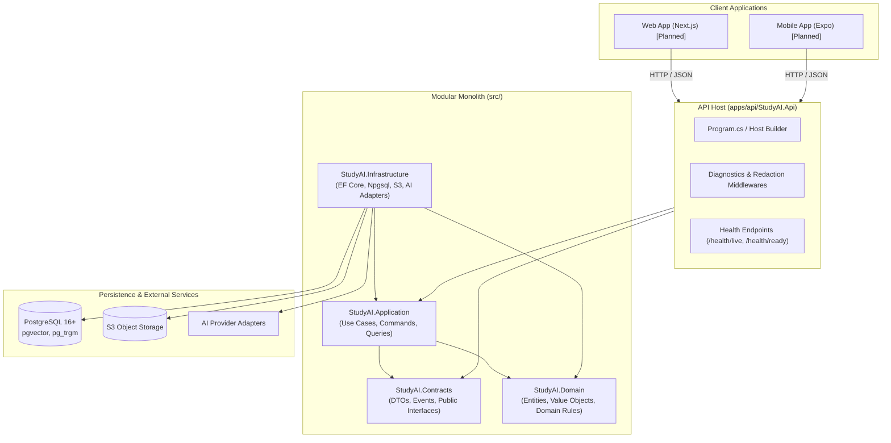
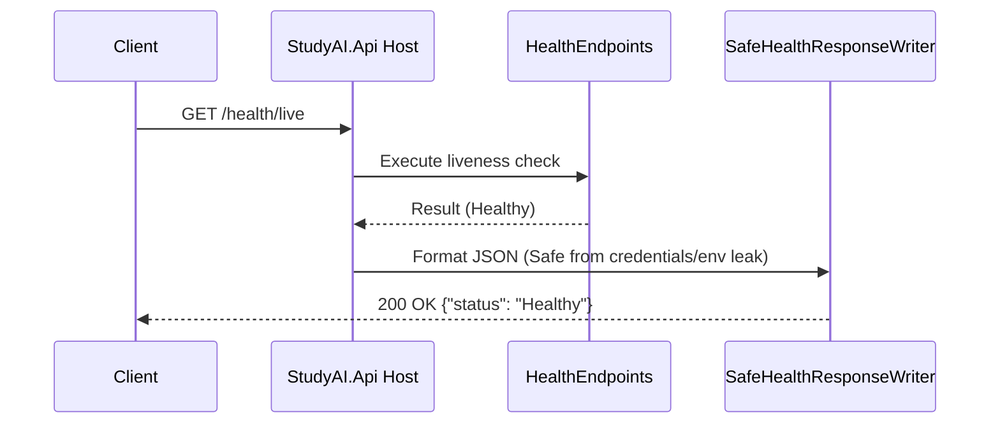
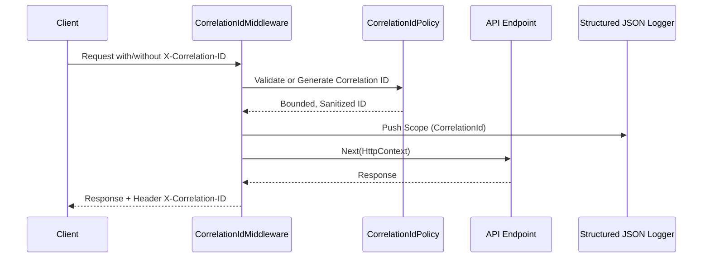

# StudyAI Campus — Living System Map

Last updated: 2026-10-19  
Document status: **Living Architecture & Navigation Map**  
Navigation: [`docs/START_HERE.md`](docs/START_HERE.md) | [`docs/INDEX.md`](docs/INDEX.md) | [`docs/codebase/MODULE_INDEX.md`](docs/codebase/MODULE_INDEX.md) | [`docs/codebase/FEATURE_MAP.md`](docs/codebase/FEATURE_MAP.md)

---

## 1. System Overview

**StudyAI Campus** is an academic SaaS platform designed as a Personal Academic Operating System for university students and researchers. It provides nine integrated modules:
1. Academic Library & Document Management
2. Course Workspace
3. Research & Project Workspace
4. Note-Taking & Knowledge Graph
5. Spaced Repetition Flashcards
6. Quiz & Assessment Generation
7. Scope-Aware Academic Chat & AI Retrieval
8. AI Quota, Usage Metering & Billing
9. Identity & Data Space Management

---

## 2. Distinction of Knowledge Layers

To prevent confusion between plans and reality, this repository distinguishes four distinct layers:

```
[Layer 1: Approved Architecture] -> What the system is intended to be (docs/architecture/StudyAI_Core_Architecture_v1.2.md)
              ↓
[Layer 2: Living System Map]     -> Current high-level organizational structure of the repository (this file)
              ↓
[Layer 3: Source Code]            -> Actual observed files and code in apps/, src/, tests/, infra/
              ↓
[Layer 4: Runtime Evidence]       -> Verified test outcomes and build artifacts (dotnet test: 28 passed)
```

---

## 3. Technology Stack Baseline

| Tier | Technology | Current Status |
|---|---|---|
| **API Backend** | ASP.NET Core (`net10.0`), C# 13, Native MTP, xUnit v3 | Foundation Host Implemented (`apps/api/StudyAI.Api`) |
| **Web Frontend** | Next.js 15, TypeScript, React 19, Vanilla CSS | Planned V1 (`apps/web`) |
| **Mobile App** | React Native, Expo | Future Target (`apps/mobile`) |
| **Database** | PostgreSQL 16+ (`pgvector`, `pg_trgm`, `btree_gist`), EF Core 10 | Schema v1.1 Validated; EF Core model pending |
| **Storage** | S3-compatible private object storage | Planned (`infra/storage`) |
| **Workers** | .NET BackgroundService + Python document processing | Planned (`workers/`) |
| **CI / Tooling** | Git, PowerShell, Python 3.8+ doc scripts | Implemented |

---

## 4. Application & Module Architecture



### Module Boundary Dependency Invariants
Enforced by architecture tests ([`tests/StudyAI.ArchitectureTests`](tests/StudyAI.ArchitectureTests/)):
- `StudyAI.Domain` has **zero** dependencies on other projects.
- `StudyAI.Application` depends **only** on `StudyAI.Domain` and `StudyAI.Contracts`.
- `StudyAI.Infrastructure` depends on `StudyAI.Domain`, `StudyAI.Application`, and `StudyAI.Contracts`.
- `StudyAI.Api` composes the modules via dependency injection and does not bypass application boundaries.

---

## 5. Main Execution Flows

### A. Health Check & Liveness Flow (Implemented)


### B. Core Request & Correlation Flow (Implemented)


---

## 6. Database & Persistence Overview

- **Engine**: PostgreSQL 16.15 with extensions `vector`, `pg_trgm`, `btree_gist`.
- **Schema Model**: Reviewed clean-slate physical schema candidate (`docs/database/StudyAI_Physical_Schema_Reviewed_v1.1.sql`).
- **Core Entities**:
  - `data_space` — Tenant & ownership isolation boundary.
  - `knowledge_item` & `knowledge_item_placement` — Single binary file with multi-context placements.
  - `note` & `note_revision` — Optimistic concurrency with recoverable versions.
  - `ai_quota_allocation` & `ai_usage_ledger` — Atomic reserve/settle/release accounting.
  - `source_citation` — Strict provenance linking generation to source chunk/version.

---

## 7. Security & Isolation Boundaries

1. **Server-Side Data Space Ownership**:
   All business operations require explicit server-side resolution of the actor's `data_space_id`. Client-provided IDs are never trusted as proof of authorization.
2. **Private File Storage**:
   S3 objects are strictly private. Access is mediated via short-lived signed URLs generated server-side after ownership verification.
3. **Structured Log Sanitization**:
   Console and log pipelines automatically redact sensitive headers (`Authorization`, `Cookie`), canary tokens, and personal student notes/prompts.
4. **AI Retrieval Scoping**:
   Retrieved context is filtered by current user Data Space prior to embedding search or prompt composition.

---

## 8. Navigation & Detailed Documentation Links

- **Module Index**: [`docs/codebase/MODULE_INDEX.md`](docs/codebase/MODULE_INDEX.md)
- **Feature Map**: [`docs/codebase/FEATURE_MAP.md`](docs/codebase/FEATURE_MAP.md)
- **File Catalog Index**: [`docs/codebase/FILE_INDEX.md`](docs/codebase/FILE_INDEX.md)
- **Per-Module Catalogs**:
  - API Host: [`docs/codebase/catalog/api-host.md`](docs/codebase/catalog/api-host.md)
  - Contracts: [`docs/codebase/catalog/contracts.md`](docs/codebase/catalog/contracts.md)
  - Domain: [`docs/codebase/catalog/domain.md`](docs/codebase/catalog/domain.md)
  - Application: [`docs/codebase/catalog/application.md`](docs/codebase/catalog/application.md)
  - Infrastructure: [`docs/codebase/catalog/infrastructure.md`](docs/codebase/catalog/infrastructure.md)
  - Tests: [`docs/codebase/catalog/tests.md`](docs/codebase/catalog/tests.md)
  - Infrastructure & Tooling: [`docs/codebase/catalog/infra.md`](docs/codebase/catalog/infra.md)
- **Current Development State**: [`docs/development/CURRENT_STATE.md`](docs/development/CURRENT_STATE.md)
- **Open Decisions Register**: [`docs/adr/OPEN_DECISIONS.md`](docs/adr/OPEN_DECISIONS.md)
