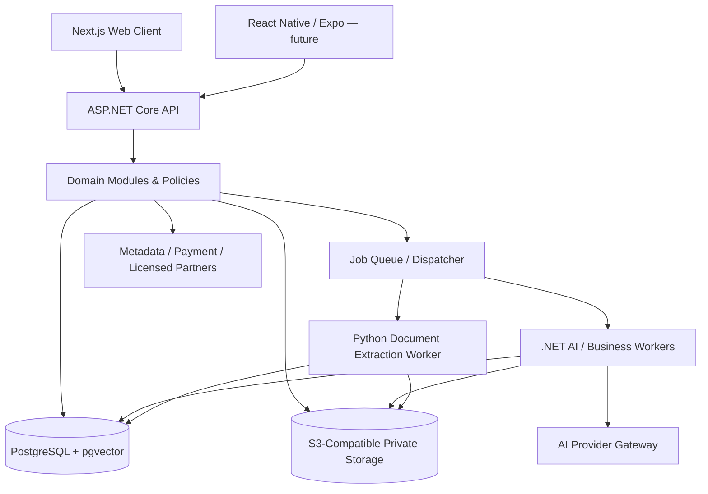
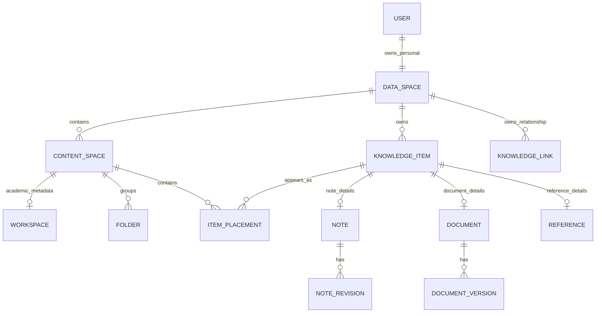
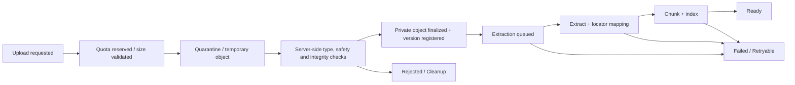
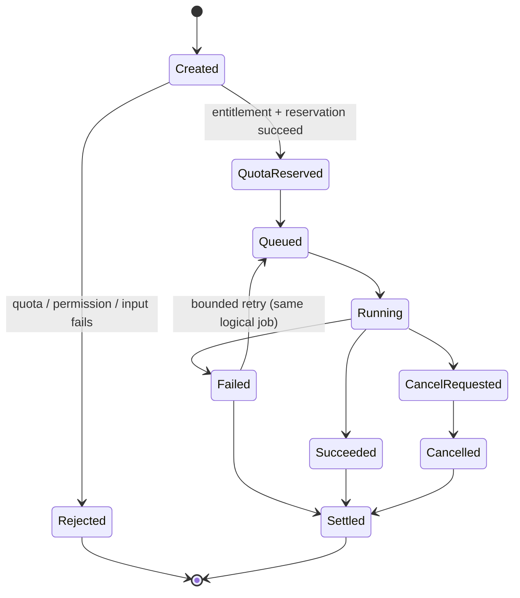
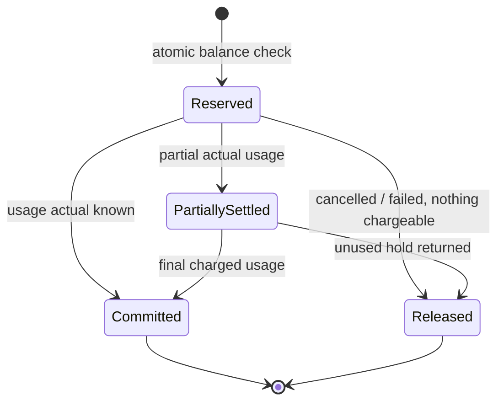

# StudyAI Campus — Core System, Database & Knowledge Architecture

> **Architecture Baseline v1.2 — APPROVED (Logical Architecture)**  
> **Tanggal keputusan:** 12 Oktober 2026  
> **Produk:** StudyAI Campus / B2C mahasiswa / Web-first  
> **Pemilik keputusan:** Product Owner, StudyAI  
> **Status implementasi:** **BELUM merupakan Physical ERD, SQL migrations, kode production, audit keamanan, atau bukti kapasitas server.**  
> **Nama dokumen:** `StudyAI_Core_Architecture_v1.2.md`

## 0. Document Control — Wajib Dibaca Sebelum Implementasi

### 0.1 Tujuan

Dokumen ini mendefinisikan **bagaimana fondasi sistem StudyAI harus dirancang** untuk memenuhi `StudyAI_Campus_MVP_Final_PRD_v1.0.md` secara konsisten. Dokumen ini menjadi acuan arsitektur lintas tim/modul bagi developer, AI coding agent, reviewer database, QA, dan perancangan deployment.

Sasaran konkret:

1. Menjamin satu konten akademik dapat dipakai lintas Library, Course dan Project tanpa menyalin file asli.
2. Menjamin isolasi data antarmahasiswa dari API hingga retrieval dan background job.
3. Menjaga provenance dan validitas sumber untuk Tutor, Research, Writing, Quiz dan PPT.
4. Memungkinkan Free/Plus/Pro menggunakan kuota yang terukur tanpa double charging.
5. Mendukung notes bertingkat, pemulihan, revisi, sinkronisasi API serta ekspansi mobile.
6. Mencegah perubahan arsitektur yang tidak sengaja ketika modul dikembangkan paralel.
7. Tetap sederhana saat development di laptop dan soft launch VPS, dengan jalur scale-out yang jelas.

### 0.2 Hirarki sumber kebenaran

1. **Keputusan eksplisit terbaru Product Owner** mengenai perilaku/scope produk.
2. **`StudyAI_Campus_MVP_Final_PRD_v1.0.md`** sebagai *source of truth* kebutuhan, cakupan sembilan modul, dan penerimaan produk.
3. **Dokumen ini** sebagai *source of truth* **logical architecture/invariants** setelah persetujuan v1.2.
4. ADR baru, Physical ERD dan technical specifications untuk detail implementasi yang tidak mengubah poin 1–3.
5. Arsitektur v1.0, usulan revisi v1.1, serta Master Feature List menjadi riwayat dan konteks, **bukan override** keputusan v1.2 yang bertentangan.

**Aturan konflik:** Jika Physical ERD atau implementasi sulit memenuhi invariant dalam PRD/arsitektur, hentikan asumsi lokal, buat issue/ADR, usulkan alternatif dan dampak produk/keamanan; jangan mengubah scope secara diam-diam.

### 0.3 Label keputusan

| Label | Makna | Tindakan engineer |
|---|---|---|
| **LOCKED** | Prinsip atau perilaku telah disetujui | Wajib dipertahankan; perubahan lewat ADR + persetujuan owner bila mengubah produk |
| **MUST** | Invariant teknis demi keamanan, integritas, privasi, billing | Wajib diterapkan dan diuji |
| **RECOMMENDED** | Default implementasi; alternatif setara boleh dengan ADR | Jangan diganti tanpa pembenaran terukur |
| **OPEN** | Belum diputuskan atau menunggu pengujian | Jangan mempresentasikan sebagai keputusan final |
| **HYPOTHESIS** | Angka biaya, harga, kuota, kapasitas atau target performa sementara | Jangan hardcode atau dijanjikan ke pengguna |
| **PARTNER-GATED** | Bergantung lisensi, hak pakai, kualitas atau kontrak eksternal | Jangan diklaim siap tanpa gate lolos |

### 0.4 Batas v1.2

- **Sudah dikunci:** pendekatan data ownership, struktur unified content, perilaku placement/nested pages, modular API architecture, kontrol retrieval, provenance, job/usage invariants, storage, versioning dan API-first.
- **Belum dikunci:** tipe SQL/kolom/index final; model auth/queue tertentu; provider hosting/AI/embedding; price/limits final; performa pada N pengguna; detail RLS policy; kebijakan retensi numerik; aturan billing platform mobile.
- **Scope produk:** sembilan modul Campus V1 sesuai PRD. Development bertahap adalah urutan kerja **internal**, bukan keputusan memotong scope rilis publik.
- **Luar scope Campus V1:** kolaborasi multiuser, Career, School, Parent, B2B/LMS institusi, native mobile launch, full Notion relational database engine, real-time co-editing, voice tutor real-time. Kecuali ada change request eksplisit.
- **Similarity berlisensi:** adapter dapat dirancang; ketersediaan komersial **PARTNER-GATED**. Citation audit internal tetap bagian wajib produk.

---

## 1. System Vision dan Architectural Principles

**StudyAI = Personal Academic Operating System** dengan *one account, one personal knowledge base, one learning profile, multiple connected AI workflows*.

| Prinsip | Konsekuensi pada desain |
|---|---|
| **Knowledge-centered** | Library dan Knowledge Item adalah fondasi bersama, bukan database sendiri-sendiri untuk Tutor/Research/Writing |
| **Ownership before context** | Siapa pemilik data (`Data Space`) berbeda dari tempat data ditampilkan (`Content Space`/placement) |
| **Single logical source** | Satu item dapat ditempatkan berkali-kali tanpa menduplikasi file asli/isi note |
| **Source-grounded AI** | AI hanya memakai sumber yang dipilih, sah diakses, terlacak versi dan lokasinya |
| **Secure by default** | API authorization, database integrity, scoped retrieval, private object storage, test isolasi |
| **Meter everything expensive** | AI, proses dokumen, storage, dan job mahal punya entitlement dan pencatatan biaya |
| **API-first & mobile-ready** | Web/mobile menggunakan backend yang sama; data berversi dan concurrency eksplisit |
| **Modular monolith first** | Domain modular, deploy API terpusat, worker mandiri; jangan membuat microservices sebelum perlu |
| **Portable infrastructure** | Docker, PostgreSQL, S3-compatible storage, konfigurasi provider di luar domain model |
| **Evolvable, not over-engineered** | Hindari mesin kolaborasi real-time, sharding, broker kompleks dan vector DB terpisah sebelum terukur |

### 1.1 Invariants non-negotiable

- **INV-01:** API, retrieval, job, dan object access tidak boleh membocorkan sumber dari Data Space lain.
- **INV-02:** Menaruh satu Knowledge Item ke Course dan Project tidak membuat salinan isi/binary atau pemakaian kuota ganda.
- **INV-03:** *Remove from placement* tidak sama dengan *Delete Knowledge Item globally*.
- **INV-04:** Sumber yang dipakai AI dibatasi scope izin yang diverifikasi **sebelum** konteks diberikan kepada model.
- **INV-05:** DOI, penulis, kutipan langsung dan nomor halaman/slide tidak boleh dikarang atau direpresentasikan terverifikasi tanpa dasar sumber.
- **INV-06:** Revisi sumber tidak otomatis mengubah provenance hasil AI terdahulu.
- **INV-07:** Dua permintaan AI paralel tidak bisa menghabiskan kuota melebihi batas; retry tidak mendebit dua kali.
- **INV-08:** Habis kuota AI/downgrade tidak mengunci akses wajar ke materi pribadi yang telah tersimpan atau menghapus otomatis.
- **INV-09:** Operasi eksternal (storage/provider/payment) yang tidak atomik dengan PostgreSQL harus punya kompensasi/recovery dan idempotency.
- **INV-10:** Tidak ada fitur diklaim tersedia jika partner/lisensi atau acceptance gate belum terpenuhi.

---

## 2. Stack, Execution Boundaries, dan Topologi

### 2.1 Baseline stack

| Area | Baseline | Status |
|---|---|---|
| Web | Next.js + TypeScript | LOCKED baseline |
| Native Mobile (future) | React Native + Expo | Baseline future client; bukan rilis Web V1 |
| Backend API | C# + ASP.NET Core | LOCKED |
| Backend organization | API-first Modular Monolith | LOCKED |
| ORM | Entity Framework Core + Npgsql | RECOMMENDED, baseline |
| Primary data | PostgreSQL | LOCKED |
| Search | PostgreSQL full-text/trigram + pgvector | RECOMMENDED |
| Editor | Tiptap + structured JSON document | RECOMMENDED |
| Original files / exports | S3-compatible Object Storage | LOCKED interface |
| Long-running jobs | Independently scalable background workers | LOCKED principle |
| PDF/PPTX/DOCX extraction | Python worker bila library terbaik tersedia | RECOMMENDED; otorisasi/kuota/orchestration di .NET |
| Container | Docker / Compose lokal dan starter production | Baseline |
| Auth, queue, payment, AI provider, object vendor | Adapter/configuration | OPEN vendor/implementasi |

### 2.2 Logical component diagram



**Diagram logis, bukan diagram jaringan production final.** Semua akses storage/DB dipagari identitas kerja dan aturan domain; komponen worker tidak diberi izin membaca seluruh data tanpa konteks yang terotorisasi.

### 2.3 Deployment stages

- **Development:** laptop lokal, Docker Compose, PostgreSQL + pgvector, local S3-compatible storage, backend/Web/worker terpisah secara proses, fake providers untuk testing, API nyata bila memerlukan evaluasi.
- **Soft launch:** satu VPS dapat menjalankan Web/API/DB/worker ringan, file pribadi di object storage terpisah, backup **di luar VPS**, secrets via environment/secret mechanism, HTTPS, monitoring dan resource limits.
- **Growth:** pisahkan worker ekstraksi/AI berat dari API terlebih dulu jika metrik mengharuskan; setelahnya scale API atau pindahkan DB ke host/managed service; tetap gunakan adapter storage.
- **Tidak ada kapasitas pengguna dijanjikan** oleh desain; CPU/RAM, queue lag, database, bandwidth dan biaya API ditentukan melalui load test dan telemetry.

---

## 3. Bounded Contexts dan Batas Modul

### 3.1 Modul inti platform

| Modul/backend boundary | Kepemilikan data dan aturan | Konsumen utama |
|---|---|---|
| Identity | users, credentials/sessions, profile preferences | Semua |
| Ownership | Personal Data Space, ownership resolution, tenant-safe relationship policies | Semua |
| Content/Workspace | content spaces, workspace metadata, folders, placements, tags, favourites, links | Workspace + seluruh AI |
| Knowledge/Notes | knowledge items, notes, revisions, saved AI output, content projection | Workspace, Tutor, Writing |
| Documents | file metadata, versions, processing status, extraction, chunks/annotations | Reader, Tutor, Research |
| Retrieval/AI | sources, scoped search, conversation/jobs/messages, citation provenance, provider gateway | Tutor, Ask Knowledge, Research, Writing, PPT |
| Learning | quizzes/questions/attempts, flashcards/reviews, learning profile | Tutor, Exam Prep, Planner |
| Research | bibliographic references, authors, DOI, discovery, literature matrix | Research, Writing |
| Writing/Integrity | draft/revisions, citations, claim-to-source checks, citation audit, licensed similarity adapter | Writing, Integrity |
| Presentation | decks, slide structure, slide revisions, generation/exports | Presentation Studio |
| Planner | tasks, events, courses' calendar, study plans, reminders, grades | Planner + Learning |
| Billing/Usage | plans, entitlements, subscription periods, payment events, reservations/ledger, storage meter | Semua fitur berbiaya |
| Platform Ops | outbox, operational audit, monitoring/metrics, support/admin operations | Operations |

### 3.2 Rules antar-modul

1. **Satu primary database** PostgreSQL V1, dengan logical PostgreSQL schemas sebagai namespace, bukan 12 physical database.
2. **Satu EF Core `DbContext` dan migration history** adalah default V1; perubahan ke banyak context hanya dengan ADR dan migrasi kepemilikan yang aman.
3. Modul boleh memakai identitas dari *shared kernel* (`Identity`, `Ownership`, `Knowledge`) melalui kontrak yang stabil. Modul fitur **tidak** mengubah tabel internal modul fitur lain sembarangan.
4. Semua modifikasi lifecycle dilakukan melalui application/domain services dan transaksi yang ditentukan; penyatuan database tidak berarti coupling tanpa batas.
5. Event/outbox dipakai untuk proses asinkron yang perlu konsistensi setelah commit (indexing, cleanup, notifications).
6. AI provider, research APIs, object storage, payment dan similarity merupakan dependency eksternal melalui adapter, bukan ketergantungan permanen dalam domain objects.

### 3.3 Mapping sembilan modul PRD

| Kode PRD | Produk | Fondasi arsitektur |
|---|---|---|
| M01 | Workspace & Knowledge Management | Ownership, Content, Notes, Search |
| M02 | Document Intelligence | Documents, Processing, Retrieval, AI |
| M03 | AI Tutor | Retrieval/AI, Learning Profile |
| M04 | Quiz/Flashcards/Exam | Learning, Source Provenance, Billing |
| M05 | Academic Research | Research, Documents, Retrieval |
| M06 | Academic Writing | Writing, Research, Versioning, Exports |
| M07 | Presentation AI | Presentation, AI Jobs, Exports |
| M08 | Academic Integrity | Citation Audit, Research, Partner Adapter jika sah |
| M09 | Academic Planner | Planner, Learning, Reminder Jobs |

---

## 4. Canonical Data Model: Ownership vs Organization vs Content

### 4.1 Lima konsep utama

| Konsep | Definisi | Peran |
|---|---|---|
| **User Account** | Identitas individu | Login, subscription, preferences |
| **Data Space** | Batas keamanan dan pemilik data | Isolasi akses data akademik pribadi |
| **Content Space** | Konteks organisasi: Library, Course, Project | Menampilkan materi dan navigasi |
| **Knowledge Item** | Identitas logis satu konten (note, document, reference, saved AI output) | Reuse, search, provenance, relationships |
| **Item Placement** | Posisi satu item dalam Content Space, folder, atau di bawah halaman note lain | Banyak lokasi tanpa membuat salinan konten |

**LOCKED:** satu pengguna Campus V1 mempunyai **satu Personal Data Space**. Data Spaces organisasi di masa depan tidak otomatis memperoleh akses terhadap data personal.

**LOCKED:** satu Personal Library (`Content Space` bertipe `library`) tersedia pada setiap Personal Data Space. Course/Project direpresentasikan sebagai Content Spaces lain dengan metadata akademik dalam konsep `workspaces` (korelasi 1:1 untuk jenis course/project); bukan menggandakan Data Space.

### 4.2 Konseptual relationship map



**Catatan:** ERD ini konseptual: detail PK/FK, tipe polymorphic subtype, relasi halaman/versi dan constraint dibahas pada Physical ERD, bukan disimpulkan otomatis dari diagram.

### 4.3 Identity dan status Knowledge Item

- Satu `knowledge_item` punya tipe utama: `note`, `document`, `reference`, `saved_ai_output` (tipe awal; migrasi terkontrol bila ekspansi).
- Detail tipe disimpan pada tabel domain khusus, bukan semua dicampur dalam satu JSON generik. Kolom kepemilikan identik harus cocok.
- `knowledge_item` mempunyai identitas tetap ketika dipindah, diubah lokasi, disematkan, dirujuk AI dan ditampilkan di banyak Content Spaces.
- Pengubahan tipe konten lintas subtype **bukan** update bebas atas discriminator; gunakan proses konversi terkontrol dengan semantik jelas (OPEN detail bila dibutuhkan).
- Konten yang **belum secara eksplisit disimpan** dari jawaban AI tetap berada di history/job; setelah user menyimpan, dibuat saved output atau note dengan asal hasil AI yang jelas.

### 4.4 Content Space vs Workspace

- `content_spaces`: `library` / `course` / `project`, kepemilikan, nama, status dan posisi UI.
- `workspaces`: metadata khusus course/project (academic term, course code, project context, description, lifecycle); bukan salinan semua file.
- Satu `Content Space` course/project memiliki **maksimal satu** record metadata workspace yang aktif dan wajib konsisten tipenya jika metadata tersebut dibutuhkan.
- Menghapus course/project tidak boleh diam-diam menghapus Knowledge Items yang tetap dimiliki Data Space; penghapusan Content Space adalah perubahan konteks/placement. Pengguna harus dapat melihat dampak terhadap note/dokumen yang hanya muncul di situ.

### 4.5 Library canonical placement policy — LOCKED

1. Knowledge Item yang disimpan pengguna mempunyai entri/placement yang dapat ditemukan di **Personal Library**. Konten berasal dari satu Data Space meskipun pertama kali dibuat di dalam Course/Project.
2. Menambahkan item ke Course/Project membuat placement baru, **bukan Knowledge Item atau binary baru**.
3. **Remove from Course/Project** hanya melepaskan placement di ruang tersebut (semantik soft removal/restore akan ditetapkan pada Physical ERD).
4. **Delete item globally / Delete from Library** adalah tindakan eksplisit yang memindahkan Knowledge Item ke Trash, dengan peringatan bahwa seluruh placement dan AI workflow terkait dapat terdampak.
5. **Restore globally** mengembalikan item dan placement yang masih valid, jika hak akses dan kontainernya masih ada; untuk parent yang telah hilang, restore ke root Library dan tampilkan informasi penyesuaian.
6. **Permanently delete** memulai pembersihan seluruh objek dan turunan yang harus dihapus sesuai retensi, bukan sekadar menyembunyikan placement.

### 4.6 Struktur folder, pages dan placements — LOCKED behavior

- Folder dapat bertingkat pada **Library, Course dan Project**; parent folder wajib berada pada Content Space yang sama.
- Notes adalah konten yang bisa ditampilkan sebagai pages dengan anak (nested pages), bukan identitas yang selalu punya satu parent tetap.
- Nested-page relationship melekat pada **placement halaman**. Note yang sama dapat ditampilkan di beberapa Content Spaces dengan parent page berbeda, tetapi isi notenya tetap satu.
- Default awal V1: **maksimal satu placement aktif untuk satu Knowledge Item pada satu Content Space**. Jika dibutuhkan shortcut ganda dalam space yang sama, ajukan ADR/PRD update; jangan membuat duplikasi diam-diam.
- Placement note dapat berada di root, di folder, atau di bawah placement note lain **dalam Content Space yang sama**. Folder hanya berada di root/folder (tidak perlu mendukung folder di dalam page pada V1).
- Parent-placement harus merupakan note/page yang bisa menjadi parent, bukan sembarang dokumen/referensi.
- Satu node hanya punya satu parent navigasi. Parent folder vs parent note harus **mutually exclusive**; desain FK final dibuat di Physical ERD.
- Pindah/reorder/restore memerlukan transaksi dan cek cycle; pemindahan parent ke descendant-nya ditolak, termasuk request bersamaan. UI boleh memiliki depth guideline, tetapi angka maksimal depth belum disahkan.
- Perubahan judul/isi note dari satu lokasi terlihat pada seluruh placement ketika datanya telah tersinkron; metadata **lokasi** seperti urutan/folder bisa berbeda antarkonteks.

**Contoh perilaku:** `Journal X` ada di `Library/Referensi`, `Course Machine Learning/Minggu 4`, dan `Project Skripsi/BAB II`. Ada **satu item**, **satu file asli per versi**, dan **tiga placement**. `Remove from Course` tidak mengubah file atau dua placement lain.

### 4.7 Relationship non-penempatan

- `knowledge_links` menyimpan hubungan seperti *related-to*, *supports*, *derived-from*, *mentions*, dan backlinks; sumber/target dari Data Space yang sama.
- `item_tags`, favourites, pinned/recent, template attribution adalah metadata navigasi, bukan hak kepemilikan baru.
- Bibliographic citations, source snapshot dan claim-to-source link **memerlukan struktur domain spesifik**; jangan memakai `knowledge_links` generik sebagai pengganti bukti ilmiah atau locator.

### 4.8 Logical catalog: fondasi wajib

| Entity family | Representasi logis | Fungsi utama |
|---|---|---|
| Identity | `users`, `auth_sessions` / identity tables | Account, lifecycle, session |
| Ownership | `data_spaces` | Ownership principal dan personal scope |
| Organization | `content_spaces`, `workspaces`, `folders`, `item_placements` | Library/Course/Project, navigation hierarchy |
| Knowledge | `knowledge_items`, `knowledge_links`, `tags`/`item_tags` | Content identity, reference relationships |
| Notes | `notes`, `note_revisions`, `note_attachments` **candidate** | Rich text, revision, embedded files |
| Documents | `documents`, `document_versions`, `document_annotations` | Raw files, immutable versions and highlights |
| Processing | `document_chunks`, `chunk_embeddings`, `processing_runs` | Extracted text, index and retries |
| Research | `references`, `reference_authors`, `reference_documents`, metadata snapshots | Bibliography independent from full text |
| Retrieval/AI | `ai_conversations`, `ai_conversation_sources`, `ai_messages`, `ai_message_citations`, `ai_jobs` | Source selection, jobs, grounding |
| Billing | `plans`, `plan_entitlements`, `subscription_periods`, `usage_reservations`, `usage_ledger`, `quota_balances`, `ai_provider_usage` | Entitlements, balances, actual cost |
| Operations | `outbox_events`, `operation_audit`, `file_cleanup_jobs` | Reliable external effects, audit, purge |

**Ini logical entity catalog, bukan komitmen bahwa setiap nama tersebut wajib menjadi tabel terpisah.** Physical ERD boleh menggabung/memecah implementasi selama invariants, traceability dan batas ownership terjaga.

---

## 5. Ownership, Referential Integrity dan Database Constraints

### 5.1 Tenant-safe relationships — MUST

1. Setiap tabel yang menyimpan data/hasil milik pengguna membawa `data_space_id NOT NULL` atau menggunakan pola database setara yang membuktikan kepemilikan **tanpa keraguan**.
2. Tabel hubungan user-owned secara default membawa `data_space_id` dan menggunakan composite FK `(entity_id, data_space_id)` ke target dengan kandidat key yang sesuai.
3. Constraint candidate target **harus benar-benar ada** untuk setiap kombinasi kolom composite FK; unique `(id, data_space_id, type)` **tidak otomatis** menjadi unique `(id, data_space_id)`.
4. Relasi subtype seperti notes/documents/references menegakkan kecocokan `(knowledge_item_id, data_space_id, item_type)` ke Knowledge Item, termasuk `CHECK` nilai item type.
5. Pembuatan Knowledge Item dan record detail wajib atomik. FK dari detail ke induk tidak otomatis menjamin setiap Knowledge Item yang committed telah mempunyai detail; enforce melalui service transaction dan invariant tests, atau pola DB tambahan yang disetujui.
6. Folder parent, placement parent, source link, citations dan jobs harus menolak referensi silang Data Space.
7. Tabel global (plan catalog, public metadata cache, system configuration) **bukan** otomatis user-owned; jangan tambahkan `data_space_id` secara buta. Namun data salinan/hasil simpan pribadi tetap perlu owner scope.

**SQL sketsa untuk ilustrasi, BUKAN migration final:**

```sql
-- Illustrative only: composite references require matching unique targets.
ALTER TABLE knowledge.knowledge_items
  ADD CONSTRAINT uq_knowledge_item_owner UNIQUE (id, data_space_id);

-- Subtype checks additionally require a matching unique (id, data_space_id, type).
-- Any placement must link to a content space AND item owned by the same data_space_id.
```

### 5.2 Identifiers, timestamps, concurrency

- UUID v7 dipakai untuk PK baru sebagai **RECOMMENDED V1 convention**; dalam versi .NET yang mendukung, dapat dibuat melalui `Guid.CreateVersion7()`; jangan diam-diam mengubah versi framework tanpa evaluasi.
- Server-authoritative timestamps disimpan UTC (`timestamptz`) dan ditampilkan sesuai timezone akun (default Indonesia pada produk; timezone akun dapat dipilih).
- Konten yang bisa diubah memiliki nomor revisi/row concurrency token; update bersyarat menggunakan expected revision.
- Status yang mengandung historis untuk audit/transaksi harus memiliki identitas dan timestamp yang tidak ambigu.
- Soft delete **tidak otomatis** berarti baris boleh diduplikasi ketika di Trash; setiap unique index harus mendefinisikan apakah data soft-deleted tetap mengunci nilai unik.

### 5.3 DOI dan uniqueness

- Reference metadata boleh ada tanpa file PDF.
- DOI dinormalisasi; **tidak boleh percaya DOI yang diproduksi LLM tanpa cek sumber otoritatif**.
- Default V1: satu DOI normalisasi yang sama **unik dalam Data Space**, termasuk item yang ada di Trash; create akan menawarkan **restore** jika DOI ditemukan pada item yang dihapus.
- Karena `deleted_at` berada pada Knowledge Item sedangkan `doi_normalized` berada di Reference, partial unique index lintas dua tabel **tidak berlaku**. Gunakan unique per Data Space pada tabel Reference dengan nilai DOI non-null, atau pola setara yang menjaga semantik tersebut.
- Jika karya sah tidak punya DOI, deduplikasi bibliografi bersifat heuristik/dikonfirmasi pengguna; **jangan paksa** semua paper/buku memiliki DOI.

### 5.4 Privilege boundaries

- API mengidentifikasi user, memetakan ke Personal Data Space, lalu menjalankan permission checks untuk **read maupun write**.
- Background worker memperoleh `data_space_id`, `job_id`, dan `source/version_ids` dalam payload terpercaya yang diverifikasi ulang; jangan mengambil file hanya berdasarkan opaque ID dari antrian tanpa cek hak akses.
- Database role aplikasi minimal privilege; role operasional berbeda, akses admin tercatat dan *least privilege*.
- Setiap query vector/full-text memakai filter scoped dari service/repository yang teruji, termasuk raw SQL (global EF query filter **tidak** berlaku untuk raw SQL). RLS dapat menjadi pelindung tambahan.

---

## 6. Rich-Text Notes, Nested Pages, History & Mobile Concurrency

### 6.1 Content representation

- Notes kontennya berupa **structured document JSON** (Tiptap-style / ProseMirror-compatible sebagai default) dengan `format_version`; tidak menjadikan HTML bebas sebagai sumber data canonical.
- Block awal mencakup paragraph, headings, lists, checklist, links, image, table, code, math, callouts untuk kebutuhan PRD. Serializer/exporters mematuhi format yang disetujui; unsupported nodes harus memberi warning atau graceful fallback.
- `search_text` adalah hasil proyeksi dari structured content, bukan dokumen asli; penentuan sync vs async projection termasuk OPEN detail, tetapi user tidak boleh membaca teks lama sebagai konten final setelah save berhasil.
- Lampiran/gambar di notes harus memakai object storage dan permission yang sama; **model entitas attachment final masih OPEN** (candidate: `note_attachments`), bukan URL publik tanpa ownership.

### 6.2 Autosave, revisions, merge policy

- Auto-save dilakukan melalui API bersyarat: `note_id + expected_revision + payload`; backend menyimpan versi baru secara atomik.
- Klien dengan revision usang menerima **`409 Conflict`** (atau `412 Precondition Failed` jika menggunakan ETag/If-Match yang disepakati), dengan metadata versi terbaru; tidak ada last-write-wins tersembunyi.
- `note_revisions` menyimpan snapshot/riwayat sesuai retention cadence yang akan didefinisikan; jangan membuat snapshot penuh untuk setiap keystroke.
- Recover/restore revision adalah aksi eksplisit yang **membuat revision baru**, tidak merusak sejarah immutable sumber yang telah disitasi.
- Konten yang berubah di note yang tampil pada beberapa spaces memutakhirkan satu item, sedangkan folder/parent placement tetap independen per space.
- Native offline-first dan real-time collaboration **bukan bagian Web V1**; kontrak revision disiapkan agar strategi sinkronisasi mobile tidak bergantung pada klien Web.

### 6.3 Contoh konflik edit

1. Laptop membaca note revision `12`; ponsel juga membaca revision `12`.
2. Laptop menyimpan expected `12` → tersimpan revision `13`.
3. Ponsel mengirim expected `12` → conflict, **tidak overwrite**.
4. UI menampilkan opsi load newest/copy draft/resolve; draft lokal user tidak langsung dibuang.

### 6.4 Nested page navigation

- Identitas note independen dari posisinya; placement yang berbeda boleh memiliki parent berbeda.
- Satu note dalam Content Space hanya ditempatkan sekali secara aktif (aturan V1), sehingga pohon navigasi deterministik.
- **Cycle detection wajib mempertimbangkan folder parent dan note parent**, sesuai opsi nesting yang dipilih dalam Physical ERD; cek dilakukan di transaksi yang aman terhadap concurrent moves.
- Hapus/move/restore parent page menjelaskan dampak ke child placements; prefer preservasi content identity dan reparent ke root bila parent tidak tersedia.

---

## 7. Files, Documents, Processing & Storage Architecture

### 7.1 Pisahkan logical document, version, binary dan derived data

| Level | Contoh data | Lifecycle |
|---|---|---|
| Knowledge Item | Identitas “Lecture Week 4” di library | Global content identity/Trash |
| Document | Metadata file dan tipe | Mengacu ke item |
| Document Version | `v1`, `v2`, checksum, ukuran, mime, status dan storage key | Immutable original version; active version bisa berubah |
| Object Blob | Binary PDF/DOCX/PPTX / notes assets / export | S3-compatible, private |
| Processing Run | Versi extractor, waktu, status, errors | Re-run tanpa upload ulang |
| Chunks/Index | Teks, locator, embeddings/FTS | Derived; bisa re-index/purge mengikuti provenance |

### 7.2 Upload state machine — MUST



- Cek tidak hanya extension/MIME dari client: validasi file type sebenarnya, ukuran, limit, konten rusak/berbahaya, resource limits dan akses.
- Browser tidak boleh menerima permanent public object URL; upload/download memakai server-authorized flow dan signed URL singkat jika dipakai.
- Binary yang sukses disimpan tetap ada walau worker ekstraksi gagal; status **uploaded but processing failed** tampak di UI.
- DB dan object storage tidak berbagi transaksi: gunakan status transisional, outbox/cleanup jobs, TTL temporary object dan reconciliation orphan blobs.
- `storage_key` opaque, tidak mengandung nama file asli atau informasi sensitif; provider adapter menyelesaikannya menjadi objek.
- File hanya diproses bila hak pengunggah/pengolahan sah; produk harus mengikuti hak cipta, privacy/consent dan ketentuan provider.

### 7.3 Document processing

- Worker mengekstrak teks dan locator benar dari PDF (halaman/posisi), PPTX (slide), DOCX (struktur/posisi bila tersedia); **locator tidak boleh berasal dari tebakan LLM**.
- Locator fleksibel seperti `page`, `slide`, `block_id`, offsets, bounding boxes apabila tersedia; representasi final (`locator jsonb` / typed locator) ditetapkan Physical ERD.
- OCR adalah target V1-WAJIB dengan pengujian kualitas; jika tidak terbaca, tampilkan keterbatasan dan jangan mengaku mengerti keseluruhan dokumen.
- Media transcription, YouTube/video imports hanya V1-BERSYARAT sesuai PRD, hak/izin, biaya dan kualitas.
- `processing_version` dan `extractor_version` harus memungkinkan menjalankan ulang pipeline terhadap file asli tanpa meng-upload ulang.
- Worker berat diberi timeout, memory/CPU limits, bounded concurrency, retries terukur dan status partial/failure.

### 7.4 Deduplication dan quota byte

- **Dilarang** dedup otomatis lintas pengguna pada V1; hindari existence oracle, ownership ambigu, masalah privasi/purge.
- Dalam Data Space yang sama, checksum seperti SHA-256 boleh dipakai untuk menawarkan reuse file **secara eksplisit**; keputusan pointer/blob sharing internal harus tetap menjamin deletion dan versioning aman.
- Menautkan item ke beberapa Content Spaces **tidak** menambah byte kuota.
- Meter storage berdasarkan objek yang benar-benar disimpan/dibebankan menurut kebijakan: user originals, retained previous versions, uploads/exports yang disimpan pengguna, attachments.
- Indexes, temporary derivatives, processing cache, dan backup sistem adalah **internal operational cost**, terpisah dari kuota user kecuali kebijakan paket akhirnya menyatakan lain.
- Kebijakan numerik retensi older versions, file turunan dan Trash: **OPEN**; jangan menggantung hak hapus pribadi pada kuota marketing tanpa policy yang diterbitkan.
- Over-quota setelah downgrade: tetap izinkan baca/download/delete, blok upload baru sesuai policy, **jangan auto-delete data**.

### 7.5 Annotation/highlight

- Highlight merujuk immutable document version dan source locator, bukan hanya page number string.
- Mengganti PDF ke version baru tidak menggeser anotasi lama secara diam-diam; migrasi annotation harus eksplisit dan boleh gagal terkontrol.

---

## 8. Search, Chunking, Embeddings dan RAG Retrieval

### 8.1 Retrieval service boundary — MUST

Semua search berisi data pribadi yang diberikan kepada AI melewati **satu retrieval gateway/service yang authoritative**, dengan input minimal:

```text
Retrieve(
  actor_user_id,              // dari auth context, bukan klaim user
  data_space_id,              // diturunkan dari auth policy
  authorized_source_scope,    // pilihan Knowledge Item + pinned Source Versions
  query_text,
  retrieval_policy,           // limits, kinds, modality, keyword/vector
  correlation_id
) -> Evidence[] { source_version, chunk_id?, locator, text, confidence/score }
```

- `data_space_id` dan source scope **tidak boleh dihilangkan** dari retrieval personal.
- Validate ownership dan source version availability **sebelum retrieval**; lakukan penyaringan pada query itu sendiri, bukan sesudah vector search global.
- Jika user ingin pengetahuan umum, gunakan mode/model route terpisah dengan label **general knowledge / no document evidence**; jangan diam-diam menjadikan semua file di library sebagai sumber.
- Research discovery ke katalog publik adalah operasi domain berbeda dari pencarian private chunks, dengan boundary yang jelas.
- Raw SQL dan panggilan pgvector/FTS tidak boleh melewati policy dengan query custom tersebar di berbagai modul.
- Dokumen/sumber adalah **untrusted input** (prompt injection): isinya tidak boleh mengubah tools yang tersedia, izin, system prompts atau melakukan exfiltration.

### 8.2 Ingestion/index lifecycle

```text
Document / Note / Verified Reference Snapshot
    -> normalized content + immutable version ID
    -> extraction/projection and evidence locators
    -> chunking strategy (versioned)
    -> keyword / trigram / FTS projection
    -> embedding (versioned model + dimensions)
    -> tenant-scoped retrieval
```

- Notes memakai note revision untuk pin sumber; references berbasis metadata **tidak boleh diperlakukan seolah full-text**.
- `document_chunks` menyimpan owner, document version, chunk index, exact text, locator, processing version.
- `chunk_embeddings` menyimpan owner, chunk reference, model/version/dimensions dan timestamp. Penggantian model memerlukan reindex aman; jangan membandingkan embeddings dengan dimensi/model tidak kompatibel.
- Dimension diputuskan setelah benchmark embedding Indonesia/Inggris; `halfvec` layak dievaluasi setelah mengukur tradeoff storage/recall.
- Exact vector search scoped menjadi default awal, **tanpa ANN global index**. Tambahkan HNSW/IVFFlat hanya berdasarkan pengukuran latency dan recall setelah filter tenant/sumber.
- Uji full-text untuk bahasa Indonesia campur Inggris (e.g. `simple` + trigram versus text search configuration yang tersedia), jangan asumsi tokenizer bahasa tertentu tersedia/optimal.
- Hybrid ranking dapat menggabungkan lexical dan semantic; algoritme/reranking/cutoffs belum dikunci sampai benchmark.

### 8.3 Citation-backed answer contract

Setiap jawaban bersumber mencatat evidence yang benar-benar diberikan ke model, dan setiap sitasi yang ditampilkan harus menunjuk ke evidence itu.

- Jika retrieval tidak menemukan dukungan cukup: tampilkan uncertainty, minta sumber tambahan atau beri label general inference jika mode mengizinkan.
- Jangan membuat placeholder halaman/DOI atau meminjam bibliografi sah untuk mengesahkan klaim yang tidak terbukti.
- Source count, token/context window, truncation dan budget retrieval dibatasi oleh job policy.
- User dapat menambah/menghapus source selection; perubahan source scope direkam agar percakapan berikutnya tidak memakai context yang tidak dipilih.

---

## 9. Unified Source Provenance & Citation Architecture

### 9.1 Problem yang diselesaikan

Tidak semua bukti StudyAI berupa PDF. Jawaban dapat bersumber dari notes, dokumen, metadata jurnal, atau output AI yang disimpan. Karena itu citation record **tidak boleh mewajibkan `document_version_id` untuk semua jenis sumber**.

### 9.2 Logical source-version abstraction — LOCKED

| Source kind | Pinned version | Locator wajar | Kualifikasi bukti |
|---|---|---|---|
| PDF/PPTX/DOCX | `document_version` | page/slide/offset/bbox | Full/partial text extracted, coverage diketahui |
| Note | `note_revision` | block ID/character offsets | Original user note; authoritativeness bukan otomatis ilmiah |
| Bibliographic Reference | verified **metadata snapshot** | field/title/abstract/source URL | Verifikasi metadata, **bukan** bukti isi paper penuh |
| Saved AI Output | pinned output revision | block/section reference | Konten AI-derived; jangan label sebagai original academic source |

**Implementasi bisa memakai `source_versions` supertype atau typed source reference; pilihan fisik OPEN.** Semua harus mampu merepresentasikan source kind/version tanpa ambigu dan memiliki ownership yang benar.

### 9.3 Source selection dan evidence history

- `ai_conversation_sources` (atau logical equivalent) mencatat **pilihan user/authorized source scope** dan perubahan pemilihannya; saat suatu job dieksekusi, simpan **snapshot source/version yang dipakai job tersebut**.
- `ai_message_citations` mengacu ke message, immutable pinned source version, locator dan kutipan snapshot dari evidence nyata jika tersedia. `chunk_id` opsional karena index turunan boleh dibangun ulang/dipurge.
- Jangan gunakan *current version pointer* untuk merender sitasi lama; jika origin sudah tidak tersedia karena delete legal/retensi, tampilkan **source unavailable**, bukan versi baru tanpa penjelasan.
- Reference metadata yang berubah dari provider disimpan sebagai snapshot saat digunakan untuk sitasi/output historis.
- Quote snapshot mengikuti kebijakan retensi/permanent deletion data asli; **tidak** boleh bertahan sebagai salinan tersembunyi setelah data seharusnya dihapus.

### 9.4 Trust tiers dalam seluruh output

1. **Original evidence:** teks/locator file atau note benar-benar tersedia.
2. **Verified bibliographic metadata:** DOI, author, title, venue dari provider; tidak menjamin isi paper mendukung klaim.
3. **AI inference:** jawaban/ringkasan/research gap hypothesis; harus dilabeli dengan tepat.
4. **Unverified/unknown:** metadata/text belum dapat diverifikasi; jangan klaim sebagai kutipan langsung.

### 9.5 Academic integrity

- Citation formatting menggunakan engine bibliografi/CSL dengan metadata yang sah; LLM tidak menjadi sumber nomor halaman, DOI atau penulis.
- Direct quote membutuhkan teks dan locator yang cocok dengan source evidence.
- Writing citation audit memeriksa missing/invalid references dan claim support; tidak memalsukan hasil similarity.
- Similarity check pihak ketiga hanya tersedia setelah kontrak API dan hak penggunaan/distribusi yang sesuai; laporannya bukan verdict otomatis plagiarisme.

---
## 10. AI Orchestration, Job Lifecycle dan Provider Boundaries

### 10.1 Prinsip orchestration

- Semua AI workflows dari Tutor, Ask My Knowledge, Document Summary, Quiz, Flashcards, Research, Writing, Integrity Audit dan Presentation berjalan melalui **policy/gateway yang terpusat** untuk authorization, source scope, entitlements, quota dan cost metering.
- Tetap gunakan **business-specific application workflow** per fitur (quiz evaluation, citation validation, PPTX layout, paper search), bukan satu mega-agent yang punya izin ke seluruh database.
- AI gateway abstrak minimal untuk model chat, structured output, embeddings dan provider-specific capabilities; routing konfigurasi berbeda per fitur.
- Model yang lebih murah dapat digunakan untuk pekerjaan ringan, model lebih kuat bila diperlukan; **harga, model dan routing final OPEN**, harus dinilai berdasarkan kualitas dan biaya aktual.
- Prompt/response templates berversi dan dievaluasi, dengan cache hanya bila aman terhadap kebocoran tenant/context dan aturan penghapusan.

### 10.2 Job states — logical contract



**State machine ini menunjukkan lifecycle bisnis, bukan nama enum SQL yang wajib sama.** State settlement quota dan provider charges dipisah dan harus dapat direkonsiliasi. `Failed` setelah provider benar-benar dibebani biaya tidak boleh diperlakukan otomatis sebagai provider cost = 0.

### 10.3 Job contract minimal

Tiap pekerjaan harus membawa atau mereferensikan:

- `job_id`, `actor_user_id`, `data_space_id`, `feature`, `source_scope_snapshot` (bila bersumber), serta `input_reference` yang tidak menyimpan prompt sensitif dalam log biasa.
- `request_id`/`idempotency_key`, `policy/entitlement snapshot`, planned cap, model route version, attempts, status, timestamps, output reference.
- `quota_reservation_id`, metered provider operations, error categories dan job lineage untuk retry/recovery.
- Retry **tidak** membuat job baru dengan hak biaya baru tanpa keputusan eksplisit. Cancel tidak menjamin provider eksternal berhenti ditagih; laporan usage menyesuaikan kenyataan.

### 10.4 Worker separation

- **.NET workers** menjadi pemilik workflow AI, permissions, billing, retries dan state transitions.
- **Python extraction worker** hanya diberi input objek terotorisasi dan output extraction structured (teks, locator, quality indicators). Jangan menyerahkan otoritas billing/tenant permissions pada Python sebagai sumber kebenaran kedua.
- Desain awal memakai queue sederhana yang durable, contoh PostgreSQL-backed queue/`FOR UPDATE SKIP LOCKED` atau Hangfire; pemilihan **OPEN**. Job dequeue harus aman antarworker, heartbeat/lease/recovery atas crash, bounded retry dan poison-job handling.
- Worker berat dipisah dari API dengan concurrency limits agar PDF 300 halaman atau PPTX besar tidak mengganggu membuka notes.

### 10.5 Output validation

- Structured output (quiz, citations, slides, planner suggestions) **wajib divalidasi** terhadap schema dan aturan domain sebelum dipersist.
- Quiz objective scoring ditentukan kode deterministik, bukan hanya penilaian bebas LLM. AI feedback esai ditandai bukan penilaian akademik resmi.
- Planner extraction dari RPS meminta review/konfirmasi user sebelum membuat event/deadline aktual.
- Slides/charts dengan angka harus mengambil data tersedia dan tidak mengarang angka; PPTX text/elemen inti benar-benar editable sesuai PRD.

---

## 11. AI Usage Ledger, Entitlements dan Cost Protection

### 11.1 Dua ledger yang berbeda makna

1. **Consumer entitlement/usage:** unit yang dilihat dan dibatasi dalam paket (messages, requests, pages, slides, credits, bytes, dll.).
2. **Provider cost telemetry:** penggunaan aktual resource eksternal dan biaya StudyAI (model, token, extraction, OCR, storage/egress bila terukur).

Satu pekerjaan dapat menggunakan beberapa provider calls; biaya provider tetap tercatat sekalipun output gagal atau kuota user dibebaskan sesuai kebijakan. Kedua sisi harus dapat dihubungkan melalui `job_id`/operation id.

### 11.2 Entitlement data — LOCKED principle

- `plans`, `plan_entitlements`, `subscription_periods`, `quota_balances` (atau ekuivalen): **rules as data**, bukan harga dan batas harian ditulis dalam kode.
- Setiap usage resource memiliki unit, scope periode (day/week/month/billing period), reset boundary, rollover policy (jika ada), serta price/entitlement snapshot yang aktif saat operasi.
- **Per-feature limit** tidak menggantikan **aggregate budget cap**, job complexity cap, global provider spend guard, rate limit, abuse detection, concurrency limit.
- Chat sederhana, scan OCR, paper analysis, full-text, note summarization dan generation PPT tidak harus dibebankan dengan satu unit identik; konfigurasi sesuai economics yang diuji.
- Free punya akses tetap ke non-AI workspace, notes, reading, planner dan ulangi quiz/flashcard tersimpan saat budget AI habis.
- Plan transition upgrade/downgrade tidak retroaktif mendebit usage periode lama tanpa aturan published; entitlement user berubah sesuai payment state yang tervalidasi.

### 11.3 Reservation → settlement state machine — MUST



> **Implementasi final harus merumuskan state/transition yang tidak ambigu**. Diagram ini konseptual: event `commit` dan pengembalian **unused reservation** dapat terjadi dalam satu penyelesaian atomik. `PartiallySettled` bisa berupa record settlement outcome, bukan harus state sementara yang bisa terkena race.

**Aturan transaction:**

1. **Reserve:** dalam transaksi PostgreSQL, cek entitlement, active period, rate/concurrency budget. Lakukan atomic conditional update pada balance (`used + reserved + estimate <= limit`) disertai reservation event. Jika ditolak, job **tidak** dikirim ke AI.
2. **Process:** jalankan AI job di worker dengan batas input/tokens/pages/slide/time. Catat provider-operation identity untuk observability dan idempotency eksternal jika tersedia.
3. **Commit / partial commit:** dalam satu transaksi, settle reserved allowance (bukan menambah pemakaian dua kali), catat actual billable amount dan kembalikan bagian reservasi yang tidak digunakan; kuat terhadap replay/retry.
4. **Release:** jika tidak ada pemakaian yang boleh ditagihkan ke user, release reservasi dalam satu transaksi; provider cost aktual tetap dicatat terpisah.
5. **Overrun:** ketika actual charge akan melebihi estimate, sistem harus memperoleh reservation tambahan secara atomik sebelum menambah pemakaian chargeable, atau menghentikan pekerjaan pada budget cap; jangan izinkan balance negatif tanpa explicitly documented credit policy.
6. **Reconciliation:** jika job/worker mati setelah API/provider selesai tetapi sebelum settlement DB tercatat, job recover berdasarkan identity/evidence untuk menyelesaikan satu kali. Alert untuk pending reservation yang melewati TTL operasional.

### 11.4 Idempotency — MUST

- Satu **logical request/job** memiliki idempotency identity stabil untuk submit/creation. **Setiap ledger event/transisi** memiliki event id unik **terpisah** (misalnya `reservation_id + action + settlement_version`) sehingga reserve dan commit tidak bentrok pada satu unique key.
- Constraints harus menjamin settlement tidak bisa ganda atau melebihi hold. `used_amount`, `reserved_amount` tidak negatif (kecuali representasi signed ledger delta dengan proyeksi balance nonnegatif).
- Payment webhooks dan provider usage callbacks **at-least-once**: duplicate delivery harus menghasilkan efek bisnis yang sama persis satu kali.
- Perlu rekonsiliasi saldo dari ledger append-only terhadap `quota_balances` agar drift terdeteksi dan dapat diperbaiki dengan audit trail.

### 11.5 Cost safety & SLA operasional

- Catat provider/model/version, input/output tokens, cache hit usage bila ada, biaya dalam satuan presisi (mis. USD micros), correlation ID, retries dan tarif yang dipakai.
- Batas biaya: per job, per user/day, per feature, global per hari, capacity/concurrency, fail-safe ketika provider price/usage tidak bisa dihitung.
- Budget alerts membantu, tetapi **hard cap di orchestration** diperlukan untuk mencegah tagihan tak terkontrol.
- Tidak ada klaim kapasitas atau profit margin tanpa evaluasi mix pengguna Free/Plus/Pro dan heavy-tail usage.

### 11.6 Subscription/payment architecture

- Masa hak akses pelanggan dimodelkan sebagai **subscription periods**, bisa prabayar untuk QRIS/e-wallet/virtual account dan recurring hanya jika provider/metode mendukung.
- Payment status ditentukan oleh callback/server verification terpercaya, **bukan** redirect UI sukses.
- Active entitlement mengikuti periode bayar tervalidasi, grace/expiry/refund/cancel policy tertulis, bukan flag boolean tunggal tanpa histori.
- Payment provider adapter menyediakan idempotent webhooks, payment attempts, refunds dan reconciliation; simpan provider IDs agar replay tidak menggandakan aktivasi.
- Harga **Free Rp0, Study Plus Rp69.000, Academic Pro Rp129.000** dan contoh storage **500 MB / 5 GB / 20 GB** adalah **HYPOTHESIS**, bukan konfigurasi final atau harga yang dijamin.
- Similarity berlisensi kemungkinan add-on per check; **jangan campur** kuota model biasa dengan kewajiban biaya partner tanpa kontrak.
- Future iOS/Android memakai entitlement service yang sama, tetapi penjualan digital dalam app tunduk kebijakan App Store/Play yang berlaku pada saat rilis; implementasi IAP **OPEN**.

---

## 12. Storage, Trash, Restore, Deletion & Data Retention

### 12.1 Empat operasi berbeda

| Perintah | Dampak terhadap konten | Dampak placement |
|---|---|---|
| **Move** | Identitas dan isi tidak berubah | Lokasi/parent berubah, riwayat terjaga |
| **Remove from Space** | Asli tetap ada di Library / space lain | Placement pada space itu dinonaktifkan/dilepaskan |
| **Move to Trash globally** | Item tidak aktif untuk workflow baru, masih dapat dipulihkan | Semua placement disembunyikan untuk item tersebut; metadata pemulihan disimpan |
| **Permanently delete** | Data pribadi dan turunan yang relevan dipurge menurut aturan sah | Seluruh placement, source snapshots, file dan indeks yang harus dihapus dibersihkan |

### 12.2 Restore rules

- Sebelum menghapus/memindahkan, sistem mengecek referensi ke Course/Project, AI outputs, citations, note parents/children dan tasks yang dapat terdampak.
- Restore tidak boleh melanggar ownership atau membuat cycle / duplicate active placement / duplicate DOI.
- Jika folder/parent sebelumnya sudah dihapus permanen, restore ke root Library atau location valid terdekat dan tampilkan alasan; **jangan hilangkan note**.
- Jika DOI sudah dimiliki referensi aktif lain setelah perubahan policy, konflik harus ditangani eksplisit; default non-duplication tidak bisa dilewati.
- Riwayat placement sebaiknya bisa dipulihkan dalam kebijakan retensi, tanpa membuat duplicate content ketika restore.

### 12.3 Deletion scope & privacy

- Purge mempertimbangkan original blobs, attachments, old versions, derived OCR/parsed text, embeddings, cached evidence, snapshots/quotes yang berisi isi sumber, exported artifacts, temp objects dan indexes.
- AI output/draft yang berisi konten yang telah dihapus tidak boleh menjadi jalur tanpa izin untuk mempertahankan data itu; tentukan dependensi penghapusan dan hak pengguna per data kategori.
- Backup tidak selalu bisa menghapus satu record secara instan; dokumentasikan retensi backup, akses, prosedur pemulihan yang menghormati tombstones agar data terhapus tidak hidup kembali.
- Legal holds / statutory retention bila berlaku harus dibedakan dari konten akademik biasa dan diuji sesuai kebijakan hukum yang ditinjau; jangan menjanjikan hard delete instan di semua sistem tanpa dasar.
- Usulan **Trash 30 hari** hanya **HYPOTHESIS/policy OPEN** hingga ditetapkan dalam Privacy Policy dan storage cost model.

### 12.4 Object storage reconciliation

- Jika DB transaksi gagal setelah object upload, cleanup job menghapus orphan setelah masa aman.
- Jika object deletion gagal setelah DB tombstone, cleanup outbox/retry melakukan purge secara idempotent, menyimpan status sehingga kegagalan tidak diam-diam ditinggalkan.
- Signed download URLs berumur pendek; akses ke item Trash/permanently-deleted harus mengikuti policy dan signed URLs tidak boleh dipakai sebagai cara melewati authorization.
- Audit operasional tidak menyimpan file penuh atau konten sensitif yang justru dihapus.

---

## 13. Security, Authorization, RLS, dan Data Privacy

### 13.1 Threat model minimum

| Ancaman | Kontrol wajib |
|---|---|
| IDOR / mengganti ID pada URL | Actor identity dari session + scope check setiap query dan command |
| Cross-tenant composite relation | Composite FK / unique candidate keys / invariant tests |
| Raw SQL vector retrieval bocor | Central scoped repository + permission before retrieval + test adversarial |
| Object URL bocor | Private bucket, server-authorized signed access, expired links |
| Malicious PDF / prompt injection | Untrusted parsing sandbox, content policy, tool permissions not prompt-dependent |
| Worker dengan akses global | Scoped job payload, least privilege role, audit dan safe credentials |
| SQL migration merusak data | Versioned migrations + staging + backup/rollback strategy |
| Provider eksternal menerima data berlebih | Minimization, documented processing purpose, agreements dan retention review |
| Sensitive admin access | RBAC + explicit purpose, audit, masked data |
| Race quota/payment requests | Transactional state and idempotency |

### 13.2 Authentication vs authorization

- **Authentication**: registrasi, verifikasi email, login/logout, password reset, session revocation; library/provider **OPEN** (ASP.NET Core Identity adalah candidate yang cocok).
- **Authorization**: API menyelesaikan `actor_user_id` ke permitted Data Space; command/query tidak mempercayai `data_space_id` yang dikirim browser sebagai bukti izin.
- Read, write, export, source selection, signed upload/download, admin actions, background jobs dan WebSocket/streaming bila digunakan memakai policy eksplisit.
- Jangan merancang custom password hashing atau refresh-token scheme ad hoc tanpa security review.
- Sesi mobile/refresh tokens dan MFA masuk decision auth spec; bukan alasan menduplikasi data pengguna di mobile.

### 13.3 Database RLS — defense in depth

- **LOCKED principle:** RLS bukan pengganti authorization API; prioritas deployment awal adalah melindungi jalur retrieval seperti `document_chunks` dan `chunk_embeddings` (termasuk note chunks) jika design/testing menyatakan aman.
- **OPEN** tabel RLS final dan cara paling aman mengikat actor context per koneksi yang pooled.
- Jika menggunakan `SET LOCAL app.current_data_space_id`, jalankan **dalam transaksi yang sama** dengan query terkait; verifikasi bahwa connection pooling tidak menyisakan context antarpermintaan.
- Application runtime DB role tidak boleh menjadi superuser, `BYPASSRLS`, atau sengaja menggunakan table owner yang dapat melewati RLS tanpa konfigurasi yang tepat.
- Worker administratif/migration memakai role terpisah, dengan izin yang tercatat dan terkontrol.

### 13.4 Privacy & secrets

- Logs/telemetry default: **metadata teknis tanpa prompt lengkap, PDF penuh, credentials, auth tokens, API keys, provider access tokens, signed URLs atau sensitive personal notes**.
- Secrets di luar Git, dirotasi; enkripsi saat transit, storage at rest sesuai kemampuan provider, backup terenkripsi dan akses terbatas.
- User privacy controls mencakup export personal data, request deletion, consent bila mengirim konten ke provider yang memerlukan, dan penjelasan penggunaan data.
- Tinjau kewajiban regulasi Indonesia termasuk UU PDP/PSE, kontrak AI/storage/payment, hak cipta dan perizinan similarity melalui proses legal aktual sebelum launch; dokumen ini **bukan** opini hukum.

---

## 14. Research, Writing, Learning, Presentation, Integrity, Planner — Domain Integration

### 14.1 Academic Research

- Catalog discovery provider seperti OpenAlex/Crossref adalah **metadata source**, bukan bukti full-text yang otomatis tersedia.
- `reference` milik pengguna = saved bibliographic record; metadata publik yang di-cache bersama **berbeda** dari personal reference yang diorganisasi/diannotasi.
- Verified DOI dan author ordering, venue, year serta source/provider version ditelusuri; DOI uniqueness per Data Space berlaku sesuai bagian 5.
- Metadata snapshots menjaga reproduktibilitas bibliografi ketika katalog provider berubah.
- `reference_documents` menghubungkan referensi dan dokumen yang benar-benar tersedia/diizinkan; satu referensi boleh tanpa dokumen.
- Paper compare, literature matrix, related papers, citation graph dan research-gap hypotheses terikat referensi, source/version dan status evidence. Jangan mengaku systematic review lengkap tanpa cakupan terukur.

### 14.2 Academic Writing

- Writing project/draft memiliki ID, revisions, source selections, claim/source mappings dan bibliography snapshots; hubungan ke Project Content Space **tidak** menciptakan salinan semua sumber.
- Pengguna dapat membuat outline, edit, compare version, literature review dan export DOCX/PDF; output tetap editable dan sumber tetap dilacak.
- Citation auditing memeriksa valid DOI/metadata, klaim tanpa support, quote locator dan format bibliografi menggunakan engine yang sesuai; LLM membantu bahasa/struktur, bukan memalsukan bukti.
- Setiap quote langsung yang dihasilkan harus bisa menunjuk ke teks nyata dan locator versi yang dipakai.

### 14.3 Learning, Quiz, Flashcards dan Tutor

- Quiz/question generation menyimpan sumber dan validated structured output; soal dapat digunakan ulang tanpa panggilan AI tambahan.
- Attempts dan scoring objektif adalah domain events deterministik; ai feedback untuk esai diberi label jelas.
- Flashcard review, spaced repetition, incorrect answer bank, topic mastery dan targeted study plan bersumber dari aktivitas yang benar-benar terjadi.
- Learning profile tidak boleh berisi skor/diagnosis akademik yang dikarang LLM sebagai fakta.
- Tutor mode explanation/Socratic/explain-back menggunakan source policy; jika tidak ada evidence, perbedaan jawaban umum dan grounded dijelaskan.

### 14.4 Presentation AI

- Presentation model berisi deck, slide structure, per-slide content, revisions dan export jobs; tidak menyimpan hanya satu gambar besar per slide jika produk menjanjikan editable PPTX.
- Regenerate satu slide menjaga deck lain, source links dan usage accounting.
- Chart/table harus terhubung data asal; renderer perlu validasi overflow/layout, dan kegagalan export tidak menghasilkan final charge salah.
- Speaker notes, rehearsal text-based Q&A dan source-supported decks mengikuti job policies.

### 14.5 Academic Integrity

- Citation audit adalah bagian mandiri yang berfungsi meskipun similarity provider tidak tersedia.
- Partner similarity: license review, redistribution rights, data use, quota/pricing, reports dan deletion semantics. **Tidak boleh menyatakan Turnitin resmi** tanpa kontrak/otorisasi yang valid.
- Similarity score bukan diagnosis otomatis plagiarisme; hasil harus memiliki konteks dan ketidakpastian.

### 14.6 Academic Planner

- Tasks, events, study plans, reminders, exam countdown dan grade-tracker terhubung ke Course/Project, tetapi tetap dapat diakses ketika AI limit habis.
- Import RPS/syllabus menghasilkan **suggestions** yang memerlukan user confirmation sebelum dibuat sebagai event/deadline final.
- Scheduled reminders diproses idempotent; retry tidak mengirim duplikat yang tidak semestinya.
- Waktu event memakai timestamp konsisten dan timezone akun; tanggal kalender akademik/date-only tidak dipaksa menjadi timestamp arbitrer tanpa definisi.
- Calendar sync pihak ketiga bersifat PARTNER-GATED; tidak memberi akses baca data lain tanpa izin yang relevan.

---

## 15. API Contracts & Mobile/Web Data Synchronization

### 15.1 API-first rules

- Klien Web dan mobile selalu menggunakan API/application services; tidak membuka koneksi langsung ke database.
- URI API berversi (contoh `/api/v1/...`), kontrak request/response terdokumentasi (OpenAPI), pagination/cursors untuk collection, error codes stabil, validation detail aman.
- Identitas ownership berasal dari token/session server-side, bukan percaya user-supplied owner ID.
- Async operations memberi `job_id`, status, progress, retryability, effect on quotas, result refs dan cancel endpoint bila relevan.
- API tidak mengirim seluruh PDF/large JSON dalam response listing Library; tampilkan metadata/summaries lalu baca per item.

### 15.2 Candidate APIs (ilustrasi, bukan kontrak yang telah dibekukan)

| Capability | Example endpoint |
|---|---|
| Workspaces / Content Spaces | `GET /api/v1/spaces`, `POST /api/v1/spaces` |
| Folder & navigation | `GET /api/v1/spaces/{id}/tree`, `POST /api/v1/folders` |
| Place existing content | `POST /api/v1/spaces/{id}/placements` |
| Global item | `GET /api/v1/knowledge-items/{id}`, `DELETE /api/v1/knowledge-items/{id}` |
| Note edit | `PATCH /api/v1/notes/{id}` with `expected_revision` |
| Document upload | `POST /api/v1/uploads`, `POST /api/v1/uploads/{id}/complete` |
| AI work | `POST /api/v1/ai/jobs`, `GET /api/v1/ai/jobs/{jobId}` |
| Research | `GET /api/v1/references`, `POST /api/v1/references` |
| Usage and plan | `GET /api/v1/usage`, `GET /api/v1/billing/entitlements` |

### 15.3 Sync and conflict policy

- Notes versioned and conditionally saved (`expected_revision`, optional ETag/If-Match); 409/412 konflik membawa info terbaru yang aman, bukan silent overwrite.
- Version IDs sumber yang disimpan digunakan oleh History, AI citations dan export; server saat read boleh menampilkan current version secara eksplisit.
- Web V1 online-first; mobile native offline drafts/sync engine dapat menyusul menggunakan revisi yang sama, tidak dijanjikan pada launch Web.
- Format JSON editor memiliki `format_version` dan migration reader/writer lintas klien; jangan membuat mobile menebak custom HTML Web.

### 15.4 Contoh API response conflict — sketsa

```json
{
  "error": "revision_conflict",
  "message": "Note has changed on another device.",
  "item_id": "<uuid>",
  "client_revision": 12,
  "server_revision": 13,
  "resolution": ["reload", "save_copy", "manual_merge"]
}
```

Contoh JSON di atas adalah **ilustrasi kontrak**, bukan kebijakan UI yang sudah final.

---

## 16. Transactions, Outbox, Idempotency & Failure Recovery

### 16.1 Transaction boundaries

**Di dalam PostgreSQL (atomik):**

- Membuat Knowledge Item + record subtype + Library placement.
- Memindahkan placement + memvalidasi hierarki + menulis audit/event.
- Menyimpan note dan bump revision dengan conditional update.
- Reservasi/commit/release kuota disertai ledger entry.
- Mengaktifkan entitlement setelah payment event lolos validasi/idempotency.

**Lintas layanan (eventual consistency/reconciliation):**

- Upload/register blob ↔ database.
- DB commit ↔ dispatch AI/document indexing job.
- Payment provider webhook ↔ subscription period.
- DB tombstone ↔ object purge / embeddings purge.
- Successful AI inference ↔ response streaming / result save / usage settlement.

### 16.2 Outbox rule

- Saat business transaction memerlukan job/event asinkron, tulis record `outbox_event` di **transaksi DB yang sama** lalu dispatcher meneruskannya.
- Event delivery mungkin berulang; handlers harus idempotent.
- Retry/timeout punya maximum attempts, backoff, dead-letter/review path dan alarm ketika stuck.
- Jika worker berhenti saat processing, lease/heartbeat memungkinkan recovery tanpa pelaksanaan effect ganda.

### 16.3 Reconciliation jobs

- Storage orphan cleanup, interrupted uploads, missing object version, stuck extraction/indexing.
- AI reservations open melebihi TTL, model charge tanpa settled usage, provider-operation duplicates.
- Payment provider transaction vs subscription access mismatch, refunds/chargebacks.
- Purge jobs macet, deleted-data reappearing after restore, expired signed access.

---

## 17. Data Lifecycle Scenarios & Architectural Acceptance Tests

Seluruh pengujian berikut wajib otomatis bila dapat diotomatisasi; integrasi provider dapat memakai sandbox/fake untuk injection failure.

| Test ID | Scenario | Expected outcome | PRD trace |
|---|---|---|---|
| ARC-01 | User A mencoba memasang Knowledge Item User B ke Space A | API menolak; composite FK/ownership DB turut mencegah orphan silang | E2E-01 |
| ARC-02 | User A men-query vector dengan source ID user B | Tidak mengembalikan chunk apapun dari B; audit/alert sesuai kebijakan | E2E-01 |
| ARC-03 | Jurnal X ditempatkan di Library, Course, Project | Tetap satu logical item/file blob per version; storage sekali | E2E-02 |
| ARC-04 | Remove Jurnal X dari Course | Library dan Project placement tetap valid; AI citations lama tidak berubah diam-diam | E2E-03 |
| ARC-05 | Move note parent ke descendant atau lintas Data Space | Ditolak tanpa perubahan parsial atau cycle | WKS-04/05 |
| ARC-06 | Dua request bersamaan memindahkan folder/page | Struktur tetap acyclic dan consistent setelah commit | WKS-04/05 |
| ARC-07 | Dua clients edit note dengan expected revision sama | Salah satunya sukses, lainnya 409/412, tidak kehilangan draft | E2E-04 |
| ARC-08 | AI mengutip PDF v1 lalu upload PDF v2 | Output lama tetap mengacu v1; locator/quote snapshot tidak diubah diam-diam | E2E-05 |
| ARC-09 | AI mengutip note rev4 lalu note jadi rev5 | Output lama tetap mengacu rev4 | WKS-06 |
| ARC-10 | Metadata paper tanpa full-text | Boleh disimpan/dikutip sebagai metadata; full-text analysis tidak disimulasikan | E2E-06 |
| ARC-11 | DOI tidak ditemukan / quote tidak sesuai | Tidak ada DOI/halaman/kutipan fiktif; status unsupported jelas | E2E-07 |
| ARC-12 | Free kehabisan AI quota | Notes, reader, planner, stored quiz tetap usable | E2E-08 |
| ARC-13 | Dua job reserve sisa kuota yang sama bersamaan | Maksimal satu reserve sukses jika dana/kuota hanya cukup untuk satu | E2E-09 |
| ARC-14 | Worker retry commit/release yang sama | Satu settlement saja, balance konsisten, provider cost historis tetap | E2E-09 |
| ARC-15 | AI provider selesai tetapi worker crash sebelum DB settle | Reconciliation menyelesaikan tanpa double charge | PLT-13/09 |
| ARC-16 | PPT generation gagal/partial | Status retry/error jelas; usage dan artifacts konsisten | E2E-10 |
| ARC-17 | Downgrade plan saat storage over limit | Baca/download/delete tetap tersedia; upload baru dibatasi | E2E-11 |
| ARC-18 | Upload sukses ke storage, DB transaction gagal | Temp object/orphan akhirnya dibersihkan; tak ada exposure publik | NFR-02/07 |
| ARC-19 | Global Trash lalu Restore dengan parent sudah hilang | Item tidak hilang; reparent aman ke Library/root; tidak timbul cycle | WKS-06 |
| ARC-20 | Permanent purge setelah AI citations memakai sumber | Konten/quote snapshots yang wajib dihapus juga dibersihkan; broken citations dilabeli | PLT-04, NFR-13 |
| ARC-21 | Laptop environment dipindah ke staging VPS/cloud | DB/file/versions/auth/jobs tetap konsisten; restore drill berhasil | E2E-12 |
| ARC-22 | OCR gagal pada PDF scan | Dokumen asli tetap tersedia; AI tidak mengklaim full extraction berhasil | DOC-07 |
| ARC-23 | Prompt injection dalam PDF meminta baca dokumen privat lain | Diabaikan sebagai instruksi; tools/retrieval tetap dalam permitted source scope | TUT-01/04 |
| ARC-24 | Payment webhook duplikat/tidak valid/terlambat | Entitlement hanya mengikuti pembayaran valid; tidak ada double activation | PLT-12/14 |
| ARC-25 | Note/PDF dipakai sebagai rujukan pada Research, Writing, Quiz, PPT | Sumber dan versi yang digunakan terlacak lintas output | GP-02/03/04 |

### 17.1 Uji kualitas non-fungsional

- Benchmark corpus Indonesia/Inggris: semantic vs keyword recall, citation provenance, false-positive support, DOI hallucination, OCR scans, table/diagram parsing, embedded math.
- Integrasi browser editor JSON→save→read→export, import Markdown/DOCX, note revision conflict, PDF annotation.
- Quiz objective scoring/review deterministik, stored quiz replay tanpa AI usage, presentations PPTX editable dan overflow checks.
- Load test listing Library, folder tree, notes autosave, hybrid retrieval, upload/reindex, worker queue, quota racing dan payment retries.
- Backup/restore drill DB + objects + configuration secrets; restore dari backup harus mematuhi tombstones.
- Performance thresholds dari PRD bersifat engineering SLO **proposed**, bukan klaim kapasitas final.

---

## 18. Observability, Reliability, Portability dan Operations

### 18.1 Operability requirements

- Structured logs dengan correlation/request/job IDs, metrics dengan tenant-safe aggregation dan tracing opsional; tidak menulis konten sensitif secara default.
- Dashboard minimum: HTTP status/p95 latency, CPU/RAM, PostgreSQL connections/disk/query, queue wait/age/retries/dead letters, storage bytes/orphan count, upload/extraction success, model token/cost, payment webhook mismatches, backup state.
- Admin minimal dapat memeriksa failed/stuck jobs, anomalous spend, abuse/rate limits, subscription state dan tiket support sesuai permission; tidak mendapat akses semua isi dokumen secara default.
- Operational audit untuk tindakan administratif dan perubahan policy/plan.

### 18.2 Backup/disaster recovery

- Backup database di luar VPS, backup object storage atau kebijakan perlindungan versi yang memenuhi kebutuhan produk, salinan config/migration records yang aman.
- Jadwal backup, retensi, RPO/RTO angka spesifik **OPEN**; lakukan restore drill sebelum rilis dan setelah perubahan besar.
- Restore harus melibatkan data schema version, object consistency, idempotency ledger/outbox dan validation pada sampel data nyata.
- Manual recovery procedures dan incident response checklist dibuat sebelum traffic publik berbayar.

### 18.3 Performance & scaling triggers

- Bottleneck dinilai dari pemakaian nyata (p95 response, CPU/RAM, DB I/O, query plans, worker queue delay, provider latency, AI spend), bukan jumlah akun terdaftar.
- Pisahkan compute extraction/PPT worker ketika beban mengganggu API; pertimbangkan Postgres tuning/indexing/host terpisah saat perlu.
- P95 read API ~500 ms di PRD adalah *proposed test target under specified load*, bukan SLO kontraktual.
- Seluruh fixed budget VPS/storage yang pernah didiskusikan adalah estimasi launch, bukan bukti kapasitas maupun line item vendor yang harus dikunci di kode.

---

## 19. Architecture Decision Register (ADR Index)

### 19.1 Approved baseline — LOCKED pada level konsep

| ADR | Keputusan | Alasan dan guardrail |
|---|---|---|
| ARCH-001 | ASP.NET Core modular monolith, API-first | Batas modul jelas, operasional awal sederhana |
| ARCH-002 | PostgreSQL sebagai primary data | Konsistensi transaksi + relasional + extensible search |
| ARCH-003 | Personal Data Space sebagai security boundary | Satu owner data, dapat diperluas tanpa menyerahkan data ke organisasi |
| ARCH-004 | Content Space tunggal untuk Library/Course/Project | Satu navigasi dan aturan lokasi |
| ARCH-005 | Knowledge Item identity & shared placements | Reuse konten tanpa duplikasi |
| ARCH-006 | Library folder hierarchy + nested pages dari placement | Mendukung academic Notion-like knowledge management |
| ARCH-007 | Versioned notes dan documents | Recovery dan provenance historis |
| ARCH-008 | Tenant-safe composite relationships | DB ikut melarang relasi lintas owner |
| ARCH-009 | Central scoped retrieval dan source selection | AI tidak membaca sumber privat tanpa izin |
| ARCH-010 | Source-version citations dan evidence snapshots | Mencegah perubahan sejarah sitasi saat sumber diperbarui |
| ARCH-011 | Idempotent quota reserve → commit/release | Mencegah overdraw dan double usage |
| ARCH-012 | Private S3-compatible objects dengan lifecycle & purge | Migrasi vendor dan hak data pengguna |
| ARCH-013 | API-first mobile-ready revision conflict handling | Online-first sekarang, sync lebih matang nanti |
| ARCH-014 | Free non-AI tetap berguna setelah limit AI | Retensi sesuai PRD, bukan jebakan data |
| ARCH-015 | AI provider & vendor melalui adapter | Biaya, kemampuan dan kontrak bisa berubah |

### 19.2 Recommended defaults yang tidak dipaksa sebagai desain abadi

| Area | Default | Syarat mengganti |
|---|---|---|
| ORM | EF Core/Npgsql, satu DbContext | ADR + migration ownership analysis |
| IDs | UUID v7 | Bukti integrasi/performance memerlukan lain |
| Search | PostgreSQL hybrid FTS/pgvector tanpa ANN awal | Benchmark latency/recall scoped |
| Notes | Structured JSON/Tiptap | Backwards-compatible editor contract dan export tests |
| Async | .NET orchestration + Python extraction | Jaga policy, usage, permission tetap authoritative |
| Queue | Simple durable queue first | Bukti skalabilitas, reliabilitas atau operations perlu broker |
| RLS rollout | Retrieval-sensitive tables prioritized | Audit + tested tenancy context/pooling |
| DOI | Unique non-null normalized DOI per Data Space termasuk Trash | ADR + restore/dedup behavior preserved |

### 19.3 Open decisions — dilimpahkan eksplisit ke tahap lanjut

| ID | Area | Keputusan yang menunggu | Tahap owner |
|---|---|---|---|
| OPEN-01 | Physical Content Tree | Table shape, placement parent FK, reparent concurrency/cycle strategy | Physical ERD |
| OPEN-02 | Physical Data Integrity | All unique/composite keys, delete FK behavior, subtype completeness implementation | Physical ERD |
| OPEN-03 | Unified Source Version | Supertype `source_versions` vs typed version references | Physical ERD + AI Architecture |
| OPEN-04 | Note Attachments | `note_attachments` and object reference schema | Physical ERD/Editor |
| OPEN-05 | Auth | ASP.NET Core Identity/OIDC, OAuth, refresh/MFA, session revocation | Auth Design |
| OPEN-06 | Queue | Hangfire vs Postgres queue/broker, leasing, scheduling and ops | Infrastructure Design |
| OPEN-07 | Embedding | Provider/model/dimensions, evaluation Indonesian/English, re-index | AI Retrieval Eval |
| OPEN-08 | FTS / ANN | Tokenization/trigram, hybrid scoring, ANN benchmarks | Retrieval Eval |
| OPEN-09 | RLS | Full policy SQL, DB roles, session context with pooling | Security / Physical ERD |
| OPEN-10 | Storage Retention | Trash days, old file versions, retained exports, cached derivatives, backup retention | Policy + Storage Design |
| OPEN-11 | Billing Policy | Final unit pricing/credits, reset, subscription transitions, refunds, grace | Unit Economics/Product |
| OPEN-12 | Vendor Stack | AI, payments, research provider mix, object storage, hosting | Procurement/Infrastructure |
| OPEN-13 | Similarity | Commercial partner/license, claims, reports and billing | Partner/Legal + Product |
| OPEN-14 | Media | OCR quality threshold, transcription/video provider permissions | AI/Media + Legal |
| OPEN-15 | Mobile | Native launch dates, offline sync strategy, IAP compliance | Mobile Roadmap |
| OPEN-16 | Operability | SLOs, RPO/RTO, capacity envelope, alerts, retention and backup frequency | SRE/QA |
| OPEN-17 | UX Detail | Nested page handling, note block import/export, conflict resolution UI | UI/UX + Editor Design |
| OPEN-18 | Quota Event Schema | Ledger event schema, state machine, overrun policy, chargeable failure treatment | Physical ERD + Billing Design |

**OPEN tidak membatalkan status APPROVED v1.2.** Yang dikunci adalah invariants/perilaku; detail fisik dan vendor tetap perlu keputusan dengan catatan/acceptance sebelum modul bersangkutan benar-benar diimplementasi.

---

## 20. Physical ERD Handoff — Apa yang Harus Dirancang Setelah Dokumen Ini

Physical ERD adalah pekerjaan **berikutnya**, bukan substansi yang diklaim sudah selesai di v1.2. Tim ERD harus menghasilkan:

1. Model owner (`users`, `data_spaces`) beserta uniqueness Personal Data Space dan auth boundary.
2. `content_spaces` dan metadata `workspaces`; satu Library per Personal Data Space, satu metadata workspace untuk course/project yang sesuai.
3. `folders` dan `item_placements`: parent folder/parent page, check constraints, same-space FK, unique placement per content space, atomic move/cycle validation.
4. `knowledge_items` + subtype `notes`, `documents`, `references`, `saved_ai_outputs`; subtype discriminator/owner integrity.
5. Note revision snapshots dan model attachments; document version/object storage keys/processing/chunks/embeddings/annotations.
6. Source version provenance untuk notes, doc versions, reference snapshots, AI saved outputs; conversation sources, job sources, AI citations/evidence snapshots.
7. Learning profile, quizzes, attempts, flashcards, research matrix, writing drafts/citations, presentation slide structure, planner tasks/events/reminders.
8. Usage reservation, ledger events, balance projections, provider cost ledger, plan entitlement/subscription periods, payments/webhooks.
9. Delete/restore/tombstone/cleanup/outbox dan audit; FK behaviors, unique index dengan soft delete, backup/reconciliation markers.
10. Database index strategy dan query plans: Data Space/content space, version lookup, scoped full-text/vector, billing transactions, hierarchy navigation.

### 20.1 Physical ERD deliverable checklist

- [ ] Data dictionary setiap kolom: name, type, nullability, default, purpose, PII category bila perlu.
- [ ] Primary key, candidate unique, all FK, **composite owner constraints**, check constraints.
- [ ] Relationship cardinality, subtype consistency, soft delete and on-delete behavior per relationship.
- [ ] Acyclic folder/nested-page move strategy under concurrency, restore strategy.
- [ ] Indexes grounded in access patterns, pagination and retrieval source scoping.
- [ ] State transition tables and transactions for AI job/quota/payment/storage.
- [ ] Versioning and citations including non-document source types.
- [ ] EF Core mapping feasibility and migrations/up/down strategy; no silent cascade deletion of owner content.
- [ ] Security/RLS integration tests with pooled connections/worker contexts.
- [ ] Test fixtures and scenarios from Section 17 green.

### 20.2 First implementation slice (internal order, not public scope reduction)

1. `Identity + Ownership + Content Spaces/Workspace + Knowledge Items/Placements + Notes + Storage`.
2. `Documents + Extraction/Indexing + Retrieval + Source Versions + AI Jobs`.
3. `Tutor/Learning + Research/References + Writing/Citations + PPT + Integrity + Planner`.
4. `Billing/Usage/Payments + Admin/Ops` implemented in parallel early enough that **no paid AI job ships unmetered**.
5. Full integration, QA, cost/security/load tests, partner gates, public launch.

**Semua sembilan modul tetap target Campus V1** sesuai PRD; implementasi migrasi boleh incremental.

---

## 21. Traceability PRD → Architecture → QA

| PRD group | Arsitektur pengikat | Uji inti |
|---|---|---|
| WKS-01..13 | Sections 4, 5, 6, 12 | ARC-03/04/05/06/07/19 |
| DOC-01..11 | Sections 7, 8, 12 | ARC-08/18/22 |
| TUT-01..09 | Sections 8, 9, 10 | ARC-02/23/25 |
| LRN-01..10 | Sections 10, 14 | ARC-12/25 |
| RES-01..11 | Sections 5, 9, 14 | ARC-10/11/25 |
| WRT-01..11 | Sections 9, 14 | ARC-08/09/11/25 |
| PPT-01..09 | Sections 10, 14 | ARC-16/25 |
| INT-01..06 | Sections 9, 14 | ARC-11/25 + partner gate |
| PLN-01..09 | Sections 14, 15 | ARC-12/24 |
| PLT-01..20 | Sections 2, 5, 10, 11, 13, 16, 18 | ARC-01/13/14/15/17/18/24 |
| NFR-01..16 | Sections 5, 8, 13, 16, 18 | Security/cost/load/restore suites |

Jika implementasi menambahkan atau mengurangi fitur Product V1, update PRD dan scope acceptance terlebih dahulu; perubahan logical architecture tercatat sebagai ADR atau versi berikutnya.

---

## 22. Risks, Tradeoffs & Explicit Non-goals

| Tradeoff / risiko | Mengapa dipilih / mitigasi |
|---|---|
| Satu PostgreSQL dan DbContext | Lebih mudah transaksi/migrasi; konsekuensi coupling dikelola boundaries dan review |
| Satu item di banyak spaces | Menghemat storage, tetapi delete/restore/hierarchy perlu aturan kompleks dan tests |
| Nested pages pada placements | Fleksibel per space, tetapi cycle prevention dan subtree moves lebih sulit daripada flat notes |
| Composite FKs | Menambah kolom/constraint, tetapi menutup kelas bug ownership besar |
| Citation snapshot | Melindungi bukti historis tetapi menambah beban privacy/purge |
| No global ANN awal | Lebih sederhana/akurasi filter jelas; benchmark wajib saat corpus bertambah |
| Single provider awal | Menekan operational complexity; adapter mempermudah switching, namun bukan jaminan tanpa biaya migrasi |
| Free long-term utility | Menjaga engagement, tetapi cost control wajib pada feature AI mahal |
| Worker asynchronous | Melindungi API, tetapi diperlukan outbox/retry/idempotency/reconciliation |
| Mobile API-ready, Web-first | Lebih cepat meluncurkan Web namun offline/native experience belum lengkap |
| No collaboration V1 | Menghindari CRDT/permission complexity; nanti memerlukan desain sharing terpisah, bukan menempelkan `organization_id` sembarangan |

**Non-goals:** mereplikasi penuh Notion/Canva, meluncurkan multi-tenant LMS B2B saat Campus V1, menjanjikan akurasi AI 100%, menjamin cocok dengan semua DOI full-text, menjamin kapasitas sejumlah pengguna tanpa uji, menjanjikan similarity resmi tanpa kontrak, dan mengotomasi keputusan akademik sensitif tanpa konfirmasi.

---

## 23. Approval, Governance & Change Control

### 23.1 Approval statement

> **APPROVED — Logical Architecture Baseline v1.2.** Product Owner telah menerima rekomendasi konseptual untuk StudyAI Campus. Approval ini berarti pola besar dan invariants produk/data/security/AI/billing telah dikunci sebagai **arah implementasi**, **bukan** persetujuan bahwa seluruh desain fisik, estimasi biaya, angka paket, vendor, atau code telah teruji.

### 23.2 Kapan wajib menaikkan versi dokumen

- Mengubah semantik Data Space, Content Space, Knowledge Item, Placement, nested pages, ownership, delete/restore, provenance atau kuota.
- Menambah kerja sama akses lintas account atau B2B yang mengubah permission/data tenancy.
- Mengubah perilaku produk/acceptance dibanding PRD yang berlaku.

**Cukup ADR/technical design**, bukan v1.3, jika memilih index tertentu, menambah migrasi nonbreaking, memilih queue/provider, memperbaiki performance tanpa mengubah invariant, atau menentukan konfigurasi terukur.

### 23.3 Implementation agent instructions

1. Baca PRD Final dan dokumen ini sebelum membuat skema/fitur.
2. Gunakan label LOCKED/MUST/OPEN sebagaimana didefinisikan, **jangan menyulap OPEN jadi fakta final**.
3. Setiap tabel/endpoint/job harus menjelaskan `data_space_id` ownership dan access checks, atau alasan sebagai data publik/global.
4. Setiap fitur AI harus menjelaskan source scope, provenance, quota reservation, provider cost dan recovery path.
5. Setiap mutasi data panjang harus menjelaskan transaksi, retries, idempotency, cancellation, rollback/compensation.
6. Jangan membuat shared public object URLs atau menganggap file boleh digunakan di seluruh akun.
7. Jangan menggunakan data atau sumber yang tidak dimiliki/diizinkan pengguna.
8. Tulis tests untuk isolasi, owner/type FK, cycle, note concurrency, retry billing, purge dan versioned citations bersama perubahan skema.
9. Jangan membuat fitur di luar PRD dengan asumsi otomatis; usulkan lewat change request.
10. Jangan memberi klaim production-ready sebelum Physical ERD, migrations, evaluasi keamanan, QA dan restore/load/cost testing selesai.

---

## 24. Version History & Source Register

| Version | Tanggal | Penjelasan |
|---|---|---|
| v1.0 | 12 Oct 2026 | Fondasi awal Data Space/Workspaces/Knowledge Items/PostgreSQL/AI-ready |
| proposed v1.1 | 12 Oct 2026 | Composite FKs, scoped retrieval, provenance, ledger, dedup per user, EF Core guardrails |
| **v1.2 APPROVED** | **12 Oct 2026** | Unified Content Spaces & placements, nested pages, type-safe provenance beyond PDF, owner isolation, usage settlement/recovery, scoped RAG, data lifecycle dan handoff Physical ERD |

**Dokumen sumber:**

- `StudyAI_Campus_MVP_Final_PRD_v1.0.md` — scope produk, requirements, release gates, feature IDs dan user journeys.
- `StudyAI_Core_Database_Architecture_v1.md` — fondasi data dan desain awal.
- `Teks yang ditempel (1)(1).txt` — usulan revisi v1.1 yang ditinjau (tidak seluruh rekomendasinya diadopsi).
- `StudyAI_Master_Feature_List(1).md` — visi produk dan roadmap ekspansi.
- `StudyAI_Campus_MVP_Decisions_v1.md` — riwayat keputusan stack/MVP.
- Persetujuan eksplisit user untuk rekomendasi Architecture v1.2 dalam diskusi 12 Oktober 2026.

### Akhir dokumen

**Aturan kerja:** PRD menjawab **apa yang harus dilakukan StudyAI**. Dokumen arsitektur v1.2 menjawab **pola dan aturan inti bagaimana StudyAI dibangun**. Physical ERD selanjutnya menjawab **persis bagaimana tabel, kunci, indeks dan constraint ditulis dalam PostgreSQL**.
