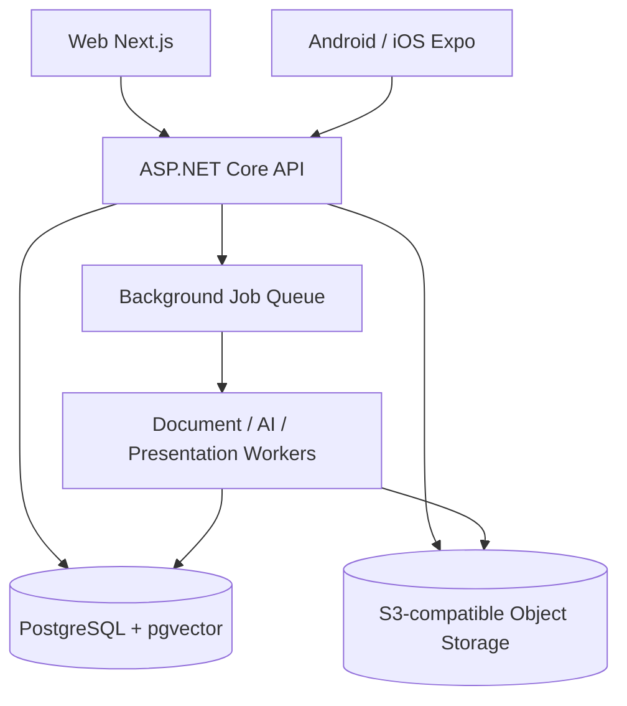
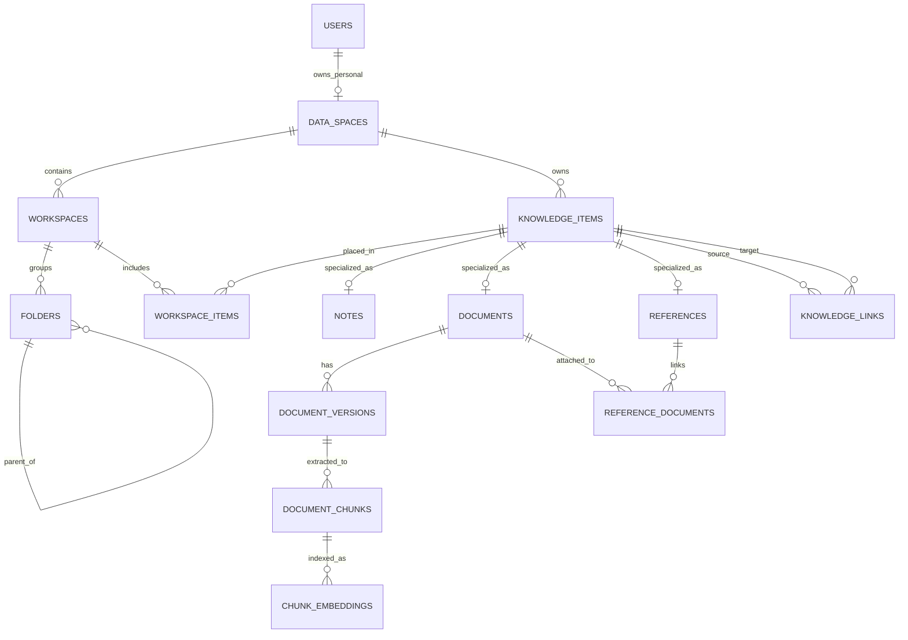

# StudyAI Campus — Core Database & Knowledge Architecture

**Dokumen:** Technical Architecture Decision & Logical Data Model  
**Versi:** 1.0 — 12 Oktober 2026  
**Status:** **Baseline disepakati untuk perancangan lanjut; belum production-ready schema**  
**Produk:** StudyAI Campus (B2C, mahasiswa)  
**Dokumen terkait:** `StudyAI_Master_Feature_List(1).md` dan `StudyAI_Campus_MVP_Decisions_v1.md`

> **Tujuan dokumen:** merekam fondasi database dan pengetahuan StudyAI yang sudah kita bahas, menjelaskan alasan desain, serta menjadi acuan sebelum membuat ERD fisik, migration Entity Framework Core, API, dan modul AI. Ini **bukan** klaim bahwa semua tabel telah diimplementasikan, di-benchmark, atau lolos audit keamanan.

---

## 1. Ringkasan keputusan

StudyAI dibangun sebagai **Personal Academic Operating System** untuk mahasiswa: workspace mata kuliah dan proyek, personal knowledge management, pengelolaan materi, AI Tutor, Quiz, Research, Writing/Skripsi, Presentation, Academic Integrity, dan Planner.

Prinsip data utamanya:

1. **Satu akun → satu ruang data personal** pada B2C V1; ruang ini menentukan pemilik dan batas akses.
2. **Workspace = konteks kegiatan**, misalnya mata kuliah, proyek, atau skripsi; bukan salinan perpustakaan pribadi.
3. **Knowledge Library = identitas konten milik pengguna**; satu jurnal atau PDF dapat digunakan di beberapa workspace tanpa upload berulang.
4. **Relasi eksplisit** menyambungkan notes, dokumen, referensi, workspace, hasil AI, dan sitasi.
5. **File asli di object storage; metadata, relasi, status, dan indeks di PostgreSQL.**
6. **Sumber dan hasil AI dipisahkan** sehingga provenance dan revisi tetap dapat ditelusuri.
7. **API-first dan versioned content**, supaya Web, iOS, dan Android memakai data yang sama serta dapat menangani konflik perubahan.
8. **Modular monolith + independent workers**, supaya sederhana di VPS tetapi bisa dikembangkan secara bertahap.

**Penilaian desain:** ini adalah fondasi yang masuk akal, modular, portable, dan cukup kuat untuk mulai implementasi bertahap. Belum pantas disebut “paling optimal” sebelum uji query, kapasitas, recovery, keamanan, dan pengalaman pengguna. Tidak semua fitur P2/P3 memerlukan skema final pada hari pertama.

---

## 2. Batas produk yang berlaku

### Termasuk target StudyAI Campus B2C V1

| Modul | Fokus |
|---|---|
| Academic Workspace | Course, project/skripsi, folder, notes, knowledge library |
| Document Intelligence | PDF/PPTX/DOCX, extraction, summary, document chat, sumber halaman |
| AI Learning | Tutor, flashcards, quiz, exam practice, progress |
| Academic Research | Jurnal, buku, DOI, research library, paper analysis |
| Academic Writing | Outline, draft assistance, bibliography, verified citations, export |
| Presentation AI | Struktur slide, edit, PPTX/PDF export |
| Academic Integrity | Citation audit; similarity pihak ketiga **hanya dengan lisensi sah** |
| Academic Planner | Tugas, kalender, deadline, study planner |
| Platform Foundation | Auth, subscription, kuota, AI usage, keamanan, monitoring |

### Tidak termasuk rilis MVP saat ini

Collaboration/group workspace, Career & Opportunities, School Experience (SD–SMA), Parent/Guardian Experience, dan B2B Teacher/Academy/Institution. Desain ownership disiapkan agar perluasan B2B kelak memungkinkan, **tanpa** membangun fitur tersebut sekarang.

---

## 3. Tech stack dan deployment yang terkait

| Bagian | Baseline |
|---|---|
| Web | Next.js + TypeScript |
| Android/iOS kelak | React Native + Expo; backend bersama |
| API / business logic | C# + ASP.NET Core |
| Arsitektur | Modular Monolith + independent background workers |
| Database | PostgreSQL |
| ORM & migrations | Entity Framework Core + Npgsql |
| Retrieval | PostgreSQL full-text search + pgvector; hybrid retrieval |
| Notes | Rich-text structured JSONB, format versioned (editor Web kandidat: Tiptap) |
| File storage | S3-compatible object storage di balik storage abstraction |
| Dokumen/AI berat | Queue + workers, Python worker untuk kebutuhan spesifik |
| Deploy | Docker images dan Compose pada local/VPS; bisa berpindah ke managed container/cloud |

**Belum diputuskan:** implementasi autentikasi final (ASP.NET Core Identity atau alternatif), background queue yang dipakai di .NET, provider storage production, strategi RLS, dan vendor/model AI per workflow.

Tidak ada asumsi bahwa satu VPS akan selalu mampu menjalankan seluruh workload. API, document workers, dan presentation workers harus bisa dipisah tanpa mengubah database domain.

---

## 4. Empat konsep inti yang tidak boleh tercampur

| Konsep | Makna | Contoh |
|---|---|---|
| **Data Space** | Siapa yang memiliki dan boleh mengakses data | Personal Data Space milik mahasiswa |
| **Workspace** | Kegiatan akademik tempat sumber digunakan | Machine Learning, Skripsi |
| **Knowledge Item** | Identitas satu informasi yang disimpan | Catatan, jurnal, PDF, saved AI output |
| **Relationship** | Hubungan antaritem dan lokasi penggunaan | Satu jurnal dipakai pada dua project |

**Implikasi:** memindahkan sebuah item di workspace **bukan** menggandakan file. Menghapus hubungan dari course **bukan** menghapus file dari library.

### Diagram arsitektur tingkat tinggi

**Catatan:** akses langsung dari mobile/web ke bucket hanya melalui upload/download flow yang diberi izin backend, misalnya signed URL berumur pendek; bukan akses publik bebas.

---

## 5. Logical ERD: entitas dan relasi

**Cara membaca:** tabel item adalah identitas umum; `notes`, `documents`, dan `references` menjadi detail satu-ke-satu yang sesuai tipenya. `workspace_items` adalah relasi banyak-ke-banyak sehingga sumber bisa tampil di lebih dari satu workspace.

Diagram ini konseptual, belum menampilkan seluruh atribut dan constraints database.

---

## 6. Delapan entitas core (contoh kolom)

Kolom di bawah adalah **usulan logical schema**, bukan daftar migrations yang sudah dibuat. Gunakan `uuid` untuk ID, `timestamptz` untuk waktu UTC, serta `bigint` untuk ukuran file dalam byte. Tetapkan `created_at`/`updated_at` dan audit metadata secukupnya pada entitas yang relevan.

### 6.1 `identity.users`

| Kolom | Fungsi |
|---|---|
| `id` (UUID, PK) | Identitas pengguna |
| `email` (unik setelah normalisasi) | Login/komunikasi |
| `display_name` | Nama tampilan |
| `status` | Active/suspended/dsb. |
| `created_at`, `updated_at` | Audit ringan |

Credential, password hash, sesi, MFA, dan token disimpan sesuai desain Identity provider yang nantinya dipilih. **Jangan membuat skema password sendiri.**

### 6.2 `ownership.data_spaces`

| Kolom | Fungsi |
|---|---|
| `id` (PK) | Batas data/ownership |
| `owner_user_id` (FK) | Pemilik personal |
| `type` | V1: `personal`; `organization` kelak jika diperlukan |
| `name` | Nama ruang data |
| `created_at` | Audit |

**Invariant V1:** satu personal data space per pengguna, ditegakkan oleh constraint/unique partial index. Ownership organisasi dan membership belum diimplementasikan.

### 6.3 `workspace.workspaces`

| Kolom | Fungsi |
|---|---|
| `id` (PK) | ID course/project |
| `data_space_id` (FK) | Pemilik |
| `type` | `course` atau `project` |
| `title`, `description` | Identitas tampilan |
| `academic_term` (nullable) | Periode/semester bila perlu |
| `created_at`, `updated_at`, `deleted_at` | Lifecycle |

### 6.4 `workspace.folders`

| Kolom | Fungsi |
|---|---|
| `id` (PK) | ID folder |
| `data_space_id` (FK) | Pemilik |
| `workspace_id` (nullable) | Null = folder Personal Library; terisi = folder workspace |
| `parent_folder_id` (nullable) | Folder induk dalam konteks yang sama |
| `name`, `sort_order` | Tampilan |
| `deleted_at` | Trash |

**Constraint penting:** parent dan child harus berada dalam Data Space serta konteks lokasi yang sama; pindah folder tidak boleh membentuk siklus. Pemilihan satu model folder ini masih harus diuji terhadap UX nested pages.

### 6.5 `knowledge.knowledge_items`

| Kolom | Fungsi |
|---|---|
| `id` (PK) | ID universal konten |
| `data_space_id` (FK) | Pemilik |
| `type` | `note`, `document`, `reference`, `saved_ai_output` |
| `title` | Judul dalam library |
| `library_folder_id` (nullable) | Lokasi di perpustakaan personal |
| `created_at`, `updated_at`, `deleted_at` | Lifecycle |

**Invariant:** tipe item dan record detailnya harus cocok, misalnya `type=note` memiliki satu record `notes`. Jangan menaruh semua tipe konten dan seluruh metadata dalam satu JSON besar. Hasil AI yang belum disimpan pengguna boleh tetap berada di riwayat AI; hanya hasil yang ditambahkan ke knowledge base yang memerlukan `knowledge_item`.

### 6.6 `knowledge.notes`

| Kolom | Fungsi |
|---|---|
| `id` (PK) | ID note |
| `knowledge_item_id` (FK, unique) | Identitas item induk |
| `content_json` (JSONB) | Blok rich-text |
| `format_version` | Versi kontrak struktur note |
| `revision` | Nomor versi untuk concurrency |
| `search_text` | Proyeksi plain text untuk pencarian |
| `updated_at` | Waktu perubahan |

Tambahan `note_revisions` untuk riwayat yang layak dipulihkan; tidak harus satu snapshot per keystroke. Mobile dapat memakai kontrak format yang sama tanpa harus memakai komponen Tiptap secara langsung.

### 6.7 `documents.documents`

| Kolom | Fungsi |
|---|---|
| `id` (PK) | Identitas logical document |
| `knowledge_item_id` (FK, unique) | Knowledge item induk |
| `original_filename` | Nama yang diberikan pengguna |
| `mime_type` | Jenis file terverifikasi |
| `current_version_id` (nullable FK) | Versi aktif |
| `created_at` | Audit |

Detail fisik berada di `document_versions`: `id`, `document_id`, `version_number`, `storage_key`, `size_bytes`, `content_sha256`, `page_count` (jika tersedia), `processing_status`, timestamps. Status ekstraksi pada level versi, karena file baru harus diindeks ulang. File binary berada di S3-compatible object storage, bukan kolom besar PostgreSQL.

### 6.8 `research.references`

| Kolom | Fungsi |
|---|---|
| `id` (PK) | ID reference di library |
| `knowledge_item_id` (FK, unique) | Item induk |
| `doi_normalized` (nullable) | DOI yang sudah dinormalisasi |
| `title` | Judul karya |
| `publication_year` | Tahun publikasi |
| `venue_name` | Jurnal, konferensi, penerbit |
| `metadata_source` | Mis. Crossref/OpenAlex/input pengguna |
| `verification_status` | Status pemeriksaan metadata |

Penulis dan urutan penulis: `reference_authors`. File pendukung: `reference_documents`. **Reference tanpa full-text tetap valid.** DOI tidak otomatis membuktikan full-text tersedia atau boleh diproses. Perlu aturan deduplikasi DOI per Data Space dengan pengecualian data tidak lengkap dan input manual.

---

## 7. Tabel penghubung dan tabel pendukung

| Tabel | Tanggung jawab | Aturan penting |
|---|---|---|
| `workspace_items` | Hubungkan satu knowledge item ke satu workspace, beserta folder penempatannya | Item dan workspace milik Data Space sama; unique `(workspace_id, knowledge_item_id)` untuk V1 |
| `knowledge_links` | Hubungan note → jurnal, summary → dokumen, draft → referensi, dll. | Source/target satu Data Space; jenis hubungan terdefinisi |
| `reference_documents` | Link metadata referensi ke PDF/lampiran | Satu reference bisa punya beberapa dokumen |
| `note_revisions` | Snapshot/revisi notes | Retensi dan restore terukur |
| `document_versions` | File asli dan versi barunya | Storage key, checksum, size, processing version |
| `document_chunks` | Potongan teks & lokasi sumber | Foreign key ke **document version**, halaman/slide bila tersedia |
| `chunk_embeddings` | Representasi vector untuk semantic search | Model/version/dimensi embedding eksplisit |
| `ai_jobs`, `ai_conversations`, `ai_messages` | Eksekusi dan riwayat AI | Idempotency, cost, status, source provenance |
| `usage_ledger` | Kuota dan biaya pemakaian | Cegah double debit saat retry |

**Catatan constraints:** untuk hubungan yang menentukan hak akses, gunakan penegakan kepemilikan pada API **dan** database (misalnya composite FK/unique key yang memasukkan `data_space_id`, atau constraint/transactional validation yang setara). FK ID saja belum tentu memastikan dua entitas berada dalam space yang sama.

---

## 8. Lifecycle penting yang harus didefinisikan

### 8.1 Satu jurnal di banyak workspace

1. Pengguna menemukan jurnal dan menyimpan metadata bibliografi di `references` + `knowledge_items`.
2. Bila ada PDF yang sah, upload menghasilkan `documents`, `document_versions`, dan hubungan `reference_documents`.
3. Menambahkan jurnal ke Course dan Skripsi membuat dua baris `workspace_items`.
4. **File asli dan metadata tidak diduplikasi.**
5. AI Tutor, Research, Writing, dan Presentation dapat membaca konten **hanya ketika pengguna memilih sumber dan memiliki izin**.

### 8.2 Upload dan reprocessing

`Upload → Validate → Store Object → Register Version → Queue Extract → Extract & page mapping → Chunk → Index keyword/vector → Ready`.

- Upload besar dapat menggunakan signed upload mechanism yang dibatasi token, ukuran, MIME, dan pemilik.
- Jangan percaya nama file/MIME dari browser saja; lakukan validasi server-side dan scanning sesuai kebutuhan.
- Gagal memproses tidak boleh membuat dokumen sumber hilang; status tetap terlihat dan bisa retry.
- `processing_version` memungkinkan ekstraksi ulang tanpa upload berulang.
- Embedding model/version harus tercatat supaya re-index tidak mencampurkan vector dari model yang tidak kompatibel.
- Citations berasal dari sumber/halaman yang benar-benar diekstrak, **bukan** nomor halaman hasil karangan model.

### 8.3 Move, remove, delete, restore

| Aksi pengguna | Efek |
|---|---|
| Pindah folder dalam workspace | Ubah placement, jangan gandakan file |
| Tambah materi ke workspace lain | Buat relasi baru |
| Remove from Course | Hapus hanya hubungan workspace terkait |
| Delete from Personal Library | Soft delete knowledge item secara global; beri peringatan jika masih digunakan |
| Restore | Pulihkan item dan relasi yang valid; jika folder sudah hilang, pulihkan ke lokasi aman |
| Delete permanently | Proses penghapusan terkontrol untuk file, versi, indeks, turunan dan backup sesuai kebijakan retensi |

**Usulan kebijakan awal:** Trash 30 hari untuk pemulihan biasa. Retensi, backup, permintaan penghapusan data, dan batas pemulihan perlu ditetapkan melalui kebijakan privasi final. Database dan object storage **tidak** membentuk satu transaksi atomik, sehingga penghapusan fisik dijalankan lewat job idempotent yang dapat diulang.

### 8.4 Sync Web/Android/iOS

- Backend/API menjadi source of truth; perangkat menyimpan cache/draft seperlunya.
- Notes mempunyai `revision`/version token.
- Update harus menyertakan versi sebelumnya; bila usang, backend memberi `409 Conflict` atau respons domain yang setara, **bukan** silent overwrite.
- Tahap awal: online-first + optimistic concurrency. Offline write/sync lengkap bisa menjadi pengembangan berikutnya.
- JSON notes memiliki `format_version` supaya app lama dan baru tidak merusak struktur data.

---

## 9. Security dan data isolation

**Default:** seluruh file, catatan, reference library, embedding, dan hasil AI personal bersifat privat.

- Validasi identitas dan ownership pada **setiap** read/write di ASP.NET Core.
- Filter retrieval AI menggunakan scope/permissions sebelum query; jangan hanya mengandalkan instruksi prompt.
- Gunakan hubungan `data_space_id` yang konsisten dan constraints untuk mencegah cross-owner reference.
- Object storage private; signed URLs berumur pendek dan terikat otorisasi.
- Hindari log yang menyimpan PDF penuh, prompt sensitif, credential, dan signed URL secara sembarangan.
- Gunakan backup terenkripsi, secrets management, dan prinsip least privilege.
- Evaluasi PostgreSQL **Row-Level Security** sebagai defense-in-depth, bukan pengganti authorization aplikasi; uji interaksi dengan EF Core, database roles, dan connection pooling sebelum aktif.
- Bila kelak B2B ditambahkan, jangan pernah secara otomatis memindahkan data Personal Data Space ke organisasi.

---

## 10. Database performance & scale strategy

**Mulai:** satu PostgreSQL instance dengan beberapa logical schemas, bukan sebelas database server.

| Query/pola | Indeks awal yang layak dievaluasi |
|---|---|
| Daftar workspace pengguna | `workspaces(data_space_id, type)` |
| Navigasi folder | `folders(data_space_id, workspace_id, parent_folder_id)` |
| Library / recent items | `knowledge_items(data_space_id, updated_at)` |
| Item dalam workspace | `workspace_items(workspace_id, knowledge_item_id)` + FK indexes |
| Deduplikasi DOI | Partial unique `(data_space_id, doi_normalized)` untuk DOI valid/non-null (melalui relasi ownership yang terdefinisi) |
| Versi dokumen | Unique `(document_id, version_number)` |
| RAG | FTS dan pgvector indexes berdasarkan profil data & benchmark |

**Catatan desain:** tabel `references` pada logical schema di atas belum memiliki `data_space_id` langsung. Jika indeks unik per Data Space dipakai, pilih salah satu pendekatan eksplisit: tambahkan `data_space_id` dengan constraint konsistensi ke knowledge item, atau enforce unik melalui tabel canonical DOI/transactional validation. Jangan membuat indeks di kolom yang belum ada.

Urutan scaling yang disarankan: **ukur → optimasi query → tambah indeks yang terbukti perlu → pagination → connection pooling → upgrade kapasitas → pisahkan workload**, baru pertimbangkan search service/vector DB terpisah, read replica, atau partitioning jika dibenarkan metrik.

Hindari klaim angka “sekian pengguna pasti kuat” tanpa uji sesuai pola upload, AI chat, pencarian, dan traffic sebenarnya.

---

## 11. Billing, storage quota, dan biaya AI

DB sejak awal harus mampu mencatat:

- Paket aktif, entitlement, limit user dan fitur.
- Jumlah byte **file pengguna yang terhitung kuota**; bedakan upload asli, versi tersimpan, file turunan, dan backup sistem.
- Halaman baru yang diproses, AI messages/jobs, output PPT, dan fitur mahal lain.
- Pemakaian AI aktual per job (model, tokens, biaya, retries, success/failure).
- Cadangan/debit/refund kuota pada proses async sehingga pekerjaan yang diulang **tidak mendebit dua kali**.

**Keputusan produk terkait:** Free Plan harus tetap bermanfaat sehari-hari untuk notes, library, planner, membaca materi, dan kuis yang sudah disimpan. Batas Free/Paid, storage 500 MB/5 GB/20 GB, dan harga Rp69rb/Rp129rb yang sempat didiskusikan masih **hipotesis bisnis**, bukan batas yang telah dibakukan atau lolos unit-economics test.

Untuk storage accounting, menduplikasi tautan `workspace_items` tidak boleh menambah jumlah byte pengguna. Kebijakan mengenai salinan versi lama, file duplikat, derived files, serta masa retention harus eksplisit.

---

## 12. API-first contract awal

| Endpoint (usulan) | Kegunaan |
|---|---|
| `GET /api/v1/workspaces` | Daftar course/project |
| `POST /api/v1/workspaces` | Buat workspace |
| `GET /api/v1/workspaces/{id}/items` | Daftar materi di workspace |
| `POST /api/v1/workspaces/{id}/items` | Tambah item library yang sudah ada |
| `POST /api/v1/knowledge-items` | Buat identitas item |
| `PUT /api/v1/notes/{id}` | Simpan konten dengan revision check |
| `POST /api/v1/documents/uploads` | Inisialisasi upload file |
| `GET /api/v1/references` | Research Library |

Tambahkan pagination/cursor, validation, error format stabil, permission checks, file policies, dan OpenAPI. Kontrak ini hanya ilustrasi, bukan API final.

---

## 13. Deployment, migration, dan maintainability

- **Local:** Next.js, ASP.NET Core, PostgreSQL+pgvector, object storage lokal, job runner lewat Docker Compose.
- **VPS soft launch:** image dan konfigurasi layanan yang sama; object storage eksternal, backup offsite, HTTPS, monitoring.
- **Cloud scale:** deploy API/worker secara terpisah, gunakan managed PostgreSQL/storage bila ekonomis; aplikasi dan model data tetap dipertahankan.
- Schema changes melalui **EF Core migrations** yang ditinjau, diuji pada staging, dan direncanakan untuk perubahan kompatibel ke belakang jika Web/Mobile memakai versi berbeda.
- Latihan restore database **dan** file object storage. `pg_dump` bermanfaat untuk dump logis; backup operasional jangka panjang perlu mempertimbangkan recovery objectives/PITR.
- Data migration harus diuji dengan checksums, row counts, referential integrity, storage objects, dan rollback plan; perpindahan hosting tidak berarti zero-downtime otomatis.

### Peran domain sebagai batas modul

`identity`, `ownership`, `workspace`, `knowledge`, `documents`, `research`, `learning`, `writing`, `presentation`, `planner`, `billing`, `platform` adalah usulan pengelompokan kode dan/atau PostgreSQL schemas; **bukan** alasan untuk membuat banyak database fisik saat V1.

---

## 14. Acceptance criteria sebelum schema dianggap siap implementasi

- [ ] Satu user hanya mempunyai satu Personal Data Space V1.
- [ ] Cross-user/cross-data-space API reads dan object references ditolak secara konsisten.
- [ ] Satu dokumen bisa ditempatkan pada dua workspace tanpa copy objek.
- [ ] Remove from Course tidak menghapus source dari Library/project lain.
- [ ] Global delete memberikan peringatan dan tidak meninggalkan indeks terakses publik.
- [ ] Restore dari Trash aman meskipun folder asal sudah dihapus.
- [ ] Notes mendeteksi konflik edit antara dua klien/perangkat.
- [ ] Upload gagal dan processing retry aman; tidak membuat catatan penggunaan ganda.
- [ ] Penggantian versi PDF tidak mengubah asal sumber hasil AI lama secara diam-diam.
- [ ] DOI tanpa PDF bisa disimpan, dicari, dan dikutip dengan metadata tervalidasi.
- [ ] Citation link menunjuk sumber serta halaman/slide yang benar-benar tersedia.
- [ ] Perhitungan storage quota tidak menganggap setiap link workspace sebagai salinan file.
- [ ] Migrasi PostgreSQL + storage ke environment baru lulus restore dan integrity tests.
- [ ] Load test mencakup Library listing, note save, hybrid search, PDF upload, dan AI job queue.

---

## 15. Keputusan yang masih **open** (jangan dikira final)

| Topik | Yang harus dipilih/diuji |
|---|---|
| Auth | ASP.NET Core Identity vs solusi lain; sessions, mobile refresh tokens, MFA |
| Folder + pages | Nested note pages vs folder tree; attachment rules; workspace shortcuts |
| Knowledge item types | Aturan spesifik saved AI output dan generated artifacts |
| Data-space ownership | Composite FK/denormalisasi `data_space_id` untuk hard isolation |
| DOI uniqueness | Canonicalization, user edits, metadata conflict, multi-version paper |
| Document storage | Per-user dedup, object versioning, storage quota accounting |
| Soft delete | Trash semantics, relation restore, retention dan purge jobs |
| Embeddings | Model, dimensi, re-index lifecycle, vector isolation dan recall testing |
| Queue | Teknologi .NET job queue, concurrency, retries, idempotency |
| RLS | Perlu tidaknya V1 serta cara identity context dikirim aman |
| Backups | Frekuensi, enkripsi, RPO/RTO, dan restore validation |
| Billing | Credit cost calculation, rate limits, refund/reservation on failed jobs |

**Keputusan implementasi pertama yang paling kritis:** finalisasi ownership invariants, placement/folder semantics, document-version model, dan transactional quota accounting sebelum modul-modul AI berkembang.

---

## 16. Next step

1. Buat **Physical ERD v1**: tipe kolom final, PK/FK, composite constraints, unique/check constraints, delete behavior, dan indexes.
2. Buat **EF Core entity configurations dan migration pertama** untuk `users`, `data_spaces`, `workspaces`, `folders`, `knowledge_items`, `workspace_items`, `notes`, `documents`, `document_versions`, `references`, `reference_documents`.
3. Buat **API contract + authorization test suite**: same-owner, conflicts, delete, versioning.
4. Lanjut ke **AI & Knowledge Engine Architecture** (chunking, retrieval, source grounding, workers, AI routing, credits/cost monitoring).
5. Uji dengan kasus nyata mahasiswa dan dokumen aktual sebelum membakukan limit atau strategi skalabilitas.

---

## Ringkasan satu kalimat

**StudyAI Campus memakai satu PostgreSQL sebagai data source utama, Data Space untuk ownership, Workspace untuk konteks akademik, Knowledge Item sebagai identitas konten, relasi eksplisit agar sumber bisa digunakan lintas fitur tanpa duplikasi, dan object storage + background workers untuk file serta pekerjaan AI—dengan API yang siap dipakai Web, Android, dan iOS.**
