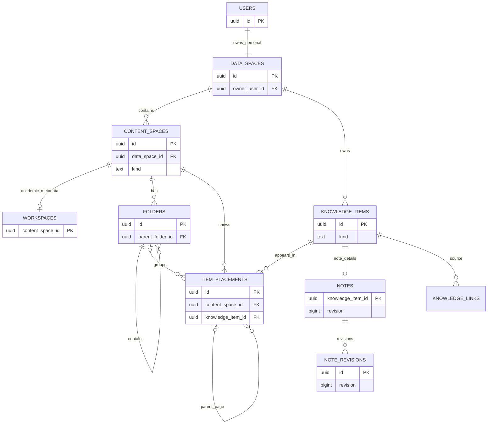
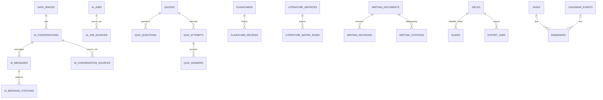
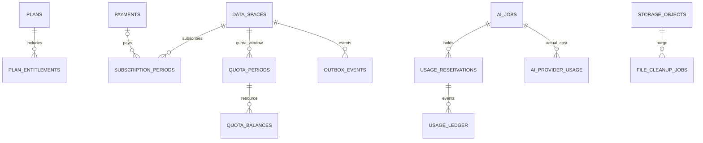

# StudyAI Campus — Physical ERD & PostgreSQL Database Implementation Handbook

> **Versi dokumen:** 1.0 (Physical Database Design Proposal)  
> **Tanggal:** 12 Oktober 2026  
> **Status:** **SIAP REVIEW TEKNIS / BELUM PRODUCTION APPROVED**  
> **Output utama:** `StudyAI_Physical_ERD_and_SQL_Handbook_v1.0.md`  
> **Lampiran opsional:** `StudyAI_Physical_Schema_Reference_v1.0.sql` (isi persis sama dengan SQL referensi di bagian 7)  
> **Cakupan:** sembilan modul Campus V1, fondasi kepemilikan dan AI, pembayaran dan operasional.

## 0. Ringkasan & sumber kebenaran

**Dokumen ini adalah usulan penerjemahan fisik** dari `StudyAI_Campus_MVP_Final_PRD_v1.0.md` (apa yang dibangun) serta `StudyAI_Core_Architecture_v1.2.md` (invariant/kontrak arsitektur yang disetujui). Dokumen ini **tidak** memodifikasi kedua dokumen tersebut. SQL berikut adalah skema referensi *greenfield* untuk review dan integration test; **bukan EF Core migration final yang boleh langsung dijalankan ke production**. Belum diuji pada instance PostgreSQL nyata di lingkungan penyusunan; klaim kualitas terbatas pada review statis dan inspeksi relasi. Semua konflik dari hasil pengujian harus diperbaiki sebelum promosi menjadi migration produksi.

**Prioritas keputusan:** keputusan terbaru pemilik produk → PRD → Architecture v1.2 → handbooks fisik/ADR → implementasi. Semua fitur Campus V1 tetap sasaran peluncuran; batch migration dapat bertahap.

### 0.1 Label

| Status | Arti |
|---|---|
| `LOCKED` | Perilaku disepakati di PRD/Architecture v1.2; desain fisik tidak boleh melanggar. |
| `PROPOSED` | SQL/tabel/relasi default pada handbook; dapat direvisi lewat review/ADR. |
| `OPEN` | Butuh benchmark, pembuktian, keputusan bisnis atau legal sebelum implementasi final. |
| `PARTNER-GATED` | Similarity atau akses konten berlisensi tidak boleh diaktifkan hanya karena tabel sudah ada. |

### 0.2 Aturan operasional mutlak

1. **Data Space** menentukan pemilik; **Content Space** menentukan lokasi; **Knowledge Item** menentukan konten; **Placement** menunjukkan konten pada satu konteks. Tidak saling ditukar.
2. Library kanonis: semua item yang disimpan punya penempatan Library yang dapat ditemukan. `Remove from Course` bukan `Delete globally`.
3. Semua query yang membaca data pribadi memvalidasi owner, izin, status soft-delete serta scope sumber. `data_space_id` adalah fakta database, **bukan nilai yang boleh dipilih sendiri oleh pengguna tanpa otorisasi**.
4. Hasil AI wajib menyimpan provenance versi sumber, bukan memalsukan DOI/halaman. Metadata jurnal tidak berarti kepemilikan full-text.
5. Workflow eksternal menggunakan idempotency/compensation; provider AI, S3, email, payment tidak masuk ke dalam transaksi PostgreSQL yang sama.
6. Ledger user credits dan cost provider **dipisah**. Batas berbayar disimpan di tabel data, bukan hardcode.
7. Penghapusan harus mencakup catatan, versi file, OCR/embedding, snapshot kutipan dan hasil ekspor yang berkaitan menurut kebijakan retensi.

## 1. Baseline lingkungan & conventions

| Topik | Desain fisik yang diusulkan |
|---|---|
| PostgreSQL | **16+** sebagai target minimum referensi, dengan extension `vector` dan `pg_trgm` aktif. |
| ORM / API | EF Core + Npgsql, ASP.NET Core; **satu DbContext/migration history** sebagai default awal. |
| ID | `uuid` (direkomendasikan UUIDv7 dibuat di .NET `Guid.CreateVersion7()`), bukan serial auto-number. |
| Waktu | `timestamptz` UTC; di UI dikonversi ke zona waktu pengguna. |
| JSON | `jsonb` untuk rich-text, editor slides dan metadata heterogen; bukan untuk semua relasi. |
| File | Blob privat pada object storage S3-compatible; database menyimpan `storage_key`, checksum dan metadata. |
| Naming | Schema per bounded context, snake_case; FK user-owned membawa `data_space_id`. |
| Nullability | FKs parent nullable hanya jika relasi opsional; composite FK nullable harus diuji dengan `MATCH SIMPLE` default. |
| Delete | Default `ON DELETE RESTRICT`; lifecycle global melalui service/outbox, bukan cascade fisik massal. |
| Search | Full-text `simple` sebagai starting default; exact pgvector; pengujian bahasa Indonesia sebelum final. |
| Money | Currency + integer minor units untuk gateway; USD micros untuk biaya AI internal. |
| Idempotency | Identity unik per logical job/payment event dan per transisi ledger. |
| Pagination | Keyset `(updated_at, id)` atau cursor untuk feed besar; offset hanya data kecil. |

**Prasyarat instalasi:** instance PostgreSQL dengan `pgvector` tersedia, perizinan extension diberikan saat migration bootstrap, backup/restore diuji di staging. `CREATE EXTENSION` mungkin membutuhkan role administratif dan sebaiknya dipisah dari runtime role. Script menggunakan `BEGIN/COMMIT` dan tidak memiliki `DROP`; jalankan **sekali** di database uji kosong.

## 2. Physical ERD per bounded context

Diagram Mermaid sengaja dipecah menjadi beberapa kelompok supaya terbaca dan dapat ditampilkan langsung di GitHub. Garis diagram memperlihatkan FK paling penting, bukan setiap constraint komposit; sumber kebenaran tipe kolom/FK adalah DDL bagian 7.

### 2.1 Ownership, Library, Workspace, nested pages



**Placement invariants:** `folder_id` dan `parent_page_placement_id` mutually exclusive; parent harus note dalam *content space* dan *data space* sama. `UNIQUE (content_space_id,knowledge_item_id) WHERE removed_at IS NULL` memastikan maksimal satu placement aktif per space. **At-most-one ≠ at-least-one:** adanya Library placement dan minimal satu subtype dijamin oleh service transaction + tests pada rancangan awal; penguatan dengan constraint trigger dapat ditambahkan melalui ADR.

### 2.2 Documents, versions, extraction, references & provenance

```mermaid
erDiagram
  KNOWLEDGE_ITEMS ||--o| DOCUMENTS : document_details
  DOCUMENTS ||--o{ DOCUMENT_VERSIONS : has
  DOCUMENT_VERSIONS ||--o{ PROCESSING_RUNS : reprocess
  PROCESSING_RUNS ||--o{ DOCUMENT_CHUNKS : produces
  DOCUMENT_CHUNKS ||--o{ CHUNK_EMBEDDINGS : embedding
  EMBEDDING_MODELS ||--o{ CHUNK_EMBEDDINGS : model
  STORAGE_OBJECTS ||--o{ DOCUMENT_VERSIONS : bytes
  KNOWLEDGE_ITEMS ||--o| BIBLIOGRAPHIC_REFERENCES : metadata
  BIBLIOGRAPHIC_REFERENCES ||--o{ REFERENCE_AUTHORS : author
  BIBLIOGRAPHIC_REFERENCES ||--o{ REFERENCE_DOCUMENTS : pdf_link
  BIBLIOGRAPHIC_REFERENCES ||--o{ REFERENCE_SNAPSHOTS : snapshots
  KNOWLEDGE_ITEMS ||--o{ SOURCE_VERSIONS : immutable_source
  SOURCE_VERSIONS ||--o{ AI_MESSAGE_CITATIONS : evidence
  DOCUMENTS { uuid knowledge_item_id PK }
  DOCUMENT_VERSIONS { uuid id PK int version_no }
  DOCUMENT_CHUNKS { uuid id PK jsonb locator }
  CHUNK_EMBEDDINGS { uuid chunk_id PK_FK vector embedding }
  SOURCE_VERSIONS { uuid id PK text source_kind }
```

### 2.3 AI, Learning, Research, Writing, Presentation, Integrity, Planner



### 2.4 Billing, quotas & operations



## 3. Aturan kardinalitas dan lifecycle (kontrak fisik)

| Relasi | Kardinalitas | Enforcement fisik / service |
|---|---|---|
| User → Personal Data Space | 1 → 1 (produk) | `ux_one_personal_space` mencegah ganda; provisioning 1:1 dilakukan atomik dan direkonsiliasi. |
| Data Space → Library Content Space | 1 → 1 (produk) | `ux_library_per_owner` mencegah ganda; create atomik, library tidak dihapus. |
| Data Space → Content Spaces | 1 → N | `content_spaces.data_space_id` FK owner. |
| Course/Project Content Space → Workspace metadata | 1 → 1 (produk) | metadata `workspaces.content_space_id` PK; `content_kind` cocok via composite FK; service menjamin record metadata dibuat. |
| Data Space → Knowledge Items | 1 → N | FK owner; soft delete pada knowledge item. |
| Knowledge Item → type-specific detail | 1 → 1 (untuk tiap item valid) | `(id, data_space_id,kind)` composite FK detail; pembuatan pasangan atomik di service. |
| Content Space ↔ Knowledge Item | N ↔ N | `item_placements` junction; item tidak disalin. |
| Folder → Folder | 0..1 parent → N children | FK same space + cycle check dalam transaksi dengan per-space advisory lock. |
| Placement → nested page placement | 0..1 parent → N children | FK same-space dan `item_kind='note'` untuk parent; cycle check berserialisasi. |
| Document → Versions | 1 → N | `(document_id,version_no)` unique; pointer current mengarah versi dari document yang sama. |
| Version → extraction / chunks | 1 → N | `processing_runs`, `document_chunks` discope owner dan versi; tidak ubah provenance lama. |
| Reference ↔ Document | N ↔ N | `reference_documents` many-to-many dalam Data Space sama. |
| Source Version → AI Citation | 1 → N | FK owner; locator/snapshot di citation, beda tipe sumber. |
| AI Job → Usage Reservation | 1 → N resource | unique `(job_id,resource)`; settlement persis satu kali. |
| Plan → Subscription Period | 1 → N | langganan berdasarkan periode bayar, tidak dari flag UI. |

**Catatan on-delete:** schema default `RESTRICT` untuk hampir seluruh FK. Penghapusan permanen **bukan** `DELETE` satu baris lalu cascade ke semua; worker purge terserialisasi harus menangani dependency graph (child-first), snapshot/retensi, job status serta object cleanup. `removed_at/deleted_at` hanya soft state yang tidak menonaktifkan FK.

## 4. Catalog table per domain

### `identity` — 1 tabel

| Tabel | Tanggung jawab |
|---|---|
| `identity.users` | Identitas akun; tabel auth provider disediakan melalui migration Identity terpisah. |

### `ownership` — 1 tabel

| Tabel | Tanggung jawab |
|---|---|
| `ownership.data_spaces` | Boundary pemilik data personal, maksimum satu personal space per akun. |

### `workspace` — 4 tabel

| Tabel | Tanggung jawab |
|---|---|
| `workspace.content_spaces` | Kontainer Library/Course/Project; Library memiliki unique invariant. |
| `workspace.workspaces` | Metadata course/project 1:1 terhadap content_spaces. |
| `workspace.folders` | Hierarki folder pada satu content space dan owner yang sama. |
| `workspace.item_placements` | Lokasi reusable item, nested pages dan pemisahan remove vs delete. |

### `knowledge` — 9 tabel

| Tabel | Tanggung jawab |
|---|---|
| `knowledge.knowledge_items` | Identitas konten kanonis, subtype tunggal dan soft delete global. |
| `knowledge.notes` | Editor structured JSONB; snapshot tersimpan di note_revisions. |
| `knowledge.note_revisions` | Snapshot immutable revisi note untuk provenance. |
| `knowledge.saved_ai_outputs` | Output AI yang disimpan pengguna ke Library. |
| `knowledge.saved_output_versions` | Riwayat immutable output AI yang tersimpan. |
| `knowledge.knowledge_links` | Relasi lintas knowledge item; bukan sitasi akademik. |
| `knowledge.tags` | Label global per Data Space. |
| `knowledge.item_tags` | Relasi many-to-many label dan Knowledge Item. |
| `knowledge.source_versions` | Abstraksi satu versi sumber immutable note/document/reference/output. |

### `documents` — 8 tabel

| Tabel | Tanggung jawab |
|---|---|
| `documents.storage_objects` | Metadata blob privat; bytes terhitung satu kali, tidak per placement. |
| `documents.documents` | Identitas file logis dan penunjuk versi saat ini. |
| `documents.document_versions` | Versi immutable blob dan status pemrosesan file. |
| `documents.processing_runs` | Jejak percobaan ekstraksi dan re-index versi dokumen. |
| `documents.document_chunks` | Teks ekstraksi, penanda lokasi, FTS untuk RAG. |
| `documents.chunk_embeddings` | Embedding chunk; dimensi diverifikasi ke katalog model. |
| `documents.note_attachments` | Lampiran dari editor note ke objek blob privat. |
| `documents.document_annotations` | Highlight/komentar berbasis locator versi dokumen. |

### `ai` — 7 tabel

| Tabel | Tanggung jawab |
|---|---|
| `ai.embedding_models` | Katalog model embedding dan dimensi yang digunakan. |
| `ai.ai_conversations` | Sesi percakapan AI milik Data Space. |
| `ai.ai_messages` | Pesan AI yang terhubung ke percakapan owner. |
| `ai.ai_conversation_sources` | Versi sumber yang dipilih untuk conversation. |
| `ai.ai_jobs` | Job AI dengan idempotency identity dan status. |
| `ai.ai_job_sources` | Versi sumber persis yang dipakai AI job. |
| `ai.ai_message_citations` | Snapshot kutipan, lokasi, claim dan versi sumber. |

### `research` — 6 tabel

| Tabel | Tanggung jawab |
|---|---|
| `research.bibliographic_references` | Metadata jurnal/buku per user; DOI unik tetap di Trash. |
| `research.reference_authors` | Daftar author yang mempertahankan urutan bibliografi. |
| `research.reference_documents` | Relasi metadata reference ke file PDF/suplemen. |
| `research.reference_snapshots` | Snapshot metadata untuk citation provenance. |
| `research.literature_matrices` | Koleksi matriks literatur suatu project. |
| `research.literature_matrix_rows` | Tabel per-paper metodologi, temuan dan keterbatasan. |

### `learning` — 8 tabel

| Tabel | Tanggung jawab |
|---|---|
| `learning.learning_profiles` | Preferensi dan tujuan pembelajaran personal. |
| `learning.quizzes` | Paket quiz yang dapat dikerjakan ulang. |
| `learning.quiz_sources` | Sumber quiz terikat pada versi asli. |
| `learning.quiz_questions` | Soal, opsi, kunci dan penjelasan. |
| `learning.quiz_attempts` | Sesi pengerjaan quiz oleh pemilik. |
| `learning.quiz_answers` | Jawaban per soal dan hasil penilaian. |
| `learning.flashcards` | Kartu review dengan jadwal pengulangan. |
| `learning.flashcard_reviews` | Histori hasil review dan quality. |

### `writing` — 3 tabel

| Tabel | Tanggung jawab |
|---|---|
| `writing.writing_documents` | Draft tulisan akademik dan status. |
| `writing.writing_revisions` | Versi konten draft untuk riwayat dan conflict. |
| `writing.citations` | Sitasi bibliografi pada dokumen tulisan. |

### `presentation` — 3 tabel

| Tabel | Tanggung jawab |
|---|---|
| `presentation.decks` | Struktur presentasi editable dan tema. |
| `presentation.slides` | Elemen editabel per slide serta sumber terkait. |
| `presentation.export_jobs` | Pekerjaan render PPTX/PDF dan file hasil. |

### `integrity` — 2 tabel

| Tabel | Tanggung jawab |
|---|---|
| `integrity.citation_audits` | Audit konsistensi kutipan/sumber internal. |
| `integrity.similarity_checks` | Placeholder provider berlisensi, tidak otomatis aktif. |

### `planner` — 3 tabel

| Tabel | Tanggung jawab |
|---|---|
| `planner.tasks` | Tugas dan deadline akademik personal. |
| `planner.calendar_events` | Agenda dan recurrence akademik. |
| `planner.reminders` | Pengingat yang menarget task atau calendar event. |

### `billing` — 10 tabel

| Tabel | Tanggung jawab |
|---|---|
| `billing.plans` | Katalog paket global; harga final tetap konfigurasi terpisah/OPEN. |
| `billing.plan_entitlements` | Hak fitur/kuota per plan dan jenis periode. |
| `billing.payments` | Transaksi pembayaran berdasarkan verifikasi server. |
| `billing.subscription_periods` | Hak akses prabayar berdasarkan periode aktif. |
| `billing.payment_webhook_events` | Inbox deduplikasi webhook gateway. |
| `billing.quota_periods` | Identitas dan interval periode kuota. |
| `billing.quota_balances` | Proyeksi kuota terpakai, reserved dan limit. |
| `billing.usage_reservations` | Hold per job/resource dengan state settlement. |
| `billing.usage_ledger` | Peristiwa debit/hold/release append-only. |
| `billing.ai_provider_usage` | Biaya provider sesungguhnya terpisah dari credits user. |

### `ops` — 3 tabel

| Tabel | Tanggung jawab |
|---|---|
| `ops.outbox_events` | Transactional outbox untuk efek luar transaksi DB. |
| `ops.file_cleanup_jobs` | Pekerjaan purge blob asinkron dan dapat di-retry. |
| `ops.operation_audit` | Audit operasi administratif tanpa merekam konten sensitif. |

## 5. Data dictionary lengkap — seluruh kolom

**Cara membaca:** `NOT NULL` berarti wajib terisi; `NULL` opsional. Default `—` berarti aplikasi/service perlu menyediakan nilai atau kolom memang opsional. Constraint multi-kolom, FK, check dan index yang lengkap ada pada SQL di bagian 7. Kolom `data_space_id` adalah security boundary; sumber `user id` harus berasal dari session terverifikasi. **Klasifikasi PII singkat:** email/display_name = identitas; note/draft/document/quiz/chat = konten pribadi; token/provider ref = data operasional; `storage_key` tidak boleh berisi informasi pengidentifikasi. Jangan log JSON body/teks pribadi secara default.

### 5.1 `identity`

#### `identity.users`

Identitas akun; tabel auth provider disediakan melalui migration Identity terpisah.

| Kolom | PostgreSQL type | Nullability | Default |
|---|---|---|---|
| `id` | `uuid` | NOT NULL | `—` |
| `email` | `text` | NOT NULL | `—` |
| `display_name` | `text` | NOT NULL | `—` |
| `status` | `text` | NOT NULL | `'active'` |
| `locale` | `text` | NOT NULL | `'id-ID'` |
| `timezone` | `text` | NOT NULL | `'Asia/Jakarta'` |
| `created_at` | `timestamptz` | NOT NULL | `now()` |
| `updated_at` | `timestamptz` | NOT NULL | `now()` |
| `deleted_at` | `timestamptz` | NULL | `—` |

### 5.2 `ownership`

#### `ownership.data_spaces`

Boundary pemilik data personal, maksimum satu personal space per akun.

| Kolom | PostgreSQL type | Nullability | Default |
|---|---|---|---|
| `id` | `uuid` | NOT NULL | `—` |
| `owner_user_id` | `uuid` | NOT NULL | `—` |
| `kind` | `text` | NOT NULL | `'personal'` |
| `name` | `text` | NOT NULL | `—` |
| `created_at` | `timestamptz` | NOT NULL | `now()` |

**Constraints tabel:**

- `UNIQUE(id,owner_user_id)`

### 5.3 `workspace`

#### `workspace.content_spaces`

Kontainer Library/Course/Project; Library memiliki unique invariant.

| Kolom | PostgreSQL type | Nullability | Default |
|---|---|---|---|
| `id` | `uuid` | NOT NULL | `—` |
| `data_space_id` | `uuid` | NOT NULL | `—` |
| `kind` | `text` | NOT NULL | `—` |
| `title` | `text` | NOT NULL | `—` |
| `description` | `text` | NULL | `—` |
| `position` | `int` | NOT NULL | `0` |
| `created_at` | `timestamptz` | NOT NULL | `now()` |
| `updated_at` | `timestamptz` | NOT NULL | `now()` |
| `deleted_at` | `timestamptz` | NULL | `—` |

**Constraints tabel:**

- `UNIQUE(id,data_space_id)`
- `UNIQUE(id,data_space_id,kind)`

#### `workspace.workspaces`

Metadata course/project 1:1 terhadap content_spaces.

| Kolom | PostgreSQL type | Nullability | Default |
|---|---|---|---|
| `content_space_id` | `uuid` | NOT NULL | `—` |
| `data_space_id` | `uuid` | NOT NULL | `—` |
| `content_kind` | `text` | NOT NULL | `—` |
| `academic_term` | `text` | NULL | `—` |
| `course_code` | `text` | NULL | `—` |
| `project_type` | `text` | NULL | `—` |
| `start_date` | `date` | NULL | `—` |
| `end_date` | `date` | NULL | `—` |
| `status` | `text` | NOT NULL | `'active'` |
| `created_at` | `timestamptz` | NOT NULL | `now()` |

**Constraints tabel:**

- `UNIQUE(content_space_id,data_space_id)`
- `FOREIGN KEY (content_space_id,data_space_id,content_kind) REFERENCES workspace.content_spaces(id,data_space_id,kind) ON DELETE RESTRICT`

#### `workspace.folders`

Hierarki folder pada satu content space dan owner yang sama.

| Kolom | PostgreSQL type | Nullability | Default |
|---|---|---|---|
| `id` | `uuid` | NOT NULL | `—` |
| `data_space_id` | `uuid` | NOT NULL | `—` |
| `content_space_id` | `uuid` | NOT NULL | `—` |
| `parent_folder_id` | `uuid` | NULL | `—` |
| `name` | `text` | NOT NULL | `—` |
| `position` | `int` | NOT NULL | `0` |
| `created_at` | `timestamptz` | NOT NULL | `now()` |
| `deleted_at` | `timestamptz` | NULL | `—` |

**Constraints tabel:**

- `UNIQUE(id,data_space_id,content_space_id)`
- `FOREIGN KEY(content_space_id,data_space_id) REFERENCES workspace.content_spaces(id,data_space_id) ON DELETE RESTRICT`
- `FOREIGN KEY(parent_folder_id,data_space_id,content_space_id) REFERENCES workspace.folders(id,data_space_id,content_space_id) ON DELETE RESTRICT`
- `CHECK(parent_folder_id IS NULL OR parent_folder_id <> id)`

#### `workspace.item_placements`

Lokasi reusable item, nested pages dan pemisahan remove vs delete.

| Kolom | PostgreSQL type | Nullability | Default |
|---|---|---|---|
| `id` | `uuid` | NOT NULL | `—` |
| `data_space_id` | `uuid` | NOT NULL | `—` |
| `content_space_id` | `uuid` | NOT NULL | `—` |
| `knowledge_item_id` | `uuid` | NOT NULL | `—` |
| `item_kind` | `text` | NOT NULL | `—` |
| `folder_id` | `uuid` | NULL | `—` |
| `parent_page_placement_id` | `uuid` | NULL | `—` |
| `parent_page_kind` | `text` | NOT NULL | `'note'` |
| `position` | `int` | NOT NULL | `0` |
| `created_at` | `timestamptz` | NOT NULL | `now()` |
| `removed_at` | `timestamptz` | NULL | `—` |

**Constraints tabel:**

- `UNIQUE(id,data_space_id,content_space_id)`
- `UNIQUE(id,data_space_id,content_space_id,item_kind)`
- `FOREIGN KEY(content_space_id,data_space_id) REFERENCES workspace.content_spaces(id,data_space_id) ON DELETE RESTRICT`
- `FOREIGN KEY(knowledge_item_id,data_space_id,item_kind) REFERENCES knowledge.knowledge_items(id,data_space_id,kind) ON DELETE RESTRICT`
- `FOREIGN KEY(folder_id,data_space_id,content_space_id) REFERENCES workspace.folders(id,data_space_id,content_space_id) ON DELETE RESTRICT`
- `FOREIGN KEY(parent_page_placement_id,data_space_id,content_space_id,parent_page_kind) REFERENCES workspace.item_placements(id,data_space_id,content_space_id,item_kind) ON DELETE RESTRICT`
- `CHECK (folder_id IS NULL OR parent_page_placement_id IS NULL)`
- `CHECK(parent_page_placement_id IS NULL OR parent_page_placement_id <> id)`

### 5.4 `knowledge`

#### `knowledge.knowledge_items`

Identitas konten kanonis, subtype tunggal dan soft delete global.

| Kolom | PostgreSQL type | Nullability | Default |
|---|---|---|---|
| `id` | `uuid` | NOT NULL | `—` |
| `data_space_id` | `uuid` | NOT NULL | `—` |
| `kind` | `text` | NOT NULL | `—` |
| `title` | `text` | NOT NULL | `—` |
| `description` | `text` | NULL | `—` |
| `created_at` | `timestamptz` | NOT NULL | `now()` |
| `updated_at` | `timestamptz` | NOT NULL | `now()` |
| `deleted_at` | `timestamptz` | NULL | `—` |

**Constraints tabel:**

- `UNIQUE(id,data_space_id)`
- `UNIQUE(id,data_space_id,kind)`

#### `knowledge.notes`

Editor structured JSONB; snapshot tersimpan di note_revisions.

| Kolom | PostgreSQL type | Nullability | Default |
|---|---|---|---|
| `knowledge_item_id` | `uuid` | NOT NULL | `—` |
| `data_space_id` | `uuid` | NOT NULL | `—` |
| `item_kind` | `text` | NOT NULL | `'note'` |
| `content_json` | `jsonb` | NOT NULL | `'{}'::jsonb` |
| `format_version` | `int` | NOT NULL | `—` |
| `revision` | `bigint` | NOT NULL | `1` |
| `search_text` | `text` | NOT NULL | `''` |
| `updated_at` | `timestamptz` | NOT NULL | `now()` |

**Constraints tabel:**

- `UNIQUE(knowledge_item_id,data_space_id)`
- `FOREIGN KEY(knowledge_item_id,data_space_id,item_kind) REFERENCES knowledge.knowledge_items(id,data_space_id,kind) ON DELETE RESTRICT`

#### `knowledge.note_revisions`

Snapshot immutable revisi note untuk provenance.

| Kolom | PostgreSQL type | Nullability | Default |
|---|---|---|---|
| `id` | `uuid` | NOT NULL | `—` |
| `data_space_id` | `uuid` | NOT NULL | `—` |
| `note_id` | `uuid` | NOT NULL | `—` |
| `revision` | `bigint` | NOT NULL | `—` |
| `format_version` | `int` | NOT NULL | `—` |
| `content_json` | `jsonb` | NOT NULL | `—` |
| `search_text` | `text` | NOT NULL | `''` |
| `created_at` | `timestamptz` | NOT NULL | `now()` |

**Constraints tabel:**

- `UNIQUE(id,data_space_id,note_id)`
- `UNIQUE(note_id,revision)`
- `FOREIGN KEY(note_id,data_space_id) REFERENCES knowledge.notes(knowledge_item_id,data_space_id) ON DELETE RESTRICT`

#### `knowledge.saved_ai_outputs`

Output AI yang disimpan pengguna ke Library.

| Kolom | PostgreSQL type | Nullability | Default |
|---|---|---|---|
| `knowledge_item_id` | `uuid` | NOT NULL | `—` |
| `data_space_id` | `uuid` | NOT NULL | `—` |
| `item_kind` | `text` | NOT NULL | `'saved_ai_output'` |
| `origin_job_id` | `uuid` | NULL | `—` |
| `content_json` | `jsonb` | NOT NULL | `—` |
| `created_at` | `timestamptz` | NOT NULL | `now()` |

**Constraints tabel:**

- `UNIQUE(knowledge_item_id,data_space_id)`
- `FOREIGN KEY(knowledge_item_id,data_space_id,item_kind) REFERENCES knowledge.knowledge_items(id,data_space_id,kind) ON DELETE RESTRICT`

#### `knowledge.saved_output_versions`

Riwayat immutable output AI yang tersimpan.

| Kolom | PostgreSQL type | Nullability | Default |
|---|---|---|---|
| `id` | `uuid` | NOT NULL | `—` |
| `data_space_id` | `uuid` | NOT NULL | `—` |
| `saved_output_id` | `uuid` | NOT NULL | `—` |
| `version_no` | `int` | NOT NULL | `—` |
| `content_json` | `jsonb` | NOT NULL | `—` |
| `created_at` | `timestamptz` | NOT NULL | `now()` |

**Constraints tabel:**

- `UNIQUE(id,data_space_id,saved_output_id)`
- `UNIQUE(saved_output_id,version_no)`
- `FOREIGN KEY(saved_output_id,data_space_id) REFERENCES knowledge.saved_ai_outputs(knowledge_item_id,data_space_id) ON DELETE RESTRICT`

#### `knowledge.knowledge_links`

Relasi lintas knowledge item; bukan sitasi akademik.

| Kolom | PostgreSQL type | Nullability | Default |
|---|---|---|---|
| `id` | `uuid` | NOT NULL | `—` |
| `data_space_id` | `uuid` | NOT NULL | `—` |
| `source_item_id` | `uuid` | NOT NULL | `—` |
| `target_item_id` | `uuid` | NOT NULL | `—` |
| `relation` | `text` | NOT NULL | `—` |
| `created_at` | `timestamptz` | NOT NULL | `now()` |

**Constraints tabel:**

- `FOREIGN KEY(source_item_id,data_space_id) REFERENCES knowledge.knowledge_items(id,data_space_id) ON DELETE RESTRICT`
- `FOREIGN KEY(target_item_id,data_space_id) REFERENCES knowledge.knowledge_items(id,data_space_id) ON DELETE RESTRICT`
- `UNIQUE(data_space_id,source_item_id,target_item_id,relation)`
- `CHECK(source_item_id<>target_item_id)`

#### `knowledge.tags`

Label global per Data Space.

| Kolom | PostgreSQL type | Nullability | Default |
|---|---|---|---|
| `id` | `uuid` | NOT NULL | `—` |
| `data_space_id` | `uuid` | NOT NULL | `—` |
| `name` | `text` | NOT NULL | `—` |

**Constraints tabel:**

- `UNIQUE(id,data_space_id)`

#### `knowledge.item_tags`

Relasi many-to-many label dan Knowledge Item.

| Kolom | PostgreSQL type | Nullability | Default |
|---|---|---|---|
| `data_space_id` | `uuid` | NOT NULL | `—` |
| `knowledge_item_id` | `uuid` | NOT NULL | `—` |
| `tag_id` | `uuid` | NOT NULL | `—` |

**Constraints tabel:**

- `PRIMARY KEY(data_space_id,knowledge_item_id,tag_id)`
- `FOREIGN KEY(knowledge_item_id,data_space_id) REFERENCES knowledge.knowledge_items(id,data_space_id) ON DELETE RESTRICT`
- `FOREIGN KEY(tag_id,data_space_id) REFERENCES knowledge.tags(id,data_space_id) ON DELETE RESTRICT`

#### `knowledge.source_versions`

Abstraksi satu versi sumber immutable note/document/reference/output.

| Kolom | PostgreSQL type | Nullability | Default |
|---|---|---|---|
| `id` | `uuid` | NOT NULL | `—` |
| `data_space_id` | `uuid` | NOT NULL | `—` |
| `knowledge_item_id` | `uuid` | NOT NULL | `—` |
| `source_kind` | `text` | NOT NULL | `—` |
| `note_revision_id` | `uuid` | NULL | `—` |
| `document_version_id` | `uuid` | NULL | `—` |
| `reference_snapshot_id` | `uuid` | NULL | `—` |
| `saved_output_version_id` | `uuid` | NULL | `—` |
| `created_at` | `timestamptz` | NOT NULL | `now()` |

**Constraints tabel:**

- `UNIQUE(id,data_space_id)`
- `UNIQUE(id,data_space_id,knowledge_item_id)`
- `FOREIGN KEY(knowledge_item_id,data_space_id,source_kind) REFERENCES knowledge.knowledge_items(id,data_space_id,kind) ON DELETE RESTRICT`
- `FOREIGN KEY(note_revision_id,data_space_id,knowledge_item_id) REFERENCES knowledge.note_revisions(id,data_space_id,note_id) ON DELETE RESTRICT`
- `FOREIGN KEY(document_version_id,data_space_id,knowledge_item_id) REFERENCES documents.document_versions(id,data_space_id,document_id) ON DELETE RESTRICT`
- `FOREIGN KEY(reference_snapshot_id,data_space_id,knowledge_item_id) REFERENCES research.reference_snapshots(id,data_space_id,reference_id) ON DELETE RESTRICT`
- `FOREIGN KEY(saved_output_version_id,data_space_id,knowledge_item_id) REFERENCES knowledge.saved_output_versions(id,data_space_id,saved_output_id) ON DELETE RESTRICT`
- `CHECK(num_nonnulls(note_revision_id,document_version_id,reference_snapshot_id,saved_output_version_id)=1)`
- `CHECK((source_kind='note' AND note_revision_id IS NOT NULL) OR (source_kind='document' AND document_version_id IS NOT NULL) OR (source_kind='reference' AND reference_snapshot_id IS NOT NULL) OR (source_kind='saved_ai_output' AND saved_output_version_id IS NOT NULL))`

### 5.5 `documents`

#### `documents.storage_objects`

Metadata blob privat; bytes terhitung satu kali, tidak per placement.

| Kolom | PostgreSQL type | Nullability | Default |
|---|---|---|---|
| `id` | `uuid` | NOT NULL | `—` |
| `data_space_id` | `uuid` | NOT NULL | `—` |
| `storage_key` | `text` | NOT NULL | `—` |
| `checksum_sha256` | `text` | NOT NULL | `—` |
| `size_bytes` | `bigint` | NOT NULL | `—` |
| `mime_type` | `text` | NOT NULL | `—` |
| `charge_class` | `text` | NOT NULL | `'billable'` |
| `state` | `text` | NOT NULL | `'pending'` |
| `created_at` | `timestamptz` | NOT NULL | `now()` |
| `deleted_at` | `timestamptz` | NULL | `—` |

**Constraints tabel:**

- `UNIQUE(id,data_space_id)`

#### `documents.documents`

Identitas file logis dan penunjuk versi saat ini.

| Kolom | PostgreSQL type | Nullability | Default |
|---|---|---|---|
| `knowledge_item_id` | `uuid` | NOT NULL | `—` |
| `data_space_id` | `uuid` | NOT NULL | `—` |
| `item_kind` | `text` | NOT NULL | `'document'` |
| `original_filename` | `text` | NOT NULL | `—` |
| `current_version_id` | `uuid` | NULL | `—` |
| `created_at` | `timestamptz` | NOT NULL | `now()` |

**Constraints tabel:**

- `UNIQUE(knowledge_item_id,data_space_id)`
- `FOREIGN KEY(knowledge_item_id,data_space_id,item_kind) REFERENCES knowledge.knowledge_items(id,data_space_id,kind) ON DELETE RESTRICT`

#### `documents.document_versions`

Versi immutable blob dan status pemrosesan file.

| Kolom | PostgreSQL type | Nullability | Default |
|---|---|---|---|
| `id` | `uuid` | NOT NULL | `—` |
| `data_space_id` | `uuid` | NOT NULL | `—` |
| `document_id` | `uuid` | NOT NULL | `—` |
| `version_no` | `int` | NOT NULL | `—` |
| `storage_object_id` | `uuid` | NOT NULL | `—` |
| `page_count` | `int` | NULL | `—` |
| `processing_status` | `text` | NOT NULL | `'pending'` |
| `processing_version` | `text` | NULL | `—` |
| `created_at` | `timestamptz` | NOT NULL | `now()` |

**Constraints tabel:**

- `UNIQUE(id,data_space_id)`
- `UNIQUE(id,data_space_id,document_id)`
- `UNIQUE(document_id,version_no)`
- `FOREIGN KEY(document_id,data_space_id) REFERENCES documents.documents(knowledge_item_id,data_space_id) ON DELETE RESTRICT`
- `FOREIGN KEY(storage_object_id,data_space_id) REFERENCES documents.storage_objects(id,data_space_id) ON DELETE RESTRICT`

#### `documents.processing_runs`

Jejak percobaan ekstraksi dan re-index versi dokumen.

| Kolom | PostgreSQL type | Nullability | Default |
|---|---|---|---|
| `id` | `uuid` | NOT NULL | `—` |
| `data_space_id` | `uuid` | NOT NULL | `—` |
| `document_version_id` | `uuid` | NOT NULL | `—` |
| `processor_version` | `text` | NOT NULL | `—` |
| `status` | `text` | NOT NULL | `—` |
| `error_code` | `text` | NULL | `—` |
| `started_at` | `timestamptz` | NULL | `—` |
| `ended_at` | `timestamptz` | NULL | `—` |
| `created_at` | `timestamptz` | NOT NULL | `now()` |

**Constraints tabel:**

- `UNIQUE(id,data_space_id,document_version_id)`
- `FOREIGN KEY(document_version_id,data_space_id) REFERENCES documents.document_versions(id,data_space_id) ON DELETE RESTRICT`

#### `documents.document_chunks`

Teks ekstraksi, penanda lokasi, FTS untuk RAG.

| Kolom | PostgreSQL type | Nullability | Default |
|---|---|---|---|
| `id` | `uuid` | NOT NULL | `—` |
| `data_space_id` | `uuid` | NOT NULL | `—` |
| `document_version_id` | `uuid` | NOT NULL | `—` |
| `processing_run_id` | `uuid` | NOT NULL | `—` |
| `chunk_index` | `int` | NOT NULL | `—` |
| `content_text` | `text` | NOT NULL | `—` |
| `locator` | `jsonb` | NOT NULL | `'{}'::jsonb` |
| `token_count` | `int` | NULL | `—` |
| `search_vector` | `tsvector` | NULL | `—` |

**Constraints tabel:**

- `UNIQUE(id,data_space_id)`
- `UNIQUE(document_version_id,processing_run_id,chunk_index)`
- `FOREIGN KEY(document_version_id,data_space_id) REFERENCES documents.document_versions(id,data_space_id) ON DELETE RESTRICT`
- `FOREIGN KEY(processing_run_id,data_space_id,document_version_id) REFERENCES documents.processing_runs(id,data_space_id,document_version_id) ON DELETE RESTRICT`

#### `documents.chunk_embeddings`

Embedding chunk; dimensi diverifikasi ke katalog model.

| Kolom | PostgreSQL type | Nullability | Default |
|---|---|---|---|
| `chunk_id` | `uuid` | NOT NULL | `—` |
| `data_space_id` | `uuid` | NOT NULL | `—` |
| `embedding_model_id` | `uuid` | NOT NULL | `—` |
| `embedding` | `vector` | NOT NULL | `—` |
| `created_at` | `timestamptz` | NOT NULL | `now()` |

**Constraints tabel:**

- `PRIMARY KEY(chunk_id,embedding_model_id)`
- `FOREIGN KEY(chunk_id,data_space_id) REFERENCES documents.document_chunks(id,data_space_id) ON DELETE RESTRICT`
- `FOREIGN KEY(embedding_model_id) REFERENCES ai.embedding_models(id) ON DELETE RESTRICT`
- `CHECK(vector_dims(embedding)>0)`

#### `documents.note_attachments`

Lampiran dari editor note ke objek blob privat.

| Kolom | PostgreSQL type | Nullability | Default |
|---|---|---|---|
| `id` | `uuid` | NOT NULL | `—` |
| `data_space_id` | `uuid` | NOT NULL | `—` |
| `note_id` | `uuid` | NOT NULL | `—` |
| `storage_object_id` | `uuid` | NOT NULL | `—` |
| `label` | `text` | NULL | `—` |
| `created_at` | `timestamptz` | NOT NULL | `now()` |

**Constraints tabel:**

- `FOREIGN KEY(note_id,data_space_id) REFERENCES knowledge.notes(knowledge_item_id,data_space_id) ON DELETE RESTRICT`
- `FOREIGN KEY(storage_object_id,data_space_id) REFERENCES documents.storage_objects(id,data_space_id) ON DELETE RESTRICT`

#### `documents.document_annotations`

Highlight/komentar berbasis locator versi dokumen.

| Kolom | PostgreSQL type | Nullability | Default |
|---|---|---|---|
| `id` | `uuid` | NOT NULL | `—` |
| `data_space_id` | `uuid` | NOT NULL | `—` |
| `document_version_id` | `uuid` | NOT NULL | `—` |
| `locator` | `jsonb` | NOT NULL | `—` |
| `body_text` | `text` | NULL | `—` |
| `color` | `text` | NULL | `—` |
| `created_at` | `timestamptz` | NOT NULL | `now()` |

**Constraints tabel:**

- `FOREIGN KEY(document_version_id,data_space_id) REFERENCES documents.document_versions(id,data_space_id) ON DELETE RESTRICT`

### 5.6 `ai`

#### `ai.embedding_models`

Katalog model embedding dan dimensi yang digunakan.

| Kolom | PostgreSQL type | Nullability | Default |
|---|---|---|---|
| `id` | `uuid` | NOT NULL | `—` |
| `provider` | `text` | NOT NULL | `—` |
| `model_key` | `text` | NOT NULL | `—` |
| `dimensions` | `int` | NOT NULL | `—` |
| `created_at` | `timestamptz` | NOT NULL | `now()` |

**Constraints tabel:**

- `UNIQUE(provider,model_key,dimensions)`

#### `ai.ai_conversations`

Sesi percakapan AI milik Data Space.

| Kolom | PostgreSQL type | Nullability | Default |
|---|---|---|---|
| `id` | `uuid` | NOT NULL | `—` |
| `data_space_id` | `uuid` | NOT NULL | `—` |
| `title` | `text` | NULL | `—` |
| `created_at` | `timestamptz` | NOT NULL | `now()` |
| `updated_at` | `timestamptz` | NOT NULL | `now()` |
| `deleted_at` | `timestamptz` | NULL | `—` |

**Constraints tabel:**

- `UNIQUE(id,data_space_id)`

#### `ai.ai_messages`

Pesan AI yang terhubung ke percakapan owner.

| Kolom | PostgreSQL type | Nullability | Default |
|---|---|---|---|
| `id` | `uuid` | NOT NULL | `—` |
| `data_space_id` | `uuid` | NOT NULL | `—` |
| `conversation_id` | `uuid` | NOT NULL | `—` |
| `role` | `text` | NOT NULL | `—` |
| `body_text` | `text` | NOT NULL | `—` |
| `created_at` | `timestamptz` | NOT NULL | `now()` |

**Constraints tabel:**

- `UNIQUE(id,data_space_id)`
- `FOREIGN KEY(conversation_id,data_space_id) REFERENCES ai.ai_conversations(id,data_space_id) ON DELETE RESTRICT`

#### `ai.ai_conversation_sources`

Versi sumber yang dipilih untuk conversation.

| Kolom | PostgreSQL type | Nullability | Default |
|---|---|---|---|
| `data_space_id` | `uuid` | NOT NULL | `—` |
| `conversation_id` | `uuid` | NOT NULL | `—` |
| `source_version_id` | `uuid` | NOT NULL | `—` |
| `added_at` | `timestamptz` | NOT NULL | `now()` |

**Constraints tabel:**

- `PRIMARY KEY(conversation_id,source_version_id)`
- `FOREIGN KEY(conversation_id,data_space_id) REFERENCES ai.ai_conversations(id,data_space_id) ON DELETE RESTRICT`
- `FOREIGN KEY(source_version_id,data_space_id) REFERENCES knowledge.source_versions(id,data_space_id) ON DELETE RESTRICT`

#### `ai.ai_jobs`

Job AI dengan idempotency identity dan status.

| Kolom | PostgreSQL type | Nullability | Default |
|---|---|---|---|
| `id` | `uuid` | NOT NULL | `—` |
| `data_space_id` | `uuid` | NOT NULL | `—` |
| `conversation_id` | `uuid` | NULL | `—` |
| `feature` | `text` | NOT NULL | `—` |
| `state` | `text` | NOT NULL | `'queued'` |
| `idempotency_key` | `text` | NOT NULL | `—` |
| `input_json` | `jsonb` | NOT NULL | `'{}'::jsonb` |
| `output_json` | `jsonb` | NULL | `—` |
| `error_code` | `text` | NULL | `—` |
| `created_at` | `timestamptz` | NOT NULL | `now()` |
| `updated_at` | `timestamptz` | NOT NULL | `now()` |

**Constraints tabel:**

- `UNIQUE(id,data_space_id)`
- `UNIQUE(data_space_id,idempotency_key)`
- `FOREIGN KEY(conversation_id,data_space_id) REFERENCES ai.ai_conversations(id,data_space_id) ON DELETE RESTRICT`

#### `ai.ai_job_sources`

Versi sumber persis yang dipakai AI job.

| Kolom | PostgreSQL type | Nullability | Default |
|---|---|---|---|
| `data_space_id` | `uuid` | NOT NULL | `—` |
| `job_id` | `uuid` | NOT NULL | `—` |
| `source_version_id` | `uuid` | NOT NULL | `—` |

**Constraints tabel:**

- `PRIMARY KEY(job_id,source_version_id)`
- `FOREIGN KEY(job_id,data_space_id) REFERENCES ai.ai_jobs(id,data_space_id) ON DELETE RESTRICT`
- `FOREIGN KEY(source_version_id,data_space_id) REFERENCES knowledge.source_versions(id,data_space_id) ON DELETE RESTRICT`

#### `ai.ai_message_citations`

Snapshot kutipan, lokasi, claim dan versi sumber.

| Kolom | PostgreSQL type | Nullability | Default |
|---|---|---|---|
| `id` | `uuid` | NOT NULL | `—` |
| `data_space_id` | `uuid` | NOT NULL | `—` |
| `message_id` | `uuid` | NOT NULL | `—` |
| `source_version_id` | `uuid` | NOT NULL | `—` |
| `locator` | `jsonb` | NOT NULL | `'{}'::jsonb` |
| `quote_snapshot` | `text` | NOT NULL | `—` |
| `claim_text` | `text` | NULL | `—` |
| `source_confidence` | `text` | NOT NULL | `'extracted'` |
| `created_at` | `timestamptz` | NOT NULL | `now()` |

**Constraints tabel:**

- `FOREIGN KEY(message_id,data_space_id) REFERENCES ai.ai_messages(id,data_space_id) ON DELETE RESTRICT`
- `FOREIGN KEY(source_version_id,data_space_id) REFERENCES knowledge.source_versions(id,data_space_id) ON DELETE RESTRICT`

### 5.7 `research`

#### `research.bibliographic_references`

Metadata jurnal/buku per user; DOI unik tetap di Trash.

| Kolom | PostgreSQL type | Nullability | Default |
|---|---|---|---|
| `knowledge_item_id` | `uuid` | NOT NULL | `—` |
| `data_space_id` | `uuid` | NOT NULL | `—` |
| `item_kind` | `text` | NOT NULL | `'reference'` |
| `doi_normalized` | `text` | NULL | `—` |
| `title` | `text` | NOT NULL | `—` |
| `publication_year` | `int` | NULL | `—` |
| `venue_name` | `text` | NULL | `—` |
| `source_provider` | `text` | NULL | `—` |
| `verification_status` | `text` | NOT NULL | `'unverified'` |
| `created_at` | `timestamptz` | NOT NULL | `now()` |

**Constraints tabel:**

- `UNIQUE(knowledge_item_id,data_space_id)`
- `FOREIGN KEY(knowledge_item_id,data_space_id,item_kind) REFERENCES knowledge.knowledge_items(id,data_space_id,kind) ON DELETE RESTRICT`

#### `research.reference_authors`

Daftar author yang mempertahankan urutan bibliografi.

| Kolom | PostgreSQL type | Nullability | Default |
|---|---|---|---|
| `data_space_id` | `uuid` | NOT NULL | `—` |
| `reference_id` | `uuid` | NOT NULL | `—` |
| `author_order` | `int` | NOT NULL | `—` |
| `full_name` | `text` | NOT NULL | `—` |
| `orcid` | `text` | NULL | `—` |

**Constraints tabel:**

- `PRIMARY KEY(reference_id,author_order)`
- `FOREIGN KEY(reference_id,data_space_id) REFERENCES research.bibliographic_references(knowledge_item_id,data_space_id) ON DELETE RESTRICT`

#### `research.reference_documents`

Relasi metadata reference ke file PDF/suplemen.

| Kolom | PostgreSQL type | Nullability | Default |
|---|---|---|---|
| `data_space_id` | `uuid` | NOT NULL | `—` |
| `reference_id` | `uuid` | NOT NULL | `—` |
| `document_id` | `uuid` | NOT NULL | `—` |
| `role` | `text` | NOT NULL | `'full_text'` |

**Constraints tabel:**

- `PRIMARY KEY(reference_id,document_id)`
- `FOREIGN KEY(reference_id,data_space_id) REFERENCES research.bibliographic_references(knowledge_item_id,data_space_id) ON DELETE RESTRICT`
- `FOREIGN KEY(document_id,data_space_id) REFERENCES documents.documents(knowledge_item_id,data_space_id) ON DELETE RESTRICT`

#### `research.reference_snapshots`

Snapshot metadata untuk citation provenance.

| Kolom | PostgreSQL type | Nullability | Default |
|---|---|---|---|
| `id` | `uuid` | NOT NULL | `—` |
| `data_space_id` | `uuid` | NOT NULL | `—` |
| `reference_id` | `uuid` | NOT NULL | `—` |
| `snapshot_no` | `int` | NOT NULL | `—` |
| `metadata_json` | `jsonb` | NOT NULL | `—` |
| `created_at` | `timestamptz` | NOT NULL | `now()` |

**Constraints tabel:**

- `UNIQUE(id,data_space_id,reference_id)`
- `UNIQUE(reference_id,snapshot_no)`
- `FOREIGN KEY(reference_id,data_space_id) REFERENCES research.bibliographic_references(knowledge_item_id,data_space_id) ON DELETE RESTRICT`

#### `research.literature_matrices`

Koleksi matriks literatur suatu project.

| Kolom | PostgreSQL type | Nullability | Default |
|---|---|---|---|
| `id` | `uuid` | NOT NULL | `—` |
| `data_space_id` | `uuid` | NOT NULL | `—` |
| `content_space_id` | `uuid` | NULL | `—` |
| `title` | `text` | NOT NULL | `—` |
| `created_at` | `timestamptz` | NOT NULL | `now()` |

**Constraints tabel:**

- `UNIQUE(id,data_space_id)`
- `FOREIGN KEY(content_space_id,data_space_id) REFERENCES workspace.content_spaces(id,data_space_id) ON DELETE RESTRICT`

#### `research.literature_matrix_rows`

Tabel per-paper metodologi, temuan dan keterbatasan.

| Kolom | PostgreSQL type | Nullability | Default |
|---|---|---|---|
| `id` | `uuid` | NOT NULL | `—` |
| `data_space_id` | `uuid` | NOT NULL | `—` |
| `matrix_id` | `uuid` | NOT NULL | `—` |
| `reference_id` | `uuid` | NOT NULL | `—` |
| `summary` | `text` | NULL | `—` |
| `method` | `text` | NULL | `—` |
| `findings` | `text` | NULL | `—` |
| `limitations` | `text` | NULL | `—` |
| `position` | `int` | NOT NULL | `0` |

**Constraints tabel:**

- `UNIQUE(matrix_id,reference_id)`
- `FOREIGN KEY(matrix_id,data_space_id) REFERENCES research.literature_matrices(id,data_space_id) ON DELETE RESTRICT`
- `FOREIGN KEY(reference_id,data_space_id) REFERENCES research.bibliographic_references(knowledge_item_id,data_space_id) ON DELETE RESTRICT`

### 5.8 `learning`

#### `learning.learning_profiles`

Preferensi dan tujuan pembelajaran personal.

| Kolom | PostgreSQL type | Nullability | Default |
|---|---|---|---|
| `data_space_id` | `uuid` | NOT NULL | `—` |
| `goals_json` | `jsonb` | NOT NULL | `'{}'::jsonb` |
| `preferences_json` | `jsonb` | NOT NULL | `'{}'::jsonb` |
| `updated_at` | `timestamptz` | NOT NULL | `now()` |

#### `learning.quizzes`

Paket quiz yang dapat dikerjakan ulang.

| Kolom | PostgreSQL type | Nullability | Default |
|---|---|---|---|
| `id` | `uuid` | NOT NULL | `—` |
| `data_space_id` | `uuid` | NOT NULL | `—` |
| `content_space_id` | `uuid` | NULL | `—` |
| `title` | `text` | NOT NULL | `—` |
| `status` | `text` | NOT NULL | `'draft'` |
| `created_at` | `timestamptz` | NOT NULL | `now()` |

**Constraints tabel:**

- `UNIQUE(id,data_space_id)`
- `FOREIGN KEY(content_space_id,data_space_id) REFERENCES workspace.content_spaces(id,data_space_id) ON DELETE RESTRICT`

#### `learning.quiz_sources`

Sumber quiz terikat pada versi asli.

| Kolom | PostgreSQL type | Nullability | Default |
|---|---|---|---|
| `data_space_id` | `uuid` | NOT NULL | `—` |
| `quiz_id` | `uuid` | NOT NULL | `—` |
| `source_version_id` | `uuid` | NOT NULL | `—` |

**Constraints tabel:**

- `PRIMARY KEY(quiz_id,source_version_id)`
- `FOREIGN KEY(quiz_id,data_space_id) REFERENCES learning.quizzes(id,data_space_id) ON DELETE RESTRICT`
- `FOREIGN KEY(source_version_id,data_space_id) REFERENCES knowledge.source_versions(id,data_space_id) ON DELETE RESTRICT`

#### `learning.quiz_questions`

Soal, opsi, kunci dan penjelasan.

| Kolom | PostgreSQL type | Nullability | Default |
|---|---|---|---|
| `id` | `uuid` | NOT NULL | `—` |
| `data_space_id` | `uuid` | NOT NULL | `—` |
| `quiz_id` | `uuid` | NOT NULL | `—` |
| `sequence_no` | `int` | NOT NULL | `—` |
| `question_type` | `text` | NOT NULL | `—` |
| `prompt` | `text` | NOT NULL | `—` |
| `choices_json` | `jsonb` | NULL | `—` |
| `answer_key_json` | `jsonb` | NOT NULL | `—` |
| `explanation` | `text` | NULL | `—` |
| `points` | `numeric(8,2)` | NOT NULL | `1` |

**Constraints tabel:**

- `UNIQUE(id,data_space_id,quiz_id)`
- `UNIQUE(quiz_id,sequence_no)`
- `FOREIGN KEY(quiz_id,data_space_id) REFERENCES learning.quizzes(id,data_space_id) ON DELETE RESTRICT`

#### `learning.quiz_attempts`

Sesi pengerjaan quiz oleh pemilik.

| Kolom | PostgreSQL type | Nullability | Default |
|---|---|---|---|
| `id` | `uuid` | NOT NULL | `—` |
| `data_space_id` | `uuid` | NOT NULL | `—` |
| `quiz_id` | `uuid` | NOT NULL | `—` |
| `state` | `text` | NOT NULL | `'in_progress'` |
| `score` | `numeric(10,2)` | NULL | `—` |
| `started_at` | `timestamptz` | NOT NULL | `now()` |
| `submitted_at` | `timestamptz` | NULL | `—` |

**Constraints tabel:**

- `UNIQUE(id,data_space_id,quiz_id)`
- `FOREIGN KEY(quiz_id,data_space_id) REFERENCES learning.quizzes(id,data_space_id) ON DELETE RESTRICT`

#### `learning.quiz_answers`

Jawaban per soal dan hasil penilaian.

| Kolom | PostgreSQL type | Nullability | Default |
|---|---|---|---|
| `data_space_id` | `uuid` | NOT NULL | `—` |
| `quiz_id` | `uuid` | NOT NULL | `—` |
| `attempt_id` | `uuid` | NOT NULL | `—` |
| `question_id` | `uuid` | NOT NULL | `—` |
| `response_json` | `jsonb` | NOT NULL | `—` |
| `awarded_points` | `numeric(8,2)` | NULL | `—` |
| `answered_at` | `timestamptz` | NOT NULL | `now()` |

**Constraints tabel:**

- `PRIMARY KEY(attempt_id,question_id)`
- `FOREIGN KEY(attempt_id,data_space_id,quiz_id) REFERENCES learning.quiz_attempts(id,data_space_id,quiz_id) ON DELETE RESTRICT`
- `FOREIGN KEY(question_id,data_space_id,quiz_id) REFERENCES learning.quiz_questions(id,data_space_id,quiz_id) ON DELETE RESTRICT`

#### `learning.flashcards`

Kartu review dengan jadwal pengulangan.

| Kolom | PostgreSQL type | Nullability | Default |
|---|---|---|---|
| `id` | `uuid` | NOT NULL | `—` |
| `data_space_id` | `uuid` | NOT NULL | `—` |
| `content_space_id` | `uuid` | NULL | `—` |
| `front_text` | `text` | NOT NULL | `—` |
| `back_text` | `text` | NOT NULL | `—` |
| `source_version_id` | `uuid` | NULL | `—` |
| `due_at` | `timestamptz` | NULL | `—` |
| `interval_days` | `int` | NOT NULL | `0` |
| `ease_factor` | `numeric(4,2)` | NOT NULL | `2.5` |
| `repetitions` | `int` | NOT NULL | `0` |
| `created_at` | `timestamptz` | NOT NULL | `now()` |

**Constraints tabel:**

- `UNIQUE(id,data_space_id)`
- `FOREIGN KEY(content_space_id,data_space_id) REFERENCES workspace.content_spaces(id,data_space_id) ON DELETE RESTRICT`
- `FOREIGN KEY(source_version_id,data_space_id) REFERENCES knowledge.source_versions(id,data_space_id) ON DELETE RESTRICT`

#### `learning.flashcard_reviews`

Histori hasil review dan quality.

| Kolom | PostgreSQL type | Nullability | Default |
|---|---|---|---|
| `id` | `uuid` | NOT NULL | `—` |
| `data_space_id` | `uuid` | NOT NULL | `—` |
| `flashcard_id` | `uuid` | NOT NULL | `—` |
| `quality` | `smallint` | NOT NULL | `—` |
| `reviewed_at` | `timestamptz` | NOT NULL | `now()` |

**Constraints tabel:**

- `FOREIGN KEY(flashcard_id,data_space_id) REFERENCES learning.flashcards(id,data_space_id) ON DELETE RESTRICT`

### 5.9 `writing`

#### `writing.writing_documents`

Draft tulisan akademik dan status.

| Kolom | PostgreSQL type | Nullability | Default |
|---|---|---|---|
| `id` | `uuid` | NOT NULL | `—` |
| `data_space_id` | `uuid` | NOT NULL | `—` |
| `content_space_id` | `uuid` | NULL | `—` |
| `title` | `text` | NOT NULL | `—` |
| `content_json` | `jsonb` | NOT NULL | `'{}'::jsonb` |
| `revision` | `bigint` | NOT NULL | `1` |
| `status` | `text` | NOT NULL | `'draft'` |
| `created_at` | `timestamptz` | NOT NULL | `now()` |
| `updated_at` | `timestamptz` | NOT NULL | `now()` |

**Constraints tabel:**

- `UNIQUE(id,data_space_id)`
- `FOREIGN KEY(content_space_id,data_space_id) REFERENCES workspace.content_spaces(id,data_space_id) ON DELETE RESTRICT`

#### `writing.writing_revisions`

Versi konten draft untuk riwayat dan conflict.

| Kolom | PostgreSQL type | Nullability | Default |
|---|---|---|---|
| `id` | `uuid` | NOT NULL | `—` |
| `data_space_id` | `uuid` | NOT NULL | `—` |
| `writing_document_id` | `uuid` | NOT NULL | `—` |
| `revision` | `bigint` | NOT NULL | `—` |
| `content_json` | `jsonb` | NOT NULL | `—` |
| `created_at` | `timestamptz` | NOT NULL | `now()` |

**Constraints tabel:**

- `UNIQUE(writing_document_id,revision)`
- `FOREIGN KEY(writing_document_id,data_space_id) REFERENCES writing.writing_documents(id,data_space_id) ON DELETE RESTRICT`

#### `writing.citations`

Sitasi bibliografi pada dokumen tulisan.

| Kolom | PostgreSQL type | Nullability | Default |
|---|---|---|---|
| `id` | `uuid` | NOT NULL | `—` |
| `data_space_id` | `uuid` | NOT NULL | `—` |
| `writing_document_id` | `uuid` | NOT NULL | `—` |
| `reference_id` | `uuid` | NOT NULL | `—` |
| `source_version_id` | `uuid` | NULL | `—` |
| `locator` | `jsonb` | NOT NULL | `'{}'::jsonb` |
| `csl_style` | `text` | NOT NULL | `'apa'` |
| `cited_text_snapshot` | `text` | NULL | `—` |
| `created_at` | `timestamptz` | NOT NULL | `now()` |

**Constraints tabel:**

- `FOREIGN KEY(writing_document_id,data_space_id) REFERENCES writing.writing_documents(id,data_space_id) ON DELETE RESTRICT`
- `FOREIGN KEY(reference_id,data_space_id) REFERENCES research.bibliographic_references(knowledge_item_id,data_space_id) ON DELETE RESTRICT`
- `FOREIGN KEY(source_version_id,data_space_id,reference_id) REFERENCES knowledge.source_versions(id,data_space_id,knowledge_item_id) ON DELETE RESTRICT`

### 5.10 `presentation`

#### `presentation.decks`

Struktur presentasi editable dan tema.

| Kolom | PostgreSQL type | Nullability | Default |
|---|---|---|---|
| `id` | `uuid` | NOT NULL | `—` |
| `data_space_id` | `uuid` | NOT NULL | `—` |
| `content_space_id` | `uuid` | NULL | `—` |
| `title` | `text` | NOT NULL | `—` |
| `theme_json` | `jsonb` | NOT NULL | `'{}'::jsonb` |
| `revision` | `bigint` | NOT NULL | `1` |
| `created_at` | `timestamptz` | NOT NULL | `now()` |
| `updated_at` | `timestamptz` | NOT NULL | `now()` |

**Constraints tabel:**

- `UNIQUE(id,data_space_id)`
- `FOREIGN KEY(content_space_id,data_space_id) REFERENCES workspace.content_spaces(id,data_space_id) ON DELETE RESTRICT`

#### `presentation.slides`

Elemen editabel per slide serta sumber terkait.

| Kolom | PostgreSQL type | Nullability | Default |
|---|---|---|---|
| `id` | `uuid` | NOT NULL | `—` |
| `data_space_id` | `uuid` | NOT NULL | `—` |
| `deck_id` | `uuid` | NOT NULL | `—` |
| `slide_no` | `int` | NOT NULL | `—` |
| `elements_json` | `jsonb` | NOT NULL | `—` |
| `speaker_notes` | `text` | NULL | `—` |
| `source_version_id` | `uuid` | NULL | `—` |

**Constraints tabel:**

- `UNIQUE(deck_id,slide_no)`
- `FOREIGN KEY(deck_id,data_space_id) REFERENCES presentation.decks(id,data_space_id) ON DELETE RESTRICT`
- `FOREIGN KEY(source_version_id,data_space_id) REFERENCES knowledge.source_versions(id,data_space_id) ON DELETE RESTRICT`

#### `presentation.export_jobs`

Pekerjaan render PPTX/PDF dan file hasil.

| Kolom | PostgreSQL type | Nullability | Default |
|---|---|---|---|
| `id` | `uuid` | NOT NULL | `—` |
| `data_space_id` | `uuid` | NOT NULL | `—` |
| `deck_id` | `uuid` | NOT NULL | `—` |
| `format` | `text` | NOT NULL | `—` |
| `status` | `text` | NOT NULL | `'queued'` |
| `storage_object_id` | `uuid` | NULL | `—` |
| `error_code` | `text` | NULL | `—` |
| `created_at` | `timestamptz` | NOT NULL | `now()` |

**Constraints tabel:**

- `FOREIGN KEY(deck_id,data_space_id) REFERENCES presentation.decks(id,data_space_id) ON DELETE RESTRICT`
- `FOREIGN KEY(storage_object_id,data_space_id) REFERENCES documents.storage_objects(id,data_space_id) ON DELETE RESTRICT`

### 5.11 `integrity`

#### `integrity.citation_audits`

Audit konsistensi kutipan/sumber internal.

| Kolom | PostgreSQL type | Nullability | Default |
|---|---|---|---|
| `id` | `uuid` | NOT NULL | `—` |
| `data_space_id` | `uuid` | NOT NULL | `—` |
| `writing_document_id` | `uuid` | NOT NULL | `—` |
| `state` | `text` | NOT NULL | `'queued'` |
| `findings_json` | `jsonb` | NULL | `—` |
| `created_at` | `timestamptz` | NOT NULL | `now()` |

**Constraints tabel:**

- `FOREIGN KEY(writing_document_id,data_space_id) REFERENCES writing.writing_documents(id,data_space_id) ON DELETE RESTRICT`

#### `integrity.similarity_checks`

Placeholder provider berlisensi, tidak otomatis aktif.

| Kolom | PostgreSQL type | Nullability | Default |
|---|---|---|---|
| `id` | `uuid` | NOT NULL | `—` |
| `data_space_id` | `uuid` | NOT NULL | `—` |
| `writing_document_id` | `uuid` | NULL | `—` |
| `provider` | `text` | NOT NULL | `—` |
| `provider_job_id` | `text` | NULL | `—` |
| `status` | `text` | NOT NULL | `'pending'` |
| `result_storage_object_id` | `uuid` | NULL | `—` |
| `created_at` | `timestamptz` | NOT NULL | `now()` |

**Constraints tabel:**

- `FOREIGN KEY(writing_document_id,data_space_id) REFERENCES writing.writing_documents(id,data_space_id) ON DELETE RESTRICT`
- `FOREIGN KEY(result_storage_object_id,data_space_id) REFERENCES documents.storage_objects(id,data_space_id) ON DELETE RESTRICT`

### 5.12 `planner`

#### `planner.tasks`

Tugas dan deadline akademik personal.

| Kolom | PostgreSQL type | Nullability | Default |
|---|---|---|---|
| `id` | `uuid` | NOT NULL | `—` |
| `data_space_id` | `uuid` | NOT NULL | `—` |
| `content_space_id` | `uuid` | NULL | `—` |
| `title` | `text` | NOT NULL | `—` |
| `description` | `text` | NULL | `—` |
| `due_at` | `timestamptz` | NULL | `—` |
| `status` | `text` | NOT NULL | `'todo'` |
| `priority` | `smallint` | NOT NULL | `2` |
| `completed_at` | `timestamptz` | NULL | `—` |
| `created_at` | `timestamptz` | NOT NULL | `now()` |

**Constraints tabel:**

- `UNIQUE(id,data_space_id)`
- `FOREIGN KEY(content_space_id,data_space_id) REFERENCES workspace.content_spaces(id,data_space_id) ON DELETE RESTRICT`

#### `planner.calendar_events`

Agenda dan recurrence akademik.

| Kolom | PostgreSQL type | Nullability | Default |
|---|---|---|---|
| `id` | `uuid` | NOT NULL | `—` |
| `data_space_id` | `uuid` | NOT NULL | `—` |
| `content_space_id` | `uuid` | NULL | `—` |
| `title` | `text` | NOT NULL | `—` |
| `starts_at` | `timestamptz` | NOT NULL | `—` |
| `ends_at` | `timestamptz` | NOT NULL | `—` |
| `timezone` | `text` | NOT NULL | `'Asia/Jakarta'` |
| `recurrence_rule` | `text` | NULL | `—` |
| `created_at` | `timestamptz` | NOT NULL | `now()` |

**Constraints tabel:**

- `UNIQUE(id,data_space_id)`
- `CHECK(ends_at>starts_at)`
- `FOREIGN KEY(content_space_id,data_space_id) REFERENCES workspace.content_spaces(id,data_space_id) ON DELETE RESTRICT`

#### `planner.reminders`

Pengingat yang menarget task atau calendar event.

| Kolom | PostgreSQL type | Nullability | Default |
|---|---|---|---|
| `id` | `uuid` | NOT NULL | `—` |
| `data_space_id` | `uuid` | NOT NULL | `—` |
| `task_id` | `uuid` | NULL | `—` |
| `event_id` | `uuid` | NULL | `—` |
| `remind_at` | `timestamptz` | NOT NULL | `—` |
| `state` | `text` | NOT NULL | `'pending'` |
| `created_at` | `timestamptz` | NOT NULL | `now()` |

**Constraints tabel:**

- `FOREIGN KEY(task_id,data_space_id) REFERENCES planner.tasks(id,data_space_id) ON DELETE RESTRICT`
- `FOREIGN KEY(event_id,data_space_id) REFERENCES planner.calendar_events(id,data_space_id) ON DELETE RESTRICT`
- `CHECK(num_nonnulls(task_id,event_id)=1)`

### 5.13 `billing`

#### `billing.plans`

Katalog paket global; harga final tetap konfigurasi terpisah/OPEN.

| Kolom | PostgreSQL type | Nullability | Default |
|---|---|---|---|
| `id` | `uuid` | NOT NULL | `—` |
| `code` | `text` | NOT NULL | `—` |
| `title` | `text` | NOT NULL | `—` |
| `active` | `boolean` | NOT NULL | `true` |
| `created_at` | `timestamptz` | NOT NULL | `now()` |

#### `billing.plan_entitlements`

Hak fitur/kuota per plan dan jenis periode.

| Kolom | PostgreSQL type | Nullability | Default |
|---|---|---|---|
| `plan_id` | `uuid` | NOT NULL | `—` |
| `resource` | `text` | NOT NULL | `—` |
| `period_kind` | `text` | NOT NULL | `—` |
| `limit_amount` | `bigint` | NOT NULL | `—` |

**Constraints tabel:**

- `PRIMARY KEY(plan_id,resource,period_kind)`

#### `billing.payments`

Transaksi pembayaran berdasarkan verifikasi server.

| Kolom | PostgreSQL type | Nullability | Default |
|---|---|---|---|
| `id` | `uuid` | NOT NULL | `—` |
| `data_space_id` | `uuid` | NOT NULL | `—` |
| `provider` | `text` | NOT NULL | `—` |
| `provider_payment_id` | `text` | NULL | `—` |
| `amount_minor` | `bigint` | NOT NULL | `—` |
| `currency` | `char(3)` | NOT NULL | `'IDR'` |
| `state` | `text` | NOT NULL | `'pending'` |
| `created_at` | `timestamptz` | NOT NULL | `now()` |
| `paid_at` | `timestamptz` | NULL | `—` |

**Constraints tabel:**

- `UNIQUE(id,data_space_id)`
- `UNIQUE(provider,provider_payment_id)`

#### `billing.subscription_periods`

Hak akses prabayar berdasarkan periode aktif.

| Kolom | PostgreSQL type | Nullability | Default |
|---|---|---|---|
| `id` | `uuid` | NOT NULL | `—` |
| `data_space_id` | `uuid` | NOT NULL | `—` |
| `plan_id` | `uuid` | NOT NULL | `—` |
| `payment_id` | `uuid` | NULL | `—` |
| `starts_at` | `timestamptz` | NOT NULL | `—` |
| `ends_at` | `timestamptz` | NOT NULL | `—` |
| `state` | `text` | NOT NULL | `—` |
| `created_at` | `timestamptz` | NOT NULL | `now()` |

**Constraints tabel:**

- `UNIQUE(id,data_space_id)`
- `CHECK(ends_at>starts_at)`
- `FOREIGN KEY(payment_id,data_space_id) REFERENCES billing.payments(id,data_space_id) ON DELETE RESTRICT`

#### `billing.payment_webhook_events`

Inbox deduplikasi webhook gateway.

| Kolom | PostgreSQL type | Nullability | Default |
|---|---|---|---|
| `id` | `uuid` | NOT NULL | `—` |
| `provider` | `text` | NOT NULL | `—` |
| `external_event_id` | `text` | NOT NULL | `—` |
| `payment_id` | `uuid` | NULL | `—` |
| `received_at` | `timestamptz` | NOT NULL | `now()` |
| `signature_verified` | `boolean` | NOT NULL | `false` |
| `payload_digest` | `text` | NULL | `—` |
| `processed_at` | `timestamptz` | NULL | `—` |

**Constraints tabel:**

- `UNIQUE(provider,external_event_id)`
- `FOREIGN KEY(payment_id) REFERENCES billing.payments(id) ON DELETE RESTRICT`

#### `billing.quota_periods`

Identitas dan interval periode kuota.

| Kolom | PostgreSQL type | Nullability | Default |
|---|---|---|---|
| `id` | `uuid` | NOT NULL | `—` |
| `data_space_id` | `uuid` | NOT NULL | `—` |
| `starts_at` | `timestamptz` | NOT NULL | `—` |
| `ends_at` | `timestamptz` | NOT NULL | `—` |
| `period_kind` | `text` | NOT NULL | `—` |

**Constraints tabel:**

- `UNIQUE(id,data_space_id)`
- `CHECK(ends_at>starts_at)`

#### `billing.quota_balances`

Proyeksi kuota terpakai, reserved dan limit.

| Kolom | PostgreSQL type | Nullability | Default |
|---|---|---|---|
| `data_space_id` | `uuid` | NOT NULL | `—` |
| `period_id` | `uuid` | NOT NULL | `—` |
| `resource` | `text` | NOT NULL | `—` |
| `limit_amount` | `bigint` | NOT NULL | `—` |
| `reserved_amount` | `bigint` | NOT NULL | `0` |
| `used_amount` | `bigint` | NOT NULL | `0` |

**Constraints tabel:**

- `PRIMARY KEY(data_space_id,period_id,resource)`
- `FOREIGN KEY(period_id,data_space_id) REFERENCES billing.quota_periods(id,data_space_id) ON DELETE RESTRICT`
- `CHECK(used_amount + reserved_amount <= limit_amount)`

#### `billing.usage_reservations`

Hold per job/resource dengan state settlement.

| Kolom | PostgreSQL type | Nullability | Default |
|---|---|---|---|
| `id` | `uuid` | NOT NULL | `—` |
| `data_space_id` | `uuid` | NOT NULL | `—` |
| `job_id` | `uuid` | NOT NULL | `—` |
| `period_id` | `uuid` | NOT NULL | `—` |
| `resource` | `text` | NOT NULL | `—` |
| `reserved_amount` | `bigint` | NOT NULL | `—` |
| `committed_amount` | `bigint` | NOT NULL | `0` |
| `state` | `text` | NOT NULL | `'reserved'` |
| `created_at` | `timestamptz` | NOT NULL | `now()` |
| `settled_at` | `timestamptz` | NULL | `—` |

**Constraints tabel:**

- `UNIQUE(id,data_space_id)`
- `UNIQUE(job_id,resource)`
- `FOREIGN KEY(job_id,data_space_id) REFERENCES ai.ai_jobs(id,data_space_id) ON DELETE RESTRICT`
- `FOREIGN KEY(data_space_id,period_id,resource) REFERENCES billing.quota_balances(data_space_id,period_id,resource) ON DELETE RESTRICT`
- `CHECK(committed_amount<=reserved_amount)`

#### `billing.usage_ledger`

Peristiwa debit/hold/release append-only.

| Kolom | PostgreSQL type | Nullability | Default |
|---|---|---|---|
| `id` | `uuid` | NOT NULL | `—` |
| `data_space_id` | `uuid` | NOT NULL | `—` |
| `reservation_id` | `uuid` | NOT NULL | `—` |
| `entry_type` | `text` | NOT NULL | `—` |
| `amount` | `bigint` | NOT NULL | `—` |
| `idempotency_key` | `text` | NOT NULL | `—` |
| `note` | `text` | NULL | `—` |
| `created_at` | `timestamptz` | NOT NULL | `now()` |

**Constraints tabel:**

- `UNIQUE(data_space_id,idempotency_key)`
- `FOREIGN KEY(reservation_id,data_space_id) REFERENCES billing.usage_reservations(id,data_space_id) ON DELETE RESTRICT`

#### `billing.ai_provider_usage`

Biaya provider sesungguhnya terpisah dari credits user.

| Kolom | PostgreSQL type | Nullability | Default |
|---|---|---|---|
| `id` | `uuid` | NOT NULL | `—` |
| `data_space_id` | `uuid` | NOT NULL | `—` |
| `job_id` | `uuid` | NOT NULL | `—` |
| `provider` | `text` | NOT NULL | `—` |
| `model` | `text` | NOT NULL | `—` |
| `provider_request_id` | `text` | NULL | `—` |
| `input_tokens` | `bigint` | NOT NULL | `0` |
| `output_tokens` | `bigint` | NOT NULL | `0` |
| `cost_usd_micros` | `bigint` | NOT NULL | `0` |
| `occurred_at` | `timestamptz` | NOT NULL | `now()` |

**Constraints tabel:**

- `FOREIGN KEY(job_id,data_space_id) REFERENCES ai.ai_jobs(id,data_space_id) ON DELETE RESTRICT`
- `UNIQUE(provider,provider_request_id)`

### 5.14 `ops`

#### `ops.outbox_events`

Transactional outbox untuk efek luar transaksi DB.

| Kolom | PostgreSQL type | Nullability | Default |
|---|---|---|---|
| `id` | `uuid` | NOT NULL | `—` |
| `data_space_id` | `uuid` | NULL | `—` |
| `event_type` | `text` | NOT NULL | `—` |
| `aggregate_id` | `uuid` | NOT NULL | `—` |
| `payload_json` | `jsonb` | NOT NULL | `'{}'::jsonb` |
| `published_at` | `timestamptz` | NULL | `—` |
| `attempts` | `int` | NOT NULL | `0` |
| `claim_token` | `uuid` | NULL | `—` |
| `claimed_until` | `timestamptz` | NULL | `—` |
| `next_attempt_at` | `timestamptz` | NOT NULL | `now()` |
| `last_error_code` | `text` | NULL | `—` |
| `created_at` | `timestamptz` | NOT NULL | `now()` |

**Constraints tabel:**

- `FOREIGN KEY(data_space_id) REFERENCES ownership.data_spaces(id) ON DELETE RESTRICT`

#### `ops.file_cleanup_jobs`

Pekerjaan purge blob asinkron dan dapat di-retry.

| Kolom | PostgreSQL type | Nullability | Default |
|---|---|---|---|
| `id` | `uuid` | NOT NULL | `—` |
| `data_space_id` | `uuid` | NOT NULL | `—` |
| `storage_object_id` | `uuid` | NOT NULL | `—` |
| `status` | `text` | NOT NULL | `'queued'` |
| `attempt_count` | `int` | NOT NULL | `0` |
| `last_error_code` | `text` | NULL | `—` |
| `created_at` | `timestamptz` | NOT NULL | `now()` |

**Constraints tabel:**

- `FOREIGN KEY(storage_object_id,data_space_id) REFERENCES documents.storage_objects(id,data_space_id) ON DELETE RESTRICT`

#### `ops.operation_audit`

Audit operasi administratif tanpa merekam konten sensitif.

| Kolom | PostgreSQL type | Nullability | Default |
|---|---|---|---|
| `id` | `uuid` | NOT NULL | `—` |
| `data_space_id` | `uuid` | NULL | `—` |
| `actor_user_id` | `uuid` | NULL | `—` |
| `action` | `text` | NOT NULL | `—` |
| `subject_type` | `text` | NOT NULL | `—` |
| `subject_id` | `uuid` | NOT NULL | `—` |
| `outcome` | `text` | NOT NULL | `—` |
| `occurred_at` | `timestamptz` | NOT NULL | `now()` |

**Constraints tabel:**

- `FOREIGN KEY(data_space_id) REFERENCES ownership.data_spaces(id) ON DELETE RESTRICT`
- `FOREIGN KEY(actor_user_id) REFERENCES identity.users(id) ON DELETE RESTRICT`

## 6. Strategi constraint, index, dan enforcement

### 6.1 Security / same-owner FK

Mayoritas relasi user-owned memakai FK `(child_id,data_space_id)` terhadap unique candidate key `(id,data_space_id)` milik parent. Subtype note/document/reference/saved output memakai discriminator `item_kind` dan FK `(knowledge_item_id,data_space_id,item_kind)` terhadap `knowledge_items(id,data_space_id,kind)`. Ini mencegah user A mengaitkan content B melalui key yang disisipkan. **FK tidak menggantikan authorization;** API tetap harus mengautentikasi akun, menyelesaikan effective Data Space di server, memastikan source scope, dan menolak item soft-deleted.

Composite FK yang mengandung parent nullable memakai `MATCH SIMPLE` default. Artinya, saat `parent_page_placement_id IS NULL`, hubungan FK parent diabaikan. Larangan keduanya berisi (`folder_id` dan parent page) ditegakkan `CHECK` terpisah.

### 6.2 Subtype existence & same-context relationships

Arah FK dari `notes` ke `knowledge_items` **tidak otomatis menjamin** setiap item bertipe note punya detail. Karena itu `CreateNote`, `CreateDocument`, `CreateReference`, `SaveAIOutput` wajib membuat item+detail+canonical Library placement dalam **satu DB transaction**; outbox dibuat dalam transaksi tersebut bila menimbulkan pekerjaan eksternal. Test integritas mencari orphan `knowledge_items` tanpa detail sebelum menyetujui migration.

Untuk Course/Project, metadata `workspace.workspaces` juga wajib dibuat secara atomik bersama `workspace.content_spaces`. `kind` harus cocok. Library tidak boleh mempunyai `workspace` metadata.

### 6.3 Nested navigation, siklus, dan konkurensi

`CHECK(parent_folder_id <> id)` dan `(parent_page_placement_id <> id)` hanya mencegah self-cycle satu level. **Siklus A→B→C→A memerlukan pemeriksaan recursive CTE.** Sebelum setiap move, pegang lock **per Content Space** (transaction-scoped PostgreSQL advisory lock atau strategi setara), kunci node, jalankan recursive descendants check, lalu update dalam transaksi yang sama. Lock **wajib konsisten** untuk semua operasi reparent termasuk folder, pages, dan restore; jangan menyisipkan path move di service lain tanpa lock yang sama.

`ux_active_item_per_content_space` hanya membatasi active placements (`removed_at IS NULL`), sehingga item lama yang dihapus boleh punya riwayat. Saat restore harus dicek tidak ada active placement pengganti; jika ada, jangan mengaktifkan duplikat, tampilkan konflik/konsolidasikan riwayat sesuai policy. Library canonical placement aktif harus selalu dapat ditemukan untuk setiap item aktif.

### 6.4 Unique DOI, Trash, dan delete

Indeks `ux_ref_doi_owner` berlaku untuk `(data_space_id,doi_normalized)` dengan DOI non-NULL bahkan ketika Knowledge Item ada di Trash, agar penyimpanan DOI sama memicu opsi **Restore existing reference**, bukan menghasilkan duplikat tersembunyi. Normalisasi DOI wajib dilakukan konsisten di aplikasi. DOI NULL diperbolehkan dan tidak boleh dipaksa unik.

`ON DELETE RESTRICT` memaksa proses purge memetakan dependensi dengan cermat. Misalnya hapus source_versions/citation snapshots sesuai retention sebelum hapus reference atau note revisions; object storage dihapus lewat outbox cleanup. **Tidak ada `CASCADE` massal** yang bisa menghapus konten tanpa otorisasi.

### 6.5 Indexing dan estimasi query performance

| Access pattern | Index awal | Evaluasi |
|---|---|---|
| Login dengan email | `ux_users_email_normalized` | Review `citext` hanya bila diperlukan; lowercase di query. |
| Daftar space pemilik | `ix_content_spaces_owner` | Kartu Course/Project/Library. |
| Subfolder | `ix_folders_children` | Recursive navigation dan pagination. |
| Item di folder/page | `ix_placement_by_folder`, `ix_placement_by_page` | Active-placement partial index. |
| Recent Library | `ix_knowledge_owner_recent` | Keyset `(updated_at,id)`. |
| DOI duplicate | `ux_ref_doi_owner` | Ketahanan soft-delete. |
| Scoped chunk retrieval | `ix_chunks_scope`, `ix_embeddings_tenant` | Owner/version/model filter **sebelum LLM**. |
| Full-text | `ix_chunks_fts` GIN | `simple` baseline untuk campuran bahasa; uji trigram/Indonesian. |
| Job scheduling | `ix_ai_jobs_pending` | Tambahkan lease/attempt pada desain queue tersendiri. |
| Plan eligibility | `ix_subscription_active` | Periode plan aktif harus berdasarkan paid entitlement. |
| Planner & reminders | `ix_tasks_owner_due` | Review query planner saat dataset bertambah. |
| Outbox | `ix_outbox_unpublished` | `FOR UPDATE SKIP LOCKED` dengan batas batch. |

**Pgvector:** schema menggunakan kolom `vector` tanpa ANN. Exact scoped search cocok sebagai titik awal untuk corpus kecil per pilihan sumber. Index ANN tidak diaktifkan sampai benchmark kualitas dan latensi pada korpus Indonesia–Inggris serta tenancy filter. Untuk model >2000 dimensi diperlukan ADR strategi `halfvec`/projection/dimensi lain; jangan sekadar memasukkan >2000 nilai ke `vector`. Katalog embedding `dimensions` bukan izin mencampur model tanpa lifecycle; reindex dilakukan via pemisahan versi/model yang eksplisit.

### 6.6 Storage & billing physical caveats

- `storage_objects.charge_class='billable'` adalah bytes yang dihitung ke kuota pengguna; `internal` untuk indeks/artefak internal, `temporary` untuk staging. Pastikan kebijakan old versions/export yang ditagih dibakukan dan setiap perubahan `charge_class` terukur.
- **Jangan hitung bytes melalui join `item_placements`**: link lintas workspace tidak menambah pemakaian storage.
- `quota_balances` adalah projection mutable; `usage_ledger` append-only adalah audit source; transaksi keduanya harus commit/rollback bersama. Reconciliation harian wajib memeriksa drift dan outstanding reservations.
- FK antar tabel billing dan job cukup untuk owner integrity tetapi **tidak** menggantikan state machine legal (`reserve→settle/release`) pada service.

## 7. SQL reference schema — lengkap

> **Perhatian:** skema ini untuk **database uji kosong**; bukan upgrade script production. Ekstensi `vector` harus dipasang di host. Kode `uuid` disuplai aplikasi; pemilihan UUIDv7 memakai `Guid.CreateVersion7()` di .NET 9+. Trigger yang ada untuk dimensi embedding hanyalah validasi teknis; side effects transaksi, soft-delete, subtype presence, dan siklus tetap memerlukan service rules dan tests.

```sql
-- StudyAI Campus / Physical ERD proposal v1.0
-- PostgreSQL 16+ and pgvector; clean database only. NO destructive DROP statements.
-- Status: IMPLEMENTATION PROPOSAL, not approved migration. Test in isolated DB.
-- UUIDv7: generate in .NET Guid.CreateVersion7(), client passes IDs.
-- All timestamps UTC timestamptz. Long binary data lives in private object storage.
BEGIN;
CREATE EXTENSION IF NOT EXISTS vector;
CREATE EXTENSION IF NOT EXISTS pg_trgm;
CREATE SCHEMA IF NOT EXISTS identity;
CREATE SCHEMA IF NOT EXISTS ownership;
CREATE SCHEMA IF NOT EXISTS workspace;
CREATE SCHEMA IF NOT EXISTS knowledge;
CREATE SCHEMA IF NOT EXISTS documents;
CREATE SCHEMA IF NOT EXISTS research;
CREATE SCHEMA IF NOT EXISTS ai;
CREATE SCHEMA IF NOT EXISTS learning;
CREATE SCHEMA IF NOT EXISTS writing;
CREATE SCHEMA IF NOT EXISTS presentation;
CREATE SCHEMA IF NOT EXISTS integrity;
CREATE SCHEMA IF NOT EXISTS planner;
CREATE SCHEMA IF NOT EXISTS billing;
CREATE SCHEMA IF NOT EXISTS ops;

-- 01 Identity / ownership ----------------------------------------------------
CREATE TABLE identity.users (
 id uuid PRIMARY KEY, email text NOT NULL, display_name text NOT NULL,
 status text NOT NULL DEFAULT 'active' CHECK(status IN ('active','suspended','closing')),
 locale text NOT NULL DEFAULT 'id-ID', timezone text NOT NULL DEFAULT 'Asia/Jakarta',
 created_at timestamptz NOT NULL DEFAULT now(), updated_at timestamptz NOT NULL DEFAULT now(),
 deleted_at timestamptz
);
CREATE UNIQUE INDEX ux_users_email_normalized ON identity.users (lower(email));
-- Auth credentials/sessions/refresh tokens belong in an auth-provider migration;
-- do not create homegrown password storage here.
CREATE TABLE ownership.data_spaces (
 id uuid PRIMARY KEY, owner_user_id uuid NOT NULL REFERENCES identity.users(id) ON DELETE RESTRICT,
 kind text NOT NULL DEFAULT 'personal' CHECK(kind = 'personal'),
 name text NOT NULL, created_at timestamptz NOT NULL DEFAULT now(),
 UNIQUE(id,owner_user_id)
);
CREATE UNIQUE INDEX ux_one_personal_space ON ownership.data_spaces(owner_user_id) WHERE kind='personal';

-- 02 Organization and placements ------------------------------------------
CREATE TABLE workspace.content_spaces (
 id uuid PRIMARY KEY, data_space_id uuid NOT NULL REFERENCES ownership.data_spaces(id) ON DELETE RESTRICT,
 kind text NOT NULL CHECK(kind IN ('library','course','project')),
 title text NOT NULL, description text, position int NOT NULL DEFAULT 0,
 created_at timestamptz NOT NULL DEFAULT now(), updated_at timestamptz NOT NULL DEFAULT now(),
 deleted_at timestamptz,
 UNIQUE(id,data_space_id), UNIQUE(id,data_space_id,kind)
);
CREATE UNIQUE INDEX ux_library_per_owner ON workspace.content_spaces(data_space_id) WHERE kind='library';
CREATE INDEX ix_content_spaces_owner ON workspace.content_spaces(data_space_id,kind,position) WHERE deleted_at IS NULL;
CREATE TABLE workspace.workspaces (
 content_space_id uuid PRIMARY KEY, data_space_id uuid NOT NULL,
 content_kind text NOT NULL CHECK(content_kind IN ('course','project')),
 academic_term text, course_code text, project_type text, start_date date, end_date date,
 status text NOT NULL DEFAULT 'active' CHECK(status IN ('active','archived','completed')),
 created_at timestamptz NOT NULL DEFAULT now(),
 UNIQUE(content_space_id,data_space_id),
 FOREIGN KEY (content_space_id,data_space_id,content_kind)
  REFERENCES workspace.content_spaces(id,data_space_id,kind) ON DELETE RESTRICT
);
CREATE TABLE workspace.folders (
 id uuid PRIMARY KEY, data_space_id uuid NOT NULL, content_space_id uuid NOT NULL,
 parent_folder_id uuid, name text NOT NULL, position int NOT NULL DEFAULT 0,
 created_at timestamptz NOT NULL DEFAULT now(), deleted_at timestamptz,
 UNIQUE(id,data_space_id,content_space_id),
 FOREIGN KEY(content_space_id,data_space_id) REFERENCES workspace.content_spaces(id,data_space_id) ON DELETE RESTRICT,
 FOREIGN KEY(parent_folder_id,data_space_id,content_space_id)
  REFERENCES workspace.folders(id,data_space_id,content_space_id) ON DELETE RESTRICT,
 CHECK(parent_folder_id IS NULL OR parent_folder_id <> id)
);
CREATE INDEX ix_folders_children ON workspace.folders(data_space_id,content_space_id,parent_folder_id,position) WHERE deleted_at IS NULL;

-- 03 Canonical knowledge item ---------------------------------------------
CREATE TABLE knowledge.knowledge_items (
 id uuid PRIMARY KEY, data_space_id uuid NOT NULL REFERENCES ownership.data_spaces(id) ON DELETE RESTRICT,
 kind text NOT NULL CHECK(kind IN ('note','document','reference','saved_ai_output')),
 title text NOT NULL, description text, created_at timestamptz NOT NULL DEFAULT now(),
 updated_at timestamptz NOT NULL DEFAULT now(), deleted_at timestamptz,
 UNIQUE(id,data_space_id), UNIQUE(id,data_space_id,kind)
);
CREATE INDEX ix_knowledge_owner_recent ON knowledge.knowledge_items(data_space_id,updated_at DESC,id) WHERE deleted_at IS NULL;
CREATE TABLE knowledge.notes (
 knowledge_item_id uuid PRIMARY KEY, data_space_id uuid NOT NULL,
 item_kind text NOT NULL DEFAULT 'note' CHECK(item_kind='note'),
 content_json jsonb NOT NULL DEFAULT '{}'::jsonb, format_version int NOT NULL CHECK(format_version>0),
 revision bigint NOT NULL DEFAULT 1 CHECK(revision>0), search_text text NOT NULL DEFAULT '',
 updated_at timestamptz NOT NULL DEFAULT now(),
 UNIQUE(knowledge_item_id,data_space_id),
 FOREIGN KEY(knowledge_item_id,data_space_id,item_kind)
  REFERENCES knowledge.knowledge_items(id,data_space_id,kind) ON DELETE RESTRICT
);
CREATE TABLE knowledge.note_revisions (
 id uuid PRIMARY KEY, data_space_id uuid NOT NULL, note_id uuid NOT NULL,
 revision bigint NOT NULL CHECK(revision>0), format_version int NOT NULL,
 content_json jsonb NOT NULL, search_text text NOT NULL DEFAULT '',
 created_at timestamptz NOT NULL DEFAULT now(),
 UNIQUE(id,data_space_id,note_id), UNIQUE(note_id,revision),
 FOREIGN KEY(note_id,data_space_id) REFERENCES knowledge.notes(knowledge_item_id,data_space_id) ON DELETE RESTRICT
);
CREATE TABLE knowledge.saved_ai_outputs (
 knowledge_item_id uuid PRIMARY KEY, data_space_id uuid NOT NULL,
 item_kind text NOT NULL DEFAULT 'saved_ai_output' CHECK(item_kind='saved_ai_output'),
 origin_job_id uuid, content_json jsonb NOT NULL, created_at timestamptz NOT NULL DEFAULT now(),
 UNIQUE(knowledge_item_id,data_space_id),
 FOREIGN KEY(knowledge_item_id,data_space_id,item_kind)
  REFERENCES knowledge.knowledge_items(id,data_space_id,kind) ON DELETE RESTRICT
);
CREATE TABLE knowledge.saved_output_versions (
 id uuid PRIMARY KEY, data_space_id uuid NOT NULL, saved_output_id uuid NOT NULL,
 version_no int NOT NULL CHECK(version_no>0), content_json jsonb NOT NULL,
 created_at timestamptz NOT NULL DEFAULT now(),
 UNIQUE(id,data_space_id,saved_output_id), UNIQUE(saved_output_id,version_no),
 FOREIGN KEY(saved_output_id,data_space_id) REFERENCES knowledge.saved_ai_outputs(knowledge_item_id,data_space_id) ON DELETE RESTRICT
);
CREATE TABLE workspace.item_placements (
 id uuid PRIMARY KEY, data_space_id uuid NOT NULL, content_space_id uuid NOT NULL,
 knowledge_item_id uuid NOT NULL, item_kind text NOT NULL CHECK(item_kind IN ('note','document','reference','saved_ai_output')),
 folder_id uuid, parent_page_placement_id uuid,
 parent_page_kind text NOT NULL DEFAULT 'note' CHECK(parent_page_kind='note'),
 position int NOT NULL DEFAULT 0, created_at timestamptz NOT NULL DEFAULT now(),
 removed_at timestamptz,
 UNIQUE(id,data_space_id,content_space_id),
 UNIQUE(id,data_space_id,content_space_id,item_kind),
 FOREIGN KEY(content_space_id,data_space_id) REFERENCES workspace.content_spaces(id,data_space_id) ON DELETE RESTRICT,
 FOREIGN KEY(knowledge_item_id,data_space_id,item_kind)
  REFERENCES knowledge.knowledge_items(id,data_space_id,kind) ON DELETE RESTRICT,
 FOREIGN KEY(folder_id,data_space_id,content_space_id)
  REFERENCES workspace.folders(id,data_space_id,content_space_id) ON DELETE RESTRICT,
 FOREIGN KEY(parent_page_placement_id,data_space_id,content_space_id,parent_page_kind)
  REFERENCES workspace.item_placements(id,data_space_id,content_space_id,item_kind) ON DELETE RESTRICT,
 CHECK (folder_id IS NULL OR parent_page_placement_id IS NULL),
 CHECK(parent_page_placement_id IS NULL OR parent_page_placement_id <> id)
);
CREATE UNIQUE INDEX ux_active_item_per_content_space ON workspace.item_placements(content_space_id,knowledge_item_id) WHERE removed_at IS NULL;
CREATE INDEX ix_placement_by_folder ON workspace.item_placements(data_space_id,content_space_id,folder_id,position) WHERE removed_at IS NULL;
CREATE INDEX ix_placement_by_page ON workspace.item_placements(data_space_id,content_space_id,parent_page_placement_id,position) WHERE removed_at IS NULL;
CREATE INDEX ix_placement_by_item ON workspace.item_placements(data_space_id,knowledge_item_id) WHERE removed_at IS NULL;
CREATE TABLE knowledge.knowledge_links (
 id uuid PRIMARY KEY, data_space_id uuid NOT NULL,
 source_item_id uuid NOT NULL, target_item_id uuid NOT NULL,
 relation text NOT NULL CHECK(relation IN ('related','supports','derived_from','mentions')),
 created_at timestamptz NOT NULL DEFAULT now(),
 FOREIGN KEY(source_item_id,data_space_id) REFERENCES knowledge.knowledge_items(id,data_space_id) ON DELETE RESTRICT,
 FOREIGN KEY(target_item_id,data_space_id) REFERENCES knowledge.knowledge_items(id,data_space_id) ON DELETE RESTRICT,
 UNIQUE(data_space_id,source_item_id,target_item_id,relation), CHECK(source_item_id<>target_item_id)
);
CREATE TABLE knowledge.tags (
 id uuid PRIMARY KEY, data_space_id uuid NOT NULL REFERENCES ownership.data_spaces(id) ON DELETE RESTRICT,
 name text NOT NULL, UNIQUE(id,data_space_id)
);
CREATE UNIQUE INDEX ux_tag_name ON knowledge.tags(data_space_id,lower(name));
CREATE TABLE knowledge.item_tags (
 data_space_id uuid NOT NULL, knowledge_item_id uuid NOT NULL, tag_id uuid NOT NULL,
 PRIMARY KEY(data_space_id,knowledge_item_id,tag_id),
 FOREIGN KEY(knowledge_item_id,data_space_id) REFERENCES knowledge.knowledge_items(id,data_space_id) ON DELETE RESTRICT,
 FOREIGN KEY(tag_id,data_space_id) REFERENCES knowledge.tags(id,data_space_id) ON DELETE RESTRICT
);

-- 04 Private file storage, documents and ingestion -------------------------
CREATE TABLE documents.storage_objects (
 id uuid PRIMARY KEY, data_space_id uuid NOT NULL REFERENCES ownership.data_spaces(id) ON DELETE RESTRICT,
 storage_key text NOT NULL UNIQUE, checksum_sha256 text NOT NULL CHECK(length(checksum_sha256)=64),
 size_bytes bigint NOT NULL CHECK(size_bytes>=0), mime_type text NOT NULL,
 charge_class text NOT NULL DEFAULT 'billable' CHECK(charge_class IN ('billable','internal','temporary')),
 state text NOT NULL DEFAULT 'pending' CHECK(state IN ('pending','verified','quarantined','deleting','deleted')),
 created_at timestamptz NOT NULL DEFAULT now(), deleted_at timestamptz,
 UNIQUE(id,data_space_id)
);
CREATE INDEX ix_storage_owner_checksum ON documents.storage_objects(data_space_id,checksum_sha256) WHERE state='verified';
CREATE TABLE documents.documents (
 knowledge_item_id uuid PRIMARY KEY, data_space_id uuid NOT NULL,
 item_kind text NOT NULL DEFAULT 'document' CHECK(item_kind='document'),
 original_filename text NOT NULL, current_version_id uuid,
 created_at timestamptz NOT NULL DEFAULT now(),
 UNIQUE(knowledge_item_id,data_space_id),
 FOREIGN KEY(knowledge_item_id,data_space_id,item_kind)
  REFERENCES knowledge.knowledge_items(id,data_space_id,kind) ON DELETE RESTRICT
);
CREATE TABLE documents.document_versions (
 id uuid PRIMARY KEY, data_space_id uuid NOT NULL, document_id uuid NOT NULL,
 version_no int NOT NULL CHECK(version_no>0), storage_object_id uuid NOT NULL,
 page_count int CHECK(page_count IS NULL OR page_count>=0),
 processing_status text NOT NULL DEFAULT 'pending'
  CHECK(processing_status IN ('pending','queued','processing','ready','failed')),
 processing_version text, created_at timestamptz NOT NULL DEFAULT now(),
 UNIQUE(id,data_space_id), UNIQUE(id,data_space_id,document_id), UNIQUE(document_id,version_no),
 FOREIGN KEY(document_id,data_space_id) REFERENCES documents.documents(knowledge_item_id,data_space_id) ON DELETE RESTRICT,
 FOREIGN KEY(storage_object_id,data_space_id) REFERENCES documents.storage_objects(id,data_space_id) ON DELETE RESTRICT
);
ALTER TABLE documents.documents ADD CONSTRAINT fk_document_current_version
 FOREIGN KEY(current_version_id,data_space_id,knowledge_item_id)
 REFERENCES documents.document_versions(id,data_space_id,document_id)
 DEFERRABLE INITIALLY IMMEDIATE;
CREATE TABLE documents.processing_runs (
 id uuid PRIMARY KEY, data_space_id uuid NOT NULL, document_version_id uuid NOT NULL,
 processor_version text NOT NULL, status text NOT NULL
  CHECK(status IN ('queued','running','ready','failed','cancelled')),
 error_code text, started_at timestamptz, ended_at timestamptz,
 created_at timestamptz NOT NULL DEFAULT now(),
 UNIQUE(id,data_space_id,document_version_id),
 FOREIGN KEY(document_version_id,data_space_id) REFERENCES documents.document_versions(id,data_space_id) ON DELETE RESTRICT
);
CREATE TABLE documents.document_chunks (
 id uuid PRIMARY KEY, data_space_id uuid NOT NULL, document_version_id uuid NOT NULL,
 processing_run_id uuid NOT NULL, chunk_index int NOT NULL CHECK(chunk_index>=0),
 content_text text NOT NULL, locator jsonb NOT NULL DEFAULT '{}'::jsonb,
 token_count int CHECK(token_count IS NULL OR token_count>=0),
 search_vector tsvector GENERATED ALWAYS AS (to_tsvector('simple',content_text)) STORED,
 UNIQUE(id,data_space_id), UNIQUE(document_version_id,processing_run_id,chunk_index),
 FOREIGN KEY(document_version_id,data_space_id) REFERENCES documents.document_versions(id,data_space_id) ON DELETE RESTRICT,
 FOREIGN KEY(processing_run_id,data_space_id,document_version_id)
  REFERENCES documents.processing_runs(id,data_space_id,document_version_id) ON DELETE RESTRICT
);
CREATE INDEX ix_chunks_scope ON documents.document_chunks(data_space_id,document_version_id,processing_run_id);
CREATE INDEX ix_chunks_fts ON documents.document_chunks USING gin(search_vector);
CREATE TABLE ai.embedding_models (
 id uuid PRIMARY KEY, provider text NOT NULL, model_key text NOT NULL,
 dimensions int NOT NULL CHECK(dimensions BETWEEN 1 AND 2000),
 created_at timestamptz NOT NULL DEFAULT now(), UNIQUE(provider,model_key,dimensions)
);
CREATE TABLE documents.chunk_embeddings (
 chunk_id uuid NOT NULL, data_space_id uuid NOT NULL, embedding_model_id uuid NOT NULL,
 embedding vector NOT NULL, created_at timestamptz NOT NULL DEFAULT now(),
 PRIMARY KEY(chunk_id,embedding_model_id),
 FOREIGN KEY(chunk_id,data_space_id) REFERENCES documents.document_chunks(id,data_space_id) ON DELETE RESTRICT,
 FOREIGN KEY(embedding_model_id) REFERENCES ai.embedding_models(id) ON DELETE RESTRICT,
 CHECK(vector_dims(embedding)>0)
);
CREATE INDEX ix_embeddings_tenant ON documents.chunk_embeddings(data_space_id,embedding_model_id);
-- Intentionally no ANN index. The trigger enforces embedding model dimension.
CREATE OR REPLACE FUNCTION documents.ensure_embedding_dimensions()
RETURNS trigger LANGUAGE plpgsql AS $$
DECLARE expected int;
BEGIN
 SELECT dimensions INTO expected FROM ai.embedding_models WHERE id = NEW.embedding_model_id;
 IF expected IS NULL THEN
   RAISE EXCEPTION 'embedding model % not found', NEW.embedding_model_id;
 END IF;
 IF vector_dims(NEW.embedding) <> expected THEN
   RAISE EXCEPTION 'embedding dimensions %, expected % for model %',
     vector_dims(NEW.embedding), expected, NEW.embedding_model_id;
 END IF;
 RETURN NEW;
END;
$$;
CREATE TRIGGER trg_embedding_dimensions BEFORE INSERT OR UPDATE OF embedding,embedding_model_id
 ON documents.chunk_embeddings FOR EACH ROW EXECUTE FUNCTION documents.ensure_embedding_dimensions();
-- embedding_models dimensions are immutable after use; guard updates in the service/migrations.

CREATE TABLE documents.note_attachments (
 id uuid PRIMARY KEY, data_space_id uuid NOT NULL, note_id uuid NOT NULL,
 storage_object_id uuid NOT NULL, label text, created_at timestamptz NOT NULL DEFAULT now(),
 FOREIGN KEY(note_id,data_space_id) REFERENCES knowledge.notes(knowledge_item_id,data_space_id) ON DELETE RESTRICT,
 FOREIGN KEY(storage_object_id,data_space_id) REFERENCES documents.storage_objects(id,data_space_id) ON DELETE RESTRICT
);
CREATE TABLE documents.document_annotations (
 id uuid PRIMARY KEY, data_space_id uuid NOT NULL, document_version_id uuid NOT NULL,
 locator jsonb NOT NULL, body_text text, color text, created_at timestamptz NOT NULL DEFAULT now(),
 FOREIGN KEY(document_version_id,data_space_id) REFERENCES documents.document_versions(id,data_space_id) ON DELETE RESTRICT
);

-- 05 Research and unified immutable provenance ----------------------------
CREATE TABLE research.bibliographic_references (
 knowledge_item_id uuid PRIMARY KEY, data_space_id uuid NOT NULL,
 item_kind text NOT NULL DEFAULT 'reference' CHECK(item_kind='reference'),
 doi_normalized text, title text NOT NULL, publication_year int,
 venue_name text, source_provider text, verification_status text NOT NULL DEFAULT 'unverified'
  CHECK(verification_status IN ('unverified','verified','failed','manual')),
 created_at timestamptz NOT NULL DEFAULT now(),
 UNIQUE(knowledge_item_id,data_space_id),
 FOREIGN KEY(knowledge_item_id,data_space_id,item_kind)
  REFERENCES knowledge.knowledge_items(id,data_space_id,kind) ON DELETE RESTRICT
);
-- No deleted_at predicate here: DOI uniqueness remains across Trash.
CREATE UNIQUE INDEX ux_ref_doi_owner ON research.bibliographic_references(data_space_id,doi_normalized) WHERE doi_normalized IS NOT NULL;
CREATE TABLE research.reference_authors (
 data_space_id uuid NOT NULL, reference_id uuid NOT NULL,
 author_order int NOT NULL CHECK(author_order>0), full_name text NOT NULL, orcid text,
 PRIMARY KEY(reference_id,author_order),
 FOREIGN KEY(reference_id,data_space_id) REFERENCES research.bibliographic_references(knowledge_item_id,data_space_id) ON DELETE RESTRICT
);
CREATE TABLE research.reference_documents (
 data_space_id uuid NOT NULL, reference_id uuid NOT NULL, document_id uuid NOT NULL,
 role text NOT NULL DEFAULT 'full_text',
 PRIMARY KEY(reference_id,document_id),
 FOREIGN KEY(reference_id,data_space_id) REFERENCES research.bibliographic_references(knowledge_item_id,data_space_id) ON DELETE RESTRICT,
 FOREIGN KEY(document_id,data_space_id) REFERENCES documents.documents(knowledge_item_id,data_space_id) ON DELETE RESTRICT
);
CREATE TABLE research.reference_snapshots (
 id uuid PRIMARY KEY, data_space_id uuid NOT NULL, reference_id uuid NOT NULL,
 snapshot_no int NOT NULL CHECK(snapshot_no>0), metadata_json jsonb NOT NULL,
 created_at timestamptz NOT NULL DEFAULT now(),
 UNIQUE(id,data_space_id,reference_id), UNIQUE(reference_id,snapshot_no),
 FOREIGN KEY(reference_id,data_space_id) REFERENCES research.bibliographic_references(knowledge_item_id,data_space_id) ON DELETE RESTRICT
);
CREATE TABLE knowledge.source_versions (
 id uuid PRIMARY KEY, data_space_id uuid NOT NULL, knowledge_item_id uuid NOT NULL,
 source_kind text NOT NULL CHECK(source_kind IN ('note','document','reference','saved_ai_output')),
 note_revision_id uuid, document_version_id uuid, reference_snapshot_id uuid, saved_output_version_id uuid,
 created_at timestamptz NOT NULL DEFAULT now(),
 UNIQUE(id,data_space_id), UNIQUE(id,data_space_id,knowledge_item_id),
 FOREIGN KEY(knowledge_item_id,data_space_id,source_kind)
  REFERENCES knowledge.knowledge_items(id,data_space_id,kind) ON DELETE RESTRICT,
 FOREIGN KEY(note_revision_id,data_space_id,knowledge_item_id)
  REFERENCES knowledge.note_revisions(id,data_space_id,note_id) ON DELETE RESTRICT,
 FOREIGN KEY(document_version_id,data_space_id,knowledge_item_id)
  REFERENCES documents.document_versions(id,data_space_id,document_id) ON DELETE RESTRICT,
 FOREIGN KEY(reference_snapshot_id,data_space_id,knowledge_item_id)
  REFERENCES research.reference_snapshots(id,data_space_id,reference_id) ON DELETE RESTRICT,
 FOREIGN KEY(saved_output_version_id,data_space_id,knowledge_item_id)
  REFERENCES knowledge.saved_output_versions(id,data_space_id,saved_output_id) ON DELETE RESTRICT,
 CHECK(num_nonnulls(note_revision_id,document_version_id,reference_snapshot_id,saved_output_version_id)=1),
 CHECK((source_kind='note' AND note_revision_id IS NOT NULL) OR
       (source_kind='document' AND document_version_id IS NOT NULL) OR
       (source_kind='reference' AND reference_snapshot_id IS NOT NULL) OR
       (source_kind='saved_ai_output' AND saved_output_version_id IS NOT NULL))
);
CREATE UNIQUE INDEX ux_source_note_rev ON knowledge.source_versions(note_revision_id) WHERE note_revision_id IS NOT NULL;
CREATE UNIQUE INDEX ux_source_doc_ver ON knowledge.source_versions(document_version_id) WHERE document_version_id IS NOT NULL;
CREATE UNIQUE INDEX ux_source_ref_snap ON knowledge.source_versions(reference_snapshot_id) WHERE reference_snapshot_id IS NOT NULL;
CREATE UNIQUE INDEX ux_source_saved_ver ON knowledge.source_versions(saved_output_version_id) WHERE saved_output_version_id IS NOT NULL;

-- 06 AI orchestration + provenance ----------------------------------------
CREATE TABLE ai.ai_conversations (
 id uuid PRIMARY KEY, data_space_id uuid NOT NULL REFERENCES ownership.data_spaces(id) ON DELETE RESTRICT,
 title text, created_at timestamptz NOT NULL DEFAULT now(), updated_at timestamptz NOT NULL DEFAULT now(),
 deleted_at timestamptz, UNIQUE(id,data_space_id)
);
CREATE TABLE ai.ai_messages (
 id uuid PRIMARY KEY, data_space_id uuid NOT NULL, conversation_id uuid NOT NULL,
 role text NOT NULL CHECK(role IN ('user','assistant','tool','system')),
 body_text text NOT NULL, created_at timestamptz NOT NULL DEFAULT now(),
 UNIQUE(id,data_space_id),
 FOREIGN KEY(conversation_id,data_space_id) REFERENCES ai.ai_conversations(id,data_space_id) ON DELETE RESTRICT
);
CREATE TABLE ai.ai_conversation_sources (
 data_space_id uuid NOT NULL, conversation_id uuid NOT NULL, source_version_id uuid NOT NULL,
 added_at timestamptz NOT NULL DEFAULT now(),
 PRIMARY KEY(conversation_id,source_version_id),
 FOREIGN KEY(conversation_id,data_space_id) REFERENCES ai.ai_conversations(id,data_space_id) ON DELETE RESTRICT,
 FOREIGN KEY(source_version_id,data_space_id) REFERENCES knowledge.source_versions(id,data_space_id) ON DELETE RESTRICT
);
CREATE TABLE ai.ai_jobs (
 id uuid PRIMARY KEY, data_space_id uuid NOT NULL REFERENCES ownership.data_spaces(id) ON DELETE RESTRICT,
 conversation_id uuid, feature text NOT NULL, state text NOT NULL DEFAULT 'queued'
  CHECK(state IN ('queued','reserved','running','succeeded','failed','cancelled')),
 idempotency_key text NOT NULL, input_json jsonb NOT NULL DEFAULT '{}'::jsonb,
 output_json jsonb, error_code text,
 created_at timestamptz NOT NULL DEFAULT now(), updated_at timestamptz NOT NULL DEFAULT now(),
 UNIQUE(id,data_space_id), UNIQUE(data_space_id,idempotency_key),
 FOREIGN KEY(conversation_id,data_space_id) REFERENCES ai.ai_conversations(id,data_space_id) ON DELETE RESTRICT
);
CREATE INDEX ix_ai_jobs_pending ON ai.ai_jobs(state,created_at) WHERE state IN ('queued','reserved');
CREATE TABLE ai.ai_job_sources (
 data_space_id uuid NOT NULL, job_id uuid NOT NULL, source_version_id uuid NOT NULL,
 PRIMARY KEY(job_id,source_version_id),
 FOREIGN KEY(job_id,data_space_id) REFERENCES ai.ai_jobs(id,data_space_id) ON DELETE RESTRICT,
 FOREIGN KEY(source_version_id,data_space_id) REFERENCES knowledge.source_versions(id,data_space_id) ON DELETE RESTRICT
);
CREATE TABLE ai.ai_message_citations (
 id uuid PRIMARY KEY, data_space_id uuid NOT NULL, message_id uuid NOT NULL,
 source_version_id uuid NOT NULL, locator jsonb NOT NULL DEFAULT '{}'::jsonb,
 quote_snapshot text NOT NULL, claim_text text, source_confidence text NOT NULL DEFAULT 'extracted'
  CHECK(source_confidence IN ('verified_metadata','extracted','user_input','inference')),
 created_at timestamptz NOT NULL DEFAULT now(),
 FOREIGN KEY(message_id,data_space_id) REFERENCES ai.ai_messages(id,data_space_id) ON DELETE RESTRICT,
 FOREIGN KEY(source_version_id,data_space_id) REFERENCES knowledge.source_versions(id,data_space_id) ON DELETE RESTRICT
);
CREATE INDEX ix_citations_message ON ai.ai_message_citations(data_space_id,message_id);

-- 07 Learning + personalized study ----------------------------------------
CREATE TABLE learning.learning_profiles (
 data_space_id uuid PRIMARY KEY REFERENCES ownership.data_spaces(id) ON DELETE RESTRICT,
 goals_json jsonb NOT NULL DEFAULT '{}'::jsonb, preferences_json jsonb NOT NULL DEFAULT '{}'::jsonb,
 updated_at timestamptz NOT NULL DEFAULT now()
);
CREATE TABLE learning.quizzes (
 id uuid PRIMARY KEY, data_space_id uuid NOT NULL REFERENCES ownership.data_spaces(id) ON DELETE RESTRICT,
 content_space_id uuid, title text NOT NULL, status text NOT NULL DEFAULT 'draft'
  CHECK(status IN ('draft','published','archived')),
 created_at timestamptz NOT NULL DEFAULT now(), UNIQUE(id,data_space_id),
 FOREIGN KEY(content_space_id,data_space_id) REFERENCES workspace.content_spaces(id,data_space_id) ON DELETE RESTRICT
);
CREATE TABLE learning.quiz_sources (
 data_space_id uuid NOT NULL, quiz_id uuid NOT NULL, source_version_id uuid NOT NULL,
 PRIMARY KEY(quiz_id,source_version_id),
 FOREIGN KEY(quiz_id,data_space_id) REFERENCES learning.quizzes(id,data_space_id) ON DELETE RESTRICT,
 FOREIGN KEY(source_version_id,data_space_id) REFERENCES knowledge.source_versions(id,data_space_id) ON DELETE RESTRICT
);
CREATE TABLE learning.quiz_questions (
 id uuid PRIMARY KEY, data_space_id uuid NOT NULL, quiz_id uuid NOT NULL,
 sequence_no int NOT NULL, question_type text NOT NULL CHECK(question_type IN ('mcq','true_false','short_answer')),
 prompt text NOT NULL, choices_json jsonb, answer_key_json jsonb NOT NULL,
 explanation text, points numeric(8,2) NOT NULL DEFAULT 1 CHECK(points>=0),
 UNIQUE(id,data_space_id,quiz_id), UNIQUE(quiz_id,sequence_no),
 FOREIGN KEY(quiz_id,data_space_id) REFERENCES learning.quizzes(id,data_space_id) ON DELETE RESTRICT
);
CREATE TABLE learning.quiz_attempts (
 id uuid PRIMARY KEY, data_space_id uuid NOT NULL, quiz_id uuid NOT NULL,
 state text NOT NULL DEFAULT 'in_progress' CHECK(state IN ('in_progress','submitted','graded')),
 score numeric(10,2), started_at timestamptz NOT NULL DEFAULT now(), submitted_at timestamptz,
 UNIQUE(id,data_space_id,quiz_id),
 FOREIGN KEY(quiz_id,data_space_id) REFERENCES learning.quizzes(id,data_space_id) ON DELETE RESTRICT
);
CREATE TABLE learning.quiz_answers (
 data_space_id uuid NOT NULL, quiz_id uuid NOT NULL, attempt_id uuid NOT NULL, question_id uuid NOT NULL,
 response_json jsonb NOT NULL, awarded_points numeric(8,2), answered_at timestamptz NOT NULL DEFAULT now(),
 PRIMARY KEY(attempt_id,question_id),
 FOREIGN KEY(attempt_id,data_space_id,quiz_id) REFERENCES learning.quiz_attempts(id,data_space_id,quiz_id) ON DELETE RESTRICT,
 FOREIGN KEY(question_id,data_space_id,quiz_id) REFERENCES learning.quiz_questions(id,data_space_id,quiz_id) ON DELETE RESTRICT
);
CREATE TABLE learning.flashcards (
 id uuid PRIMARY KEY, data_space_id uuid NOT NULL REFERENCES ownership.data_spaces(id) ON DELETE RESTRICT,
 content_space_id uuid, front_text text NOT NULL, back_text text NOT NULL,
 source_version_id uuid, due_at timestamptz, interval_days int NOT NULL DEFAULT 0 CHECK(interval_days>=0),
 ease_factor numeric(4,2) NOT NULL DEFAULT 2.5, repetitions int NOT NULL DEFAULT 0,
 created_at timestamptz NOT NULL DEFAULT now(), UNIQUE(id,data_space_id),
 FOREIGN KEY(content_space_id,data_space_id) REFERENCES workspace.content_spaces(id,data_space_id) ON DELETE RESTRICT,
 FOREIGN KEY(source_version_id,data_space_id) REFERENCES knowledge.source_versions(id,data_space_id) ON DELETE RESTRICT
);
CREATE TABLE learning.flashcard_reviews (
 id uuid PRIMARY KEY, data_space_id uuid NOT NULL, flashcard_id uuid NOT NULL,
 quality smallint NOT NULL CHECK(quality BETWEEN 0 AND 5),
 reviewed_at timestamptz NOT NULL DEFAULT now(),
 FOREIGN KEY(flashcard_id,data_space_id) REFERENCES learning.flashcards(id,data_space_id) ON DELETE RESTRICT
);

-- 08 Research workflows beyond bibliography -------------------------------
CREATE TABLE research.literature_matrices (
 id uuid PRIMARY KEY, data_space_id uuid NOT NULL REFERENCES ownership.data_spaces(id) ON DELETE RESTRICT,
 content_space_id uuid, title text NOT NULL, created_at timestamptz NOT NULL DEFAULT now(),
 UNIQUE(id,data_space_id),
 FOREIGN KEY(content_space_id,data_space_id) REFERENCES workspace.content_spaces(id,data_space_id) ON DELETE RESTRICT
);
CREATE TABLE research.literature_matrix_rows (
 id uuid PRIMARY KEY, data_space_id uuid NOT NULL, matrix_id uuid NOT NULL,
 reference_id uuid NOT NULL, summary text, method text, findings text, limitations text,
 position int NOT NULL DEFAULT 0,
 UNIQUE(matrix_id,reference_id),
 FOREIGN KEY(matrix_id,data_space_id) REFERENCES research.literature_matrices(id,data_space_id) ON DELETE RESTRICT,
 FOREIGN KEY(reference_id,data_space_id) REFERENCES research.bibliographic_references(knowledge_item_id,data_space_id) ON DELETE RESTRICT
);

-- 09 Writing / citations ---------------------------------------------------
CREATE TABLE writing.writing_documents (
 id uuid PRIMARY KEY, data_space_id uuid NOT NULL REFERENCES ownership.data_spaces(id) ON DELETE RESTRICT,
 content_space_id uuid, title text NOT NULL,
 content_json jsonb NOT NULL DEFAULT '{}'::jsonb, revision bigint NOT NULL DEFAULT 1 CHECK(revision>0),
 status text NOT NULL DEFAULT 'draft' CHECK(status IN ('draft','review','final')),
 created_at timestamptz NOT NULL DEFAULT now(), updated_at timestamptz NOT NULL DEFAULT now(),
 UNIQUE(id,data_space_id),
 FOREIGN KEY(content_space_id,data_space_id) REFERENCES workspace.content_spaces(id,data_space_id) ON DELETE RESTRICT
);
CREATE TABLE writing.writing_revisions (
 id uuid PRIMARY KEY, data_space_id uuid NOT NULL, writing_document_id uuid NOT NULL,
 revision bigint NOT NULL, content_json jsonb NOT NULL, created_at timestamptz NOT NULL DEFAULT now(),
 UNIQUE(writing_document_id,revision),
 FOREIGN KEY(writing_document_id,data_space_id) REFERENCES writing.writing_documents(id,data_space_id) ON DELETE RESTRICT
);
CREATE TABLE writing.citations (
 id uuid PRIMARY KEY, data_space_id uuid NOT NULL, writing_document_id uuid NOT NULL,
 reference_id uuid NOT NULL, source_version_id uuid,
 locator jsonb NOT NULL DEFAULT '{}'::jsonb, csl_style text NOT NULL DEFAULT 'apa',
 cited_text_snapshot text, created_at timestamptz NOT NULL DEFAULT now(),
 FOREIGN KEY(writing_document_id,data_space_id) REFERENCES writing.writing_documents(id,data_space_id) ON DELETE RESTRICT,
 FOREIGN KEY(reference_id,data_space_id) REFERENCES research.bibliographic_references(knowledge_item_id,data_space_id) ON DELETE RESTRICT,
 FOREIGN KEY(source_version_id,data_space_id,reference_id)
  REFERENCES knowledge.source_versions(id,data_space_id,knowledge_item_id) ON DELETE RESTRICT
);

-- 10 Presentation & exports -----------------------------------------------
CREATE TABLE presentation.decks (
 id uuid PRIMARY KEY, data_space_id uuid NOT NULL REFERENCES ownership.data_spaces(id) ON DELETE RESTRICT,
 content_space_id uuid, title text NOT NULL,
 theme_json jsonb NOT NULL DEFAULT '{}'::jsonb, revision bigint NOT NULL DEFAULT 1,
 created_at timestamptz NOT NULL DEFAULT now(), updated_at timestamptz NOT NULL DEFAULT now(),
 UNIQUE(id,data_space_id),
 FOREIGN KEY(content_space_id,data_space_id) REFERENCES workspace.content_spaces(id,data_space_id) ON DELETE RESTRICT
);
CREATE TABLE presentation.slides (
 id uuid PRIMARY KEY, data_space_id uuid NOT NULL, deck_id uuid NOT NULL,
 slide_no int NOT NULL CHECK(slide_no>0), elements_json jsonb NOT NULL,
 speaker_notes text, source_version_id uuid,
 UNIQUE(deck_id,slide_no),
 FOREIGN KEY(deck_id,data_space_id) REFERENCES presentation.decks(id,data_space_id) ON DELETE RESTRICT,
 FOREIGN KEY(source_version_id,data_space_id) REFERENCES knowledge.source_versions(id,data_space_id) ON DELETE RESTRICT
);
CREATE TABLE presentation.export_jobs (
 id uuid PRIMARY KEY, data_space_id uuid NOT NULL, deck_id uuid NOT NULL,
 format text NOT NULL CHECK(format IN ('pptx','pdf')),
 status text NOT NULL DEFAULT 'queued' CHECK(status IN ('queued','running','ready','failed')),
 storage_object_id uuid, error_code text, created_at timestamptz NOT NULL DEFAULT now(),
 FOREIGN KEY(deck_id,data_space_id) REFERENCES presentation.decks(id,data_space_id) ON DELETE RESTRICT,
 FOREIGN KEY(storage_object_id,data_space_id) REFERENCES documents.storage_objects(id,data_space_id) ON DELETE RESTRICT
);

-- 11 Integrity/audits (similarity only if legally integrated) --------------
CREATE TABLE integrity.citation_audits (
 id uuid PRIMARY KEY, data_space_id uuid NOT NULL, writing_document_id uuid NOT NULL,
 state text NOT NULL DEFAULT 'queued' CHECK(state IN ('queued','running','completed','failed')),
 findings_json jsonb, created_at timestamptz NOT NULL DEFAULT now(),
 FOREIGN KEY(writing_document_id,data_space_id) REFERENCES writing.writing_documents(id,data_space_id) ON DELETE RESTRICT
);
CREATE TABLE integrity.similarity_checks (
 id uuid PRIMARY KEY, data_space_id uuid NOT NULL REFERENCES ownership.data_spaces(id) ON DELETE RESTRICT,
 writing_document_id uuid, provider text NOT NULL, provider_job_id text,
 status text NOT NULL DEFAULT 'pending' CHECK(status IN ('pending','running','completed','failed')),
 result_storage_object_id uuid, created_at timestamptz NOT NULL DEFAULT now(),
 FOREIGN KEY(writing_document_id,data_space_id) REFERENCES writing.writing_documents(id,data_space_id) ON DELETE RESTRICT,
 FOREIGN KEY(result_storage_object_id,data_space_id) REFERENCES documents.storage_objects(id,data_space_id) ON DELETE RESTRICT
);

-- 12 Academic planner ------------------------------------------------------
CREATE TABLE planner.tasks (
 id uuid PRIMARY KEY, data_space_id uuid NOT NULL REFERENCES ownership.data_spaces(id) ON DELETE RESTRICT,
 content_space_id uuid, title text NOT NULL, description text, due_at timestamptz,
 status text NOT NULL DEFAULT 'todo' CHECK(status IN ('todo','doing','done','cancelled')),
 priority smallint NOT NULL DEFAULT 2 CHECK(priority BETWEEN 1 AND 3),
 completed_at timestamptz, created_at timestamptz NOT NULL DEFAULT now(),
 UNIQUE(id,data_space_id),
 FOREIGN KEY(content_space_id,data_space_id) REFERENCES workspace.content_spaces(id,data_space_id) ON DELETE RESTRICT
);
CREATE INDEX ix_tasks_owner_due ON planner.tasks(data_space_id,status,due_at);
CREATE TABLE planner.calendar_events (
 id uuid PRIMARY KEY, data_space_id uuid NOT NULL REFERENCES ownership.data_spaces(id) ON DELETE RESTRICT,
 content_space_id uuid, title text NOT NULL, starts_at timestamptz NOT NULL, ends_at timestamptz NOT NULL,
 timezone text NOT NULL DEFAULT 'Asia/Jakarta', recurrence_rule text,
 created_at timestamptz NOT NULL DEFAULT now(),
 UNIQUE(id,data_space_id), CHECK(ends_at>starts_at),
 FOREIGN KEY(content_space_id,data_space_id) REFERENCES workspace.content_spaces(id,data_space_id) ON DELETE RESTRICT
);
CREATE TABLE planner.reminders (
 id uuid PRIMARY KEY, data_space_id uuid NOT NULL, task_id uuid, event_id uuid,
 remind_at timestamptz NOT NULL, state text NOT NULL DEFAULT 'pending'
  CHECK(state IN ('pending','sent','failed','cancelled')),
 created_at timestamptz NOT NULL DEFAULT now(),
 FOREIGN KEY(task_id,data_space_id) REFERENCES planner.tasks(id,data_space_id) ON DELETE RESTRICT,
 FOREIGN KEY(event_id,data_space_id) REFERENCES planner.calendar_events(id,data_space_id) ON DELETE RESTRICT,
 CHECK(num_nonnulls(task_id,event_id)=1)
);

-- 13 Plans, prepaid subscriptions, payment and quota accounting -----------
CREATE TABLE billing.plans (
 id uuid PRIMARY KEY, code text NOT NULL UNIQUE, title text NOT NULL,
 active boolean NOT NULL DEFAULT true, created_at timestamptz NOT NULL DEFAULT now()
);
CREATE TABLE billing.plan_entitlements (
 plan_id uuid NOT NULL REFERENCES billing.plans(id) ON DELETE RESTRICT,
 resource text NOT NULL, period_kind text NOT NULL CHECK(period_kind IN ('daily','weekly','monthly','subscription','lifetime')),
 limit_amount bigint NOT NULL CHECK(limit_amount>=0),
 PRIMARY KEY(plan_id,resource,period_kind)
);
CREATE TABLE billing.payments (
 id uuid PRIMARY KEY, data_space_id uuid NOT NULL REFERENCES ownership.data_spaces(id) ON DELETE RESTRICT,
 provider text NOT NULL, provider_payment_id text,
 amount_minor bigint NOT NULL CHECK(amount_minor>=0), currency char(3) NOT NULL DEFAULT 'IDR',
 state text NOT NULL DEFAULT 'pending' CHECK(state IN ('pending','paid','failed','refunded','cancelled')),
 created_at timestamptz NOT NULL DEFAULT now(), paid_at timestamptz,
 UNIQUE(id,data_space_id), UNIQUE(provider,provider_payment_id)
);
CREATE TABLE billing.subscription_periods (
 id uuid PRIMARY KEY, data_space_id uuid NOT NULL REFERENCES ownership.data_spaces(id) ON DELETE RESTRICT,
 plan_id uuid NOT NULL REFERENCES billing.plans(id) ON DELETE RESTRICT,
 payment_id uuid, starts_at timestamptz NOT NULL, ends_at timestamptz NOT NULL,
 state text NOT NULL CHECK(state IN ('pending','active','expired','cancelled','refunded')),
 created_at timestamptz NOT NULL DEFAULT now(),
 UNIQUE(id,data_space_id), CHECK(ends_at>starts_at),
 FOREIGN KEY(payment_id,data_space_id) REFERENCES billing.payments(id,data_space_id) ON DELETE RESTRICT
);
CREATE INDEX ix_subscription_active ON billing.subscription_periods(data_space_id,starts_at DESC,ends_at DESC) WHERE state='active';
CREATE TABLE billing.payment_webhook_events (
 id uuid PRIMARY KEY, provider text NOT NULL, external_event_id text NOT NULL,
 payment_id uuid, received_at timestamptz NOT NULL DEFAULT now(),
 signature_verified boolean NOT NULL DEFAULT false, payload_digest text,
 processed_at timestamptz, UNIQUE(provider,external_event_id),
 FOREIGN KEY(payment_id) REFERENCES billing.payments(id) ON DELETE RESTRICT
);
CREATE TABLE billing.quota_periods (
 id uuid PRIMARY KEY, data_space_id uuid NOT NULL REFERENCES ownership.data_spaces(id) ON DELETE RESTRICT,
 starts_at timestamptz NOT NULL, ends_at timestamptz NOT NULL, period_kind text NOT NULL,
 UNIQUE(id,data_space_id), CHECK(ends_at>starts_at)
);
CREATE TABLE billing.quota_balances (
 data_space_id uuid NOT NULL, period_id uuid NOT NULL, resource text NOT NULL,
 limit_amount bigint NOT NULL CHECK(limit_amount>=0),
 reserved_amount bigint NOT NULL DEFAULT 0 CHECK(reserved_amount>=0),
 used_amount bigint NOT NULL DEFAULT 0 CHECK(used_amount>=0),
 PRIMARY KEY(data_space_id,period_id,resource),
 FOREIGN KEY(period_id,data_space_id) REFERENCES billing.quota_periods(id,data_space_id) ON DELETE RESTRICT,
 CHECK(used_amount + reserved_amount <= limit_amount)
);
CREATE TABLE billing.usage_reservations (
 id uuid PRIMARY KEY, data_space_id uuid NOT NULL, job_id uuid NOT NULL,
 period_id uuid NOT NULL, resource text NOT NULL,
 reserved_amount bigint NOT NULL CHECK(reserved_amount>0),
 committed_amount bigint NOT NULL DEFAULT 0 CHECK(committed_amount>=0),
 state text NOT NULL DEFAULT 'reserved' CHECK(state IN ('reserved','settled','released')),
 created_at timestamptz NOT NULL DEFAULT now(), settled_at timestamptz,
 UNIQUE(id,data_space_id), UNIQUE(job_id,resource),
 FOREIGN KEY(job_id,data_space_id) REFERENCES ai.ai_jobs(id,data_space_id) ON DELETE RESTRICT,
 FOREIGN KEY(data_space_id,period_id,resource)
  REFERENCES billing.quota_balances(data_space_id,period_id,resource) ON DELETE RESTRICT,
 CHECK(committed_amount<=reserved_amount)
);
CREATE TABLE billing.usage_ledger (
 id uuid PRIMARY KEY, data_space_id uuid NOT NULL,
 reservation_id uuid NOT NULL, entry_type text NOT NULL CHECK(entry_type IN ('reserve','commit','release','adjust')),
 amount bigint NOT NULL CHECK(amount>=0), idempotency_key text NOT NULL,
 note text, created_at timestamptz NOT NULL DEFAULT now(),
 UNIQUE(data_space_id,idempotency_key),
 FOREIGN KEY(reservation_id,data_space_id)
  REFERENCES billing.usage_reservations(id,data_space_id) ON DELETE RESTRICT
);
CREATE TABLE billing.ai_provider_usage (
 id uuid PRIMARY KEY, data_space_id uuid NOT NULL, job_id uuid NOT NULL,
 provider text NOT NULL, model text NOT NULL, provider_request_id text,
 input_tokens bigint NOT NULL DEFAULT 0 CHECK(input_tokens>=0),
 output_tokens bigint NOT NULL DEFAULT 0 CHECK(output_tokens>=0),
 cost_usd_micros bigint NOT NULL DEFAULT 0 CHECK(cost_usd_micros>=0),
 occurred_at timestamptz NOT NULL DEFAULT now(),
 FOREIGN KEY(job_id,data_space_id) REFERENCES ai.ai_jobs(id,data_space_id) ON DELETE RESTRICT,
 UNIQUE(provider,provider_request_id)
);

-- 14 Reliable work and deletion -------------------------------------------
CREATE TABLE ops.outbox_events (
 id uuid PRIMARY KEY, data_space_id uuid, event_type text NOT NULL,
 aggregate_id uuid NOT NULL, payload_json jsonb NOT NULL DEFAULT '{}'::jsonb,
 published_at timestamptz, attempts int NOT NULL DEFAULT 0 CHECK(attempts>=0),
 claim_token uuid, claimed_until timestamptz, next_attempt_at timestamptz NOT NULL DEFAULT now(),
 last_error_code text,
 created_at timestamptz NOT NULL DEFAULT now(),
 FOREIGN KEY(data_space_id) REFERENCES ownership.data_spaces(id) ON DELETE RESTRICT
);
CREATE INDEX ix_outbox_unpublished ON ops.outbox_events(next_attempt_at,created_at) WHERE published_at IS NULL;
CREATE TABLE ops.file_cleanup_jobs (
 id uuid PRIMARY KEY, data_space_id uuid NOT NULL, storage_object_id uuid NOT NULL,
 status text NOT NULL DEFAULT 'queued' CHECK(status IN ('queued','running','completed','failed')),
 attempt_count int NOT NULL DEFAULT 0 CHECK(attempt_count>=0),
 last_error_code text, created_at timestamptz NOT NULL DEFAULT now(),
 FOREIGN KEY(storage_object_id,data_space_id) REFERENCES documents.storage_objects(id,data_space_id) ON DELETE RESTRICT
);
CREATE TABLE ops.operation_audit (
 id uuid PRIMARY KEY, data_space_id uuid, actor_user_id uuid,
 action text NOT NULL, subject_type text NOT NULL, subject_id uuid NOT NULL,
 outcome text NOT NULL, occurred_at timestamptz NOT NULL DEFAULT now(),
 FOREIGN KEY(data_space_id) REFERENCES ownership.data_spaces(id) ON DELETE RESTRICT,
 FOREIGN KEY(actor_user_id) REFERENCES identity.users(id) ON DELETE RESTRICT
);
COMMIT;

```

## 8. Query Cookbook — SQL + dokumentasi penggunaan

**Konvensi parameter:** contoh di bagian ini memakai `$1`, `$2`, ... sebagai positional parameters pada Npgsql/SQL prepared command. Query contoh **tidak otomatis bisa dijalankan tanpa parameter**; aplikasi harus menggantinya dengan nilai valid dan mengisi transaksi, error handling, authorization, dan request context. `$1` yang melambangkan `data_space_id` **harus berasal dari session terotorisasi**, bukan parameter owner yang dipercaya mentah dari frontend. UUIDv7 dibuat server aplikasi. **Tidak pernah menggunakan string concatenation** untuk query.

### Q01 — Provision akun, personal space, dan Library (atomik)

**Input:** ID user, email, display name, ID data_space, ID library. **Output:** tiga baris baru atau rollback. **Invariant:** satu personal space dan satu Library.

```sql
BEGIN;
INSERT INTO identity.users(id,email,display_name)
VALUES ($1,$2,$3);
INSERT INTO ownership.data_spaces(id,owner_user_id,kind,name)
VALUES ($4,$1,'personal',$3 || ' Library');
INSERT INTO workspace.content_spaces(id,data_space_id,kind,title)
VALUES ($5,$4,'library','Personal Library');
COMMIT;
```

**Failure path:** email duplicate, personal space duplicate, library duplicate ⇒ rollback. Untuk OAuth provisioning ulang, gunakan service idempotent yang mengambil row existing setelah verifikasi pemilik, **bukan** membuat akun kembar.

### Q02 — Buat Course/Project Content Space beserta metadata

**Input:** `$1` content_space_id, `$2` owner, `$3` `course|project`, `$4` judul, `$5` term.

```sql
BEGIN;
INSERT INTO workspace.content_spaces(id,data_space_id,kind,title)
VALUES ($1,$2,$3,$4);
INSERT INTO workspace.workspaces(content_space_id,data_space_id,content_kind,academic_term)
VALUES ($1,$2,$3,$5);
COMMIT;
```

**Failure path:** buat satu dari dua tabel saja tidak diizinkan. `content_kind` FK memastikan tipe benar.

### Q03 — Create Note + subtype + first revision + canonical Library placement

**Input:** `$1` item ID, `$2` owner, `$3` judul, `$4` content JSON, `$5` note revision ID, `$6` source_version ID, `$7` library content space ID, `$8` placement ID. Library ID wajib diverifikasi owner dan `kind='library'` di service.

```sql
BEGIN;
INSERT INTO knowledge.knowledge_items(id,data_space_id,kind,title)
VALUES ($1,$2,'note',$3);
INSERT INTO knowledge.notes(knowledge_item_id,data_space_id,content_json,format_version)
VALUES ($1,$2,$4::jsonb,1);
INSERT INTO knowledge.note_revisions(id,data_space_id,note_id,revision,format_version,content_json)
VALUES ($5,$2,$1,1,1,$4::jsonb);
INSERT INTO knowledge.source_versions(id,data_space_id,knowledge_item_id,source_kind,note_revision_id)
VALUES ($6,$2,$1,'note',$5);
INSERT INTO workspace.item_placements(id,data_space_id,content_space_id,knowledge_item_id,item_kind)
SELECT $8,$2,cs.id,$1,'note' FROM workspace.content_spaces cs
WHERE cs.id=$7 AND cs.data_space_id=$2 AND cs.kind='library' AND cs.deleted_at IS NULL;
-- Assert 1 row inserted; if 0 ROLLBACK, not COMMIT.
COMMIT;
```

**Catatan:** perintah langsung tidak otomatis meng-assert affected rows; service transaction harus memeriksa `INSERT ... RETURNING` dan membatalkan transaksi jika placement gagal.

### Q04 — Gunakan item yang sudah ada di Course/Project (tanpa copy file)

**Input:** `$1` placement ID, `$2` owner, `$3` target content_space, `$4` knowledge item, `$5` optional folder UUID.

```sql
INSERT INTO workspace.item_placements
 (id,data_space_id,content_space_id,knowledge_item_id,item_kind,folder_id)
SELECT $1,$2,cs.id,ki.id,ki.kind,$5
FROM workspace.content_spaces cs
JOIN knowledge.knowledge_items ki ON ki.data_space_id=cs.data_space_id
WHERE cs.id=$3 AND cs.data_space_id=$2 AND cs.kind IN ('course','project')
  AND cs.deleted_at IS NULL AND ki.id=$4 AND ki.deleted_at IS NULL
RETURNING id;
```

**Security:** cross-owner insert menghasilkan 0 row, dan FK akan menolak jika dipaksakan. Jika sudah ada active placement ⇒ unique index menolak duplikasi. Jika item pernah `removed_at` maka buat row baru atau revive sesuai kebijakan restore yang tervalidasi.

### Q05 — Daftar item aktif satu Content Space (keyset-ready)

```sql
SELECT p.id AS placement_id, p.folder_id, p.parent_page_placement_id,
       p.position, k.id AS item_id, k.kind, k.title, k.updated_at
FROM workspace.item_placements p
JOIN knowledge.knowledge_items k
  ON k.id=p.knowledge_item_id AND k.data_space_id=p.data_space_id
JOIN workspace.content_spaces cs
  ON cs.id=p.content_space_id AND cs.data_space_id=p.data_space_id
WHERE p.data_space_id=$1 AND p.content_space_id=$2
  AND p.removed_at IS NULL AND k.deleted_at IS NULL AND cs.deleted_at IS NULL
  AND p.folder_id IS NOT DISTINCT FROM $3::uuid
  AND p.parent_page_placement_id IS NOT DISTINCT FROM $4::uuid
ORDER BY p.position,p.id LIMIT $5;
```

**Pagination:** untuk folder berisi banyak item, tambahkan cursor `(position,id)` dan filter `p.position > cursor_position OR (...id > cursor_id)`; `LIMIT` wajib dibatasi server.

### Q06 — Aman memindahkan nested page, cegah siklus dan concurrent reparent

**Input:** `$1` owner, `$2` content_space, `$3` moved placement, `$4` new parent placement (nullable). Satu transaction-scoped advisory lock per space wajib diambil **sebelum** read recursive dan update. Gunakan lock key konsisten untuk semua path reparent.

```sql
BEGIN;
SELECT pg_advisory_xact_lock(hashtextextended($2::text, 20261012));
-- Lock moved placement row in service; assert same owner and not removed.
SELECT id FROM workspace.item_placements
WHERE id=$3 AND data_space_id=$1 AND content_space_id=$2 AND removed_at IS NULL
FOR UPDATE;
WITH RECURSIVE descendants AS (
 SELECT id FROM workspace.item_placements
 WHERE id=$3 AND data_space_id=$1 AND content_space_id=$2
 UNION
 SELECT child.id FROM workspace.item_placements child
 JOIN descendants d ON child.parent_page_placement_id=d.id
 WHERE child.data_space_id=$1 AND child.content_space_id=$2 AND child.removed_at IS NULL
)
SELECT EXISTS (SELECT 1 FROM descendants WHERE id=$4::uuid) AS makes_cycle;
-- If makes_cycle = TRUE, ROLLBACK.
-- Validate new parent exists, active, type='note'; checked again by composite FK.
UPDATE workspace.item_placements
SET parent_page_placement_id=$4, folder_id=NULL
WHERE id=$3 AND data_space_id=$1 AND content_space_id=$2 AND removed_at IS NULL;
COMMIT;
```

**Penting:** block di atas mengilustrasikan operasi multi-step service (hasil `makes_cycle` harus diperiksa **sebelum** UPDATE). Untuk folder move gunakan recursive CTE atas `workspace.folders.parent_folder_id` dan advisory lock *yang sama* untuk target Content Space.

### Q07 — Remove from Course, tidak menghapus Knowledge Item

```sql
UPDATE workspace.item_placements p
SET removed_at=now()
WHERE p.id=$1 AND p.data_space_id=$2 AND p.content_space_id=$3
  AND p.removed_at IS NULL
  AND EXISTS (SELECT 1 FROM workspace.content_spaces cs
              WHERE cs.id=p.content_space_id AND cs.kind IN ('course','project'))
RETURNING p.knowledge_item_id;
```

**Postcondition:** note/PDF tetap ada di Library dan tempat lain. Bila placement punya nested children, service harus menetapkan apakah subtree ikut dinonaktifkan atau reparent sebelum operasi; **jangan menyisakan orphan hierarchy aktif**.

### Q08 — Trash global & restore global

```sql
-- Trash global (item masih dapat dipulihkan):
UPDATE knowledge.knowledge_items
SET deleted_at=now(), updated_at=now()
WHERE id=$1 AND data_space_id=$2 AND deleted_at IS NULL
RETURNING id;

-- Restore item (service harus validasi semua parent/folder, DOI, dan placements dahulu):
UPDATE knowledge.knowledge_items
SET deleted_at=NULL, updated_at=now()
WHERE id=$1 AND data_space_id=$2 AND deleted_at IS NOT NULL
RETURNING id;
```

**Restore policy:** aktifkan kembali canonical Library placement jika perlu, pulihkan placements lain hanya jika parent masih valid. Jika parent hilang, pindahkan ke Library root dan catat peristiwa recovery. Jangan melakukan physical delete dari API biasa.

### Q09 — Autosave note dengan optimistic concurrency (HTTP 409 jika stale)

**Input:** `$1` item/note ID, `$2` owner, `$3` new content JSON, `$4` expected revision, `$5` updated plain text. Simpan revision snapshot baru setelah berhasil; pembuatan `note_revisions`/`source_versions` menggunakan ID baru dari aplikasi.

```sql
BEGIN;
UPDATE knowledge.notes n
SET content_json=$3::jsonb, search_text=$5, revision=n.revision+1, updated_at=now()
WHERE n.knowledge_item_id=$1 AND n.data_space_id=$2
  AND n.revision=$4
  AND EXISTS(SELECT 1 FROM knowledge.knowledge_items k
              WHERE k.id=n.knowledge_item_id AND k.data_space_id=$2 AND k.deleted_at IS NULL)
RETURNING revision;
-- If 0 rows: ROLLBACK; HTTP 409, include server revision metadata.
UPDATE knowledge.knowledge_items
SET updated_at=now() WHERE id=$1 AND data_space_id=$2;
-- Insert note_revisions + source_versions for checkpoints determined by policy.
COMMIT;
```

**Nuance:** provenance membutuhkan immutable snapshot yang benar-benar ada. Jika UI membuat save tanpa snapshot untuk tiap autosave, jangan menciptakan `source_version` yang menunjuk checkpoint yang belum disimpan.

### Q10 — Registrasi dokumen & versi setelah blob verified

```sql
BEGIN;
INSERT INTO knowledge.knowledge_items(id,data_space_id,kind,title)
VALUES ($1,$2,'document',$3);
INSERT INTO documents.documents(knowledge_item_id,data_space_id,original_filename)
VALUES ($1,$2,$4);
INSERT INTO documents.document_versions(id,data_space_id,document_id,version_no,storage_object_id)
VALUES ($5,$2,$1,1,$6);
UPDATE documents.documents SET current_version_id=$5
WHERE knowledge_item_id=$1 AND data_space_id=$2;
INSERT INTO knowledge.source_versions(id,data_space_id,knowledge_item_id,source_kind,document_version_id)
VALUES ($7,$2,$1,'document',$5);
-- Canonical Library placement + outbox processing event MUST be added here.
COMMIT;
```

**External effect:** upload object terjadi sebelum/di luar transaksi; jika DB commit gagal, cleanup worker akan menghapus orphan setelah TTL aman. Server wajib validasi checksum, MIME magic, malware policy, size/page limits, dan status `verified` pada `storage_objects` sebelum mengekspos file.

### Q11 — Daftar versi file & status ekstraksi

```sql
SELECT v.id,v.version_no,v.page_count,v.processing_status,v.processing_version,
       o.size_bytes,o.mime_type
FROM documents.document_versions v
JOIN documents.storage_objects o
 ON o.id=v.storage_object_id AND o.data_space_id=v.data_space_id
WHERE v.document_id=$1 AND v.data_space_id=$2
ORDER BY v.version_no DESC LIMIT $3;
```

### Q12 — Keyword search dari versi PDF yang sudah diizinkan

**Input:** `$1` owner, `$2` AI Job UUID yang sudah diautentikasi, `$3` query, `$4` limit. Sumber diambil langsung dari `ai.ai_job_sources` (source set immutable job).

```sql
SELECT c.id AS chunk_id, c.content_text, c.locator,
       sv.id AS source_version_id,
       ts_rank(c.search_vector, plainto_tsquery('simple',$3)) AS rank
FROM ai.ai_job_sources js
JOIN knowledge.source_versions sv ON sv.id=js.source_version_id AND sv.data_space_id=js.data_space_id
JOIN documents.document_chunks c
 ON c.document_version_id=sv.document_version_id AND c.data_space_id=sv.data_space_id
JOIN documents.processing_runs r
 ON r.id=c.processing_run_id AND r.data_space_id=c.data_space_id
WHERE js.job_id=$2 AND js.data_space_id=$1
  AND sv.source_kind='document' AND r.status='ready'
  AND c.search_vector @@ plainto_tsquery('simple',$3)
ORDER BY rank DESC, c.id LIMIT $4;
```

**Wajib:** pilih satu `processing_run` aktif per document version di orchestration; jika dua ready runs ada, filter hasil dari run terpilih agar chunk tidak ganda. `job_id` bukan izin universal; backend harus memastikan job dimiliki owner, state benar, dan daftar `ai_job_sources` divalidasi sebelum pemanggilan model.

### Q13 — Exact vector nearest neighbor (tanpa HNSW)

**Input:** `$1` owner, `$2` AI Job UUID, `$3` query vector dengan dimensi model, `$4` embedding_model_id, `$5` limit. Operator `<=>` = cosine distance.

```sql
SELECT c.id AS chunk_id, sv.id AS source_version_id, c.locator, c.content_text,
       1 - (e.embedding <=> $3::vector) AS cosine_similarity
FROM ai.ai_job_sources js
JOIN knowledge.source_versions sv ON sv.id=js.source_version_id AND sv.data_space_id=js.data_space_id
JOIN documents.document_chunks c
 ON c.document_version_id=sv.document_version_id AND c.data_space_id=sv.data_space_id
JOIN documents.chunk_embeddings e
 ON e.chunk_id=c.id AND e.data_space_id=c.data_space_id
JOIN documents.processing_runs r
 ON r.id=c.processing_run_id AND r.data_space_id=c.data_space_id
WHERE js.job_id=$2 AND js.data_space_id=$1
 AND sv.source_kind='document' AND e.embedding_model_id=$4 AND r.status='ready'
ORDER BY e.embedding <=> $3::vector, c.id
LIMIT $5;
```

**Security:** owner dan source scope di dalam query dan service permission check sebelum memanggilnya. Jika `source_versions` untuk document version lama dihapus secara sengaja, pengambilan versi lama harus lewat aturan history yang eksplisit.

### Q14 — Hybrid retrieval (RRF) baseline; formula dan limit dikonfigurasi

```sql
WITH allowed AS (
 SELECT c.id,c.content_text,c.locator,sv.id AS source_version_id,
        c.search_vector,e.embedding
 FROM ai.ai_job_sources js
 JOIN knowledge.source_versions sv ON sv.id=js.source_version_id AND sv.data_space_id=js.data_space_id
 JOIN documents.document_chunks c
  ON c.document_version_id=sv.document_version_id AND c.data_space_id=sv.data_space_id
 JOIN documents.processing_runs r ON r.id=c.processing_run_id AND r.data_space_id=c.data_space_id
 JOIN documents.chunk_embeddings e ON e.chunk_id=c.id AND e.data_space_id=c.data_space_id
 WHERE js.job_id=$2 AND js.data_space_id=$1
   AND sv.source_kind='document' AND r.status='ready' AND e.embedding_model_id=$4
),
keyword AS (
 SELECT id,source_version_id,
        row_number() OVER (ORDER BY ts_rank(search_vector,plainto_tsquery('simple',$3)) DESC,id) AS rank_k
 FROM allowed WHERE search_vector @@ plainto_tsquery('simple',$3)
 ORDER BY ts_rank(search_vector,plainto_tsquery('simple',$3)) DESC,id LIMIT 100
),
semantic AS (
 SELECT id,source_version_id,
        row_number() OVER (ORDER BY embedding <=> $5::vector,id) AS rank_s
 FROM allowed ORDER BY embedding <=> $5::vector,id LIMIT 100
),
unioned AS (
 SELECT id,source_version_id,1.0/(60+rank_k) AS score FROM keyword
 UNION ALL
 SELECT id,source_version_id,1.0/(60+rank_s) AS score FROM semantic
)
SELECT id,source_version_id,SUM(score) AS rrf_score
FROM unioned GROUP BY id,source_version_id
ORDER BY rrf_score DESC,id LIMIT $6;
```

**Evaluasi:** contoh recipe untuk review, bukan ranking final. Dalam implementasi produksi, `LIMIT` di kedua CTE ranking harus diterapkan **sebelum** penggabungan, gunakan query plan dan kualitas retrieval yang diuji. Query ini hanya dokumen; gabungkan note/reference melalui retriever source-type masing-masing dengan policy scope yang sama. Jangan mencampur embedding dimensi berbeda.

### Q15 — Query notes dalam tenant scope (tanpa mengandalkan raw vector)

```sql
SELECT k.id,k.title,n.search_text,n.revision
FROM knowledge.notes n
JOIN knowledge.knowledge_items k
 ON k.id=n.knowledge_item_id AND k.data_space_id=n.data_space_id
WHERE n.data_space_id=$1 AND k.deleted_at IS NULL
  AND to_tsvector('simple',n.search_text) @@ plainto_tsquery('simple',$2)
ORDER BY k.updated_at DESC LIMIT $3;
```

**Optimasi:** bila notes besar, tambahkan generated tsvector + GIN index melalui migration benchmarked; SQL di atas baseline yang aman secara scope, belum optimum skala besar.

### Q16 — Tambah citation snapshot untuk jawaban AI

```sql
INSERT INTO ai.ai_message_citations
 (id,data_space_id,message_id,source_version_id,locator,quote_snapshot,claim_text,source_confidence)
SELECT $1,$2,m.id,sv.id,$5::jsonb,$6,$7,$8
FROM ai.ai_messages m
JOIN knowledge.source_versions sv ON sv.data_space_id=m.data_space_id
JOIN ai.ai_conversation_sources cs ON cs.conversation_id=m.conversation_id
 AND cs.data_space_id=m.data_space_id AND cs.source_version_id=sv.id
WHERE m.id=$3 AND m.data_space_id=$2 AND sv.id=$4
RETURNING id;
```

**Precondition:** validator harus membuktikan locator/quote berasal dari source_version dan sesuai `source_confidence` (jangan menyamakan metadata DOI dengan bukti isi). Snapshot disimpan sesuai privacy retention; hapus atau redact saat purge yang diwajibkan.

### Q17 — Cari DOI termasuk yang berada di Trash

```sql
SELECT r.knowledge_item_id,r.title,k.deleted_at,r.verification_status
FROM research.bibliographic_references r
JOIN knowledge.knowledge_items k ON k.id=r.knowledge_item_id AND k.data_space_id=r.data_space_id
WHERE r.data_space_id=$1 AND r.doi_normalized=$2;
```

**UI rule:** jika ada di Trash, tawarkan restore; jika ada aktif, open existing. DOI harus dinormalisasi + diverifikasi metadata provider sesuai kebijakan.

### Q18 — Writing citations dengan metadata akademik

```sql
SELECT c.id,c.locator,c.csl_style,r.title,r.doi_normalized,r.publication_year,
       c.cited_text_snapshot
FROM writing.citations c
JOIN research.bibliographic_references r
 ON r.knowledge_item_id=c.reference_id AND r.data_space_id=c.data_space_id
WHERE c.writing_document_id=$1 AND c.data_space_id=$2
ORDER BY c.created_at,c.id;
```

**Contract:** formatting CSL dilakukan oleh citation engine, bukan menyuruh LLM menebak referensi.

### Q19 — Planner: tugas mendekati deadline

```sql
SELECT id,title,due_at,priority,status
FROM planner.tasks
WHERE data_space_id=$1 AND status IN ('todo','doing')
  AND due_at >= now() AND due_at < now() + interval '14 days'
ORDER BY due_at ASC,id LIMIT $2;
```

### Q20 — Quiz attempts dan jawaban per soal (ownership-safe)

```sql
SELECT a.id AS attempt_id,a.state,a.score,
       q.id AS question_id,q.prompt,ans.response_json,ans.awarded_points
FROM learning.quiz_attempts a
JOIN learning.quiz_questions q ON q.quiz_id=a.quiz_id AND q.data_space_id=a.data_space_id
LEFT JOIN learning.quiz_answers ans
 ON ans.attempt_id=a.id AND ans.question_id=q.id AND ans.data_space_id=a.data_space_id
WHERE a.data_space_id=$1 AND a.id=$2
ORDER BY q.sequence_no;
```

**Safety:** jangan mengirim `answer_key_json` ke klien sebelum aturan submission mengizinkan. Penilaian dilakukan di service otoritatif.

### Q21 — Quota RESERVE: operasi transaksional dengan job lock

**Input:** `$1` owner, `$2` job_id, `$3` period_id, `$4` resource, `$5` estimasi, `$6` reservation_id, `$7` ledger_event_id, `$8` ledger idempotency key.

```sql
BEGIN;
-- Service terlebih dahulu mengunci job dan mengecek reservation existing:
SELECT id FROM ai.ai_jobs WHERE id=$2 AND data_space_id=$1 FOR UPDATE;
SELECT id,state,reserved_amount FROM billing.usage_reservations
 WHERE job_id=$2 AND resource=$4 FOR UPDATE;
-- If already reserved/settled: return existing result, DO NOT increment balance.
UPDATE billing.quota_balances
SET reserved_amount=reserved_amount+$5
WHERE data_space_id=$1 AND period_id=$3 AND resource=$4
  AND $5>0 AND used_amount+reserved_amount+$5<=limit_amount
RETURNING reserved_amount;
-- If 0 rows: ROLLBACK / quota exceeded.
INSERT INTO billing.usage_reservations
 (id,data_space_id,job_id,period_id,resource,reserved_amount)
VALUES ($6,$1,$2,$3,$4,$5);
INSERT INTO billing.usage_ledger
 (id,data_space_id,reservation_id,entry_type,amount,idempotency_key)
VALUES ($7,$1,$6,'reserve',$5,$8);
COMMIT;
```

**Important:** ini transaction recipe yang membutuhkan conditional branching di service. Jika worker crash setelah reserve, watchdog melakukan settle/release dengan audit; tidak boleh debit ulang pada retry.

### Q22 — Quota SETTLEMENT partial (reserve 10, used 6, release 4)

**Input:** `$1` owner, `$2` reservation id, `$3` actual charge (≤ reserved), `$4/$5` commit-event IDs/keys, `$6/$7` release-event IDs/keys. Semua statement **dalam satu transaksi**.

```sql
BEGIN;
SELECT id,reserved_amount,committed_amount,state,period_id,resource
FROM billing.usage_reservations
WHERE id=$2 AND data_space_id=$1 FOR UPDATE;
-- Assert state='reserved' AND $3 between 0 and reserved_amount.
UPDATE billing.usage_reservations
SET committed_amount=$3,state='settled',settled_at=now()
WHERE id=$2 AND data_space_id=$1 AND state='reserved' AND reserved_amount >= $3
RETURNING reserved_amount,period_id,resource;
-- Assert exactly 1 affected row; use values returned above for params below.
UPDATE billing.quota_balances
SET reserved_amount=reserved_amount-$8,used_amount=used_amount+$3
WHERE data_space_id=$1 AND period_id=$9 AND resource=$10
  AND reserved_amount >= $8;
-- Assert exactly 1 row; $8 is locked reservation's reserved_amount.
INSERT INTO billing.usage_ledger
 (id,data_space_id,reservation_id,entry_type,amount,idempotency_key)
VALUES ($4,$1,$2,'commit',$3,$5),($6,$1,$2,'release',$8-$3,$7);
COMMIT;
```

**Zero release:** policy boleh mencatat `release 0` untuk audit konsisten (seperti script) atau menghindari event nol melalui conditional branch; **tidak boleh** mendebit lebih dari satu kali. Jika actual>reserved: tambahan reserve/stop sebelum settle, bukan overdraw balance. Catat `ai_provider_usage` secara independen meski job gagal.

### Q23 — Quota RELEASE total ketika tidak ada chargeable output

```sql
BEGIN;
SELECT id,reserved_amount,period_id,resource,state
FROM billing.usage_reservations
WHERE id=$1 AND data_space_id=$2 FOR UPDATE;
-- Assert reserved.
UPDATE billing.usage_reservations
SET state='released',committed_amount=0,settled_at=now()
WHERE id=$1 AND data_space_id=$2 AND state='reserved';
-- Assert exactly 1 row; derive $3 amount, $4 period_id, $5 resource from locked row.
UPDATE billing.quota_balances
SET reserved_amount=reserved_amount-$3
WHERE data_space_id=$2 AND period_id=$4 AND resource=$5 AND reserved_amount >= $3;
INSERT INTO billing.usage_ledger
 (id,data_space_id,reservation_id,entry_type,amount,idempotency_key)
VALUES ($6,$2,$1,'release',$3,$7);
COMMIT;
```

**Critical:** provider AI cost may still be nonzero. Provider usage ledger mencatat biaya vendor secara terpisah dari credit user.

### Q24 — Payment webhook: dedupe dulu, validasi provider server-side

```sql
BEGIN;
WITH received AS (
 INSERT INTO billing.payment_webhook_events
   (id,provider,external_event_id,payment_id,signature_verified,payload_digest)
 SELECT $1,$2,$3,$4,$5,$6 WHERE $5::boolean IS TRUE
 ON CONFLICT(provider,external_event_id) DO NOTHING
 RETURNING id
)
UPDATE billing.payments p SET state='paid',paid_at=now()
WHERE p.id=$4 AND p.provider=$2 AND p.state='pending'
 AND p.amount_minor=$7 AND p.currency=$8
 AND $5::boolean IS TRUE AND EXISTS(SELECT 1 FROM received)
RETURNING p.id,p.data_space_id;
-- 0 row: duplicate, unsigned or mismatch. Do not activate a new period.
-- Payment amount/currency/owner/status MUST be verified through trusted provider server-side.
-- Insert/activate subscription_period only after a verified transition and policy checks.
COMMIT;
```

**Safety:** lakukan verifikasi kriptografis signature dan konfirmasi status pembayaran ke provider **sebelum memasukkan event ke inbox**; event tidak valid tidak boleh mendaftarkan external_event_id (mencegah event-ID poisoning). Query ini masih perlu aturan amount/currency/order/owner/refund consistency di service. Webhook at-least-once; receiver harus idempotent.

### Q25 — Storage quota (jangan gandakan karena multi-placement)

```sql
SELECT COALESCE(SUM(size_bytes),0) AS billable_storage_bytes
FROM documents.storage_objects
WHERE data_space_id=$1 AND state='verified' AND charge_class='billable';
```

**Scope:** sesuai policy retention, file versi lama yang tetap disimpan mungkin tetap billable; internal derived files tetap `charge_class=internal`. Record verified reusable per tenant satu object dihitung sekali.

### Q26 — Klaim outbox events secara paralel (`SKIP LOCKED`)

```sql
WITH candidates AS (
 SELECT id FROM ops.outbox_events
 WHERE published_at IS NULL AND next_attempt_at<=now()
   AND (claimed_until IS NULL OR claimed_until<now())
 ORDER BY next_attempt_at,created_at,id
 FOR UPDATE SKIP LOCKED LIMIT $1
)
UPDATE ops.outbox_events o
SET claim_token=$2,claimed_until=now()+interval '2 minutes',attempts=attempts+1
FROM candidates c WHERE o.id=c.id
RETURNING o.id,o.event_type,o.aggregate_id,o.payload_json;
-- Outside transaction: publish idempotently to target.
-- On success, acknowledge with claim_token:
UPDATE ops.outbox_events
SET published_at=now(),claim_token=NULL,claimed_until=NULL
WHERE id=$3 AND claim_token=$2 AND published_at IS NULL;
-- On failure: set next_attempt_at=now()+backoff, clear claim_token/claimed_until,
-- record last_error_code (not content), retry after timeout. Worker must be idempotent.
```

**Nuance:** worker yang melakukan publish setelah transaction release tanpa claim persisted bisa dipilih worker lain; pada production harus mempunyai durable lease/claim & retry identity. Skema di DDL merupakan *outbox storage baseline*, bukan full queue engine.

### Q27 — Ambil paket aktif berdasarkan periode (bukan UI redirect)

```sql
SELECT sp.id,sp.plan_id,sp.starts_at,sp.ends_at,p.code,p.title
FROM billing.subscription_periods sp
JOIN billing.plans p ON p.id=sp.plan_id
WHERE sp.data_space_id=$1 AND sp.state='active'
  AND sp.starts_at<=now() AND sp.ends_at>now()
ORDER BY sp.starts_at DESC LIMIT 1;
```

**Note:** perlu aturan bila dua periode overlap; default service menolak overlap plan aktif atau memakai satu precedence yang eksplisit. Free fallback perlu policy ketika tidak ada periode berbayar.

### Q28 — List provenance suatu pesan AI

```sql
SELECT c.id,c.claim_text,c.quote_snapshot,c.locator,c.source_confidence,
       sv.knowledge_item_id,sv.source_kind,sv.note_revision_id,
       sv.document_version_id,sv.reference_snapshot_id,sv.saved_output_version_id
FROM ai.ai_message_citations c
JOIN knowledge.source_versions sv
 ON sv.id=c.source_version_id AND sv.data_space_id=c.data_space_id
WHERE c.data_space_id=$1 AND c.message_id=$2
ORDER BY c.created_at,c.id;
```

### Q29 — Diagnosis job bermasalah per tenant

```sql
SELECT id,feature,state,error_code,created_at,updated_at
FROM ai.ai_jobs
WHERE data_space_id=$1 AND state IN ('queued','reserved','running','failed')
ORDER BY created_at DESC LIMIT $2;
```

### Q30 — RLS hardening template (OPTIONAL / harus diuji dengan role runtime)

`RLS` **tidak diaktifkan otomatis dalam schema referensi**, karena keamanan implementasinya bergantung pada DB roles dan transaksi pooled connections. Setelah uji dengan role aplikasi **non-owner dan tanpa BYPASSRLS**, dapat dipertimbangkan:

```sql
ALTER TABLE documents.document_chunks ENABLE ROW LEVEL SECURITY;
ALTER TABLE documents.chunk_embeddings ENABLE ROW LEVEL SECURITY;
CREATE POLICY chunk_owner ON documents.document_chunks
 USING (data_space_id = NULLIF(current_setting('app.current_data_space_id',true),'')::uuid)
 WITH CHECK (data_space_id = NULLIF(current_setting('app.current_data_space_id',true),'')::uuid);
CREATE POLICY embedding_owner ON documents.chunk_embeddings
 USING (data_space_id = NULLIF(current_setting('app.current_data_space_id',true),'')::uuid)
 WITH CHECK (data_space_id = NULLIF(current_setting('app.current_data_space_id',true),'')::uuid);
-- Runtime API connection (the entire request query in one transaction):
BEGIN;
SELECT set_config('app.current_data_space_id',$1,true);
-- ... scoped retrieval queries ...
COMMIT;
```

**Warning:** signed-off RLS design juga perlu memperhitungkan peran worker, SELECT/INSERT permissions ke tabel induk, view owner bypass, `FORCE ROW LEVEL SECURITY` bila relevan dan pooled connections. Set context transaction-local, **bukan session global**. Jangan menjalankan contoh RLS pada production tanpa dedicated authorization tests.

---

## 9. EF Core mapping, migration strategy dan transaction boundaries

### 9.1 Mapping C# (gambaran kontrak)

- Satu `StudyAiDbContext` dan migration history sentral pada awal implementasi, PostgreSQL schemas sebagai nama ruang modul.
- `HasColumnType("jsonb")` untuk rich-text dan struktur editor; sebaiknya pertimbangkan `ToJson()` pada objek yang sesuai. Concurrency gunakan `revision` eksplisit (`IsConcurrencyToken`) atau update kondisional pada DB.
- Setiap relasi `data_space_id` dipetakan sebagai composite key (mis. `HasPrincipalKey(x => new { x.Id, x.DataSpaceId })`). Discriminator item kind bukan pengganti FK type-safe.
- `vector` perlu mapping Npgsql/pgvector yang sesuai package/version. Jangan mengasumsikan EF LINQ otomatis menerapkan tenant filter pada raw SQL.
- Jangan membiarkan global query filter menjadi satu-satunya authorization boundary. `ExecuteSqlRaw`/raw SQL wajib memuat scope eksplisit.
- Simpan migration up/down **incremental**; `01_schema.sql` adalah referensi clean slate dan **tidak** boleh diadopsi sebagai satu migration giant sebelum review dependency/readiness.

### 9.2 Transaction boundary per use case

| Transaksi PostgreSQL | Komponen wajib atomik | Efek luar transaksi |
|---|---|---|
| Provision account | users + personal space + Library | Email welcome melalui outbox |
| Create content | knowledge item + subtype + Library placement + tags/link utama | Parser jobs melalui outbox |
| Reparent nested page/folder | lock per space + recursive cycle check + FK-valid update | Event refresh cache |
| Update notes | revision conditional + snapshot jika checkpoint + updated_at | Queue indexing |
| Publish document version | document version + source_version + current pointer + outbox | Storage upload sebelum register; cleanup orphan bila gagal |
| Run AI job | source set + job state + reserve quota + ledger | Provider calls; retries reconciled |
| Settle credits | reservation state + quota projection + ledger event(s) | Cost provider disimpan terpisah |
| Grant entitlement | verified payment + period activation + webhook dedupe | Payment check server-side |
| Trash globally | knowledge_items tombstone + outbox recovery | Purge setelah retention |

### 9.3 Migration rollout

1. `V001`: extensions/bootstrap role in admin deployment (provider-dependent); Identity & Ownership.
2. `V002`: Content Spaces, Workspace metadata, folders, knowledge, placements, notes.
3. `V003`: Document objects/versions, processing, source_versions, scoped retrieval.
4. `V004`: AI job, conversations, citations, Learning & Research.
5. `V005`: Writing, Presentation, Integrity, Planner.
6. `V006`: Billing, ledger, payment, outbox; dapat dikembangkan paralel lebih awal agar paid AI tidak pernah berjalan tanpa quota guard.
7. `V007`: RLS + online indexing optimization **hanya setelah** negative authorization tests green.

Migration ordering tersebut adalah **internal implementation slices**, bukan pemangkasan PRD rilis. Migration produksi harus punya strategi backward compatibility dan pemeriksaan data untuk entitas yang mulai terisi.

### 9.4 Error semantics (API → SQL)

| Kondisi DB | API behavior |
|---|---|
| Unique violation `23505` | 409 duplicate atau return existing untuk idempotent request; jangan expose raw DB error. |
| Foreign key violation `23503` | 400 invalid relation / 404 resource tidak bisa diakses, sesuai threat model. |
| Check violation `23514` | 422 validation error; log code, bukan konten sensitif. |
| Stale revision 0 row | 409 Conflict dengan revision server dan opsi merge/reload. |
| Quota atomic update 0 row | 402/429/409 sesuai kontrak product entitlements; detail payload konsisten. |
| RLS denies read | 404/403 policy; jangan mengekspos keberadaan milik akun lain. |
| Provider timeout | status job recoverable; jangan ulang reserve dan billing tanpa idempotency. |

## 10. QA plan, test data dan negative cases

### 10.1 User/data-space fixtures

Buat minimal dua user (`A`, `B`) dengan Data Space dan Library terpisah. A punya Course Machine Learning, Project Skripsi, note nested, reference DOI, PDF dan AI conversation. B punya data terlihat serupa tetapi ownership berbeda. Duplicate title tidak boleh membuat isolasi kabur.

### 10.2 Test cases fisik — MUST sebelum migration disetujui

| ID | Test | Expected |
|---|---|---|
| DB-01 | Notes menunjuk Knowledge Item milik B dari Data Space A | DB menolak FK |
| DB-02 | Notes memaksa subtype `'document'` | DB menolak CHECK/FK |
| DB-03 | Placement item A ke Content Space B | DB menolak FK |
| DB-04 | Folder A punya parent folder dari B | DB menolak FK |
| DB-05 | Placement parent page bukan note | DB menolak FK |
| DB-06 | Placement parent berada di space lain | DB menolak FK |
| DB-07 | Satu item ditempatkan dua kali aktif pada space sama | DB menolak partial unique |
| DB-08 | Nested pages A→B→C→A di-request paralel | service serial lock menolak tanpa cycle |
| DB-09 | Item yang sama pada 3 spaces | 1 Knowledge Item, 3 placements, 1 copy blob/versi |
| DB-10 | Remove Course | Library tetap memuat item |
| DB-11 | Global Trash lalu restore dengan parent hilang | item muncul di Library root, tanpa orphan |
| DB-12 | DOI sama ketika existing item ada di Trash | restore existing, bukan duplikat baru |
| DB-13 | `document.current_version_id` menunjuk dokumen lain | DB menolak composite FK |
| DB-14 | `source_versions` menunjuk note revision dari item lain | DB menolak composite FK |
| DB-15 | `source_versions` berisi dua tipe sekaligus | DB menolak CHECK |
| DB-16 | Dimensi embedding berbeda dari katalog model | DB trigger menolak |
| DB-17 | Vector / FTS query B menggunakan source A | hasil kosong; RLS test terpisah |
| DB-18 | Sitasi AI menunjuk versi PDF v1, file v2 dibuat | sitasi tetap menunjuk v1 |
| DB-19 | Old chunk dihapus | quote snapshot tetap ada bila retention valid |
| DB-20 | Dua klien update note revision sama | salah satu gagal HTTP 409 |
| DB-21 | Dua jobs reserve sisa credits bersamaan | maksimum satu hold lolos sesuai kuota |
| DB-22 | Retry reserve/commit/release | tidak ada double counting |
| DB-23 | Actual credits > reservation | service menolak/menambah hold sebelum settle |
| DB-24 | Payment webhook dikirim dua kali | satu payment transition/entitlement |
| DB-25 | Storage quota 3 workspace placements | byte tidak dikalikan 3 |
| DB-26 | Object upload sukses, DB gagal | orphan cleanup berjalan dengan retry |
| DB-27 | Object purge gagal | cleanup job retry, user tidak bisa akses objek terhapus |
| DB-28 | Down-grade plan saat storage penuh | read/download existing tersedia; upload baru dibatasi |
| DB-29 | Pindah Postgres + S3 ke staging | restore and source links intact |
| DB-30 | Non-owner RLS pooled connections A→B | tidak ada leakage; context transaksi reset |

### 10.3 Performance / load acceptance

Wajib `EXPLAIN (ANALYZE, BUFFERS)` pada staging dengan data realistis: listing 1000+ items, folder 5 level, save notes, document Q&A 50–5000 chunks, hybrid retrieval, 10–100 concurrent AI job reserve, payment webhook replay, query unpaid/active periods. **Jangan mengklaim SLA, N pengguna, atau cost/user sebelum benchmark.** Setiap index baru perlu query plan dan measured tradeoff insert speed/storage.

### 10.4 Quality checks / security reviews

- SQL migration green di PostgreSQL + pgvector versi target; run fresh install dan forward upgrade.
- FK/unique/partial indexes dinilai dengan `pg_constraint` / `pg_indexes`, orphan scanner negatif.
- Integration tests dengan **real database**, bukan SQLite pengganti (tipe `vector`, JSONB, RLS, unique partial indexes tidak setara).
- Transaction retry dengan idempotency key sama (AI, upload, webhook).
- Privacy deletion audit termasuk note snapshots, quotes, intermediate blobs dan backups; expired signed URLs.
- Roles: app/worker read-write minimum; migrator terpisah; jangan gunakan superuser sebagai runtime.

## 11. Open decisions & ADR register sebelum production

| ADR | Area | Mengapa tidak langsung dikunci |
|---|---|---|
| DB-ADR-001 | Final auth tables/provider | ASP.NET Identity vs provider adapter, MFA, refresh sessions dan OAuth ditentukan di Auth Design. |
| DB-ADR-002 | At-least-one Library placement/subtype DB trigger | Model saat ini memakai service transaction + validation; trigger DEFERRABLE mungkin berguna tapi perlu review. |
| DB-ADR-003 | Folder+Page ancestry concurrency & subtree removal | Semantik subtrees memengaruhi restore dan UI; seragamkan jalur reparent/trash. |
| DB-ADR-004 | `document_versions` processing run active pointer | Extracted chunks tidak boleh bercampur antar `processing_run` ready; pilih pointer/stage. |
| DB-ADR-005 | Note checkpoints/revision retention | Snapshot per durasi/per perubahan, ukuran storage, compare API. |
| DB-ADR-006 | Embedding provider/dimensi/model migrations | Eval Bahasa Indonesia, source recall, reindex schedule. |
| DB-ADR-007 | RLS policy role/connection/worker | Butuh security test dan provider environment nyata. |
| DB-ADR-008 | Full queue implementation + outbox claim lease | `ops.outbox_events` menyediakan lease untuk event publishing; job scheduler AI tetap memerlukan policy queue terpisah. |
| DB-ADR-009 | Billing adjustments, credit top-ups, price metadata | Reserve/settle baseline tersedia; admin adjust perlu audited balance policy. |
| DB-ADR-010 | Payment plan price/tax/promo/mobile IAP | Angka bisnis masih hipotesis dan bergantung channel. |
| DB-ADR-011 | Retention/Trash/legal request | 30 hari hanya hipotesis; kebijakan PDP/provider ditinjau sebelum rilis. |
| DB-ADR-012 | Similarity partner contract | Tidak mengiklankan check similarity yang tidak berizin. |
| DB-ADR-013 | API source scope/AI prompt injection | Role-aware authorization dan output evidence validators. |
| DB-ADR-014 | Performance strategy index/partitioning | Bergantung benchmark query nyata, bukan jumlah user hipotetis. |

## 12. Deployment, restore dan operasi

**Development:** jalankan PostgreSQL/pgvector dan MinIO kompatibel S3 dalam Docker Compose bersama ASP.NET API dan worker; secrets lewat local env terpisah, tidak dimasukkan repo. `CREATE EXTENSION` dapat dipasang pada migration bootstrap admin.

**VPS soft launch:** API dan worker bisa berada di server sama dengan Postgres bila sumber daya mencukupi pengujian; file asli pada private object store eksternal; offsite backup dan alerting wajib. Jangan mengklaim jumlah user yang pasti didukung tanpa load test.

**Managed/cloud scale:** pindahkan Postgres melalui backup/restore tervalidasi, pertahankan UUID dan storage keys; upload file tidak menggunakan hostname vendor permanen. Re-index boleh diulang dari file asli; provenance snapshot harus tetap konsisten.

**Disaster recovery:** encrypted PostgreSQL backups + point-in-time/wal bila dimungkinkan provider + object backups; restore drill pada staging. Rekonsiliasi object DB <> bucket, ledger vs balances, payment provider vs periode subscription, dan tombstone agar deleted data tidak muncul kembali. Audit retensi backup dan data pribadi.

## 13. Traceability PRD → Physical tables → Query → Acceptance

| PRD/domain | Physical tables | Query samples | Tests |
|---|---|---|---|
| Workspace & Knowledge | content_spaces,folders,item_placements,knowledge_items,notes | Q02–Q09 | DB-01…12 |
| Documents | storage_objects,document_versions,processing_runs,chunks | Q10–Q13 | DB-13…17,26…27 |
| AI Tutor & RAG | source_versions,ai_conversations,ai_messages,ai_message_citations | Q12–Q16,Q28 | DB-17…19 |
| Learning/Quiz | quizzes,questions,attempts,answers,flashcards | Q20 | DB-21 quota guard |
| Research | bibliographic_references,reference_authors,reference_documents | Q17 | DB-12,18 |
| Writing | writing_documents,revisions,citations | Q18 | DB-18…19 |
| Presentation | decks,slides,export_jobs | Q10 variant, Q29 jobs | DB-26–27 |
| Integrity | citation_audits,similarity_checks | Audit + service provider, partner gate | Legal/QA gate |
| Planner | tasks,calendar_events,reminders | Q19 | Due date / idempotent reminder |
| Billing | plans,entitlements,quota_periods,balances,usage_reservations,ledger,payments | Q21–Q27 | DB-21–25 |
| Security/Operations | owner composite FKs,outbox,cleanup,audit | Q06,Q26,Q30 | DB-01–08,30 |

## 14. Approval & next actions

**Status dokumen:** *Physical ERD & reference SQL — review candidate*. Architecture v1.2 tetap Approved Logical Architecture. Sebelum menjadikan SQL ini *production migration*, lakukan (1) review internal ADR di atas, (2) jalankan schema pada PostgreSQL target termasuk extension, (3) jalankan negative FK/RLS/concurrency tests, (4) tetapkan auth dan queue strategy, (5) lakukan cost/retrieval benchmark, (6) pecah ke migration EF Core sesuai modul, (7) lakukan restore drill. Hasil review dapat merevisi detail fisik tanpa membuka ulang PRD atau invariant v1.2 selama perilaku pengguna tetap sama.

### Sumber teknis yang berguna

- [PostgreSQL Foreign Keys / Constraints](https://www.postgresql.org/docs/current/ddl-constraints.html): rujukan unique target, composite FK, check constraints.
- [PostgreSQL Row-Level Security](https://www.postgresql.org/docs/current/ddl-rowsecurity.html): role bypass, policy scope, owner vs app roles.
- [pgvector official README](https://github.com/pgvector/pgvector): exact search default, scoped filtering, ANN tradeoffs.
- [Npgsql EF Core provider](https://www.npgsql.org/efcore/): data mapping ke PostgreSQL dan migrations.

**Akhir dokumen.**
