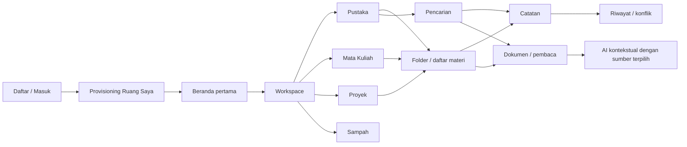

# StudyAI UI/UX Guidelines and Initial Flows

Status: **DRAFT — requires Product Owner approval**

Prepared: 2026-10-20

## Experience promise

StudyAI helps a student know where their academic material is, what they can do with it, and what evidence an answer came from. The interface should reduce navigation anxiety and protect work in progress. It must never obscure ownership, duplicate a file unexpectedly, silently overwrite a note, or imply that AI has access beyond the authorized source scope.

## Language and product vocabulary

Default interface language candidate: Bahasa Indonesia.

| Product concept | Preferred UI wording | Avoid |
|---|---|---|
| Personal Workspace | Ruang Saya / Workspace | Tenant, data space |
| Personal Library | Pustaka | Blob store, object repository |
| Course Space | Mata Kuliah | Workspace type enum |
| Project Space | Proyek | Container |
| Knowledge Item | Materi or item-specific noun | Record, entity |
| Placement | Lokasi / Ditampilkan di | Duplicate copy |
| Trash placement | Sampah | Deleted everywhere |
| AI source scope | Sumber yang digunakan | Context window |

Use stable, plain verbs. If a button says **Buat catatan**, the success message says **Catatan dibuat**, not “Operation successful.”

## Proposed information architecture

```text
StudyAI
├── Beranda
├── Workspace
│   ├── Pustaka
│   │   ├── Semua materi
│   │   ├── Disematkan
│   │   └── Folder / nested pages
│   ├── Mata Kuliah
│   │   └── Course Space → hierarchy → items
│   ├── Proyek
│   │   └── Project Space → hierarchy → items
│   └── Sampah
├── Belajar
├── Riset
├── Studio Kreasi
└── Planner
```

The hierarchy under a Course or Project represents placements. The canonical item remains in the Personal Library model. UI copy and destructive actions must make that distinction understandable without teaching database terminology.

## Screen relationships



## App shell

### Desktop

- Global rail: logo/product switch, core modules, help, account.
- Workspace sidebar: Pustaka, Mata Kuliah, Proyek, Sampah, pinned items.
- Context tree: appears after choosing a course, project, or hierarchical folder.
- Study spine/topbar: breadcrumb, current scope, save/processing state, contextual actions.
- Main content: list, reader, editor, or focused flow.
- Optional context panel: metadata, locations, version/provenance, or explicitly opened AI—not all at once.

### Mobile web

- Bottom module navigation for the most frequent top-level destinations.
- Sticky location header with back, title, and overflow action.
- Full-screen hierarchy picker rather than a permanently visible tree.
- Search opens as a dedicated route/sheet with persistent scope control.
- Editing uses a minimal toolbar; secondary formatting and AI actions move to bottom sheets.

## Flow 1 — Register or log in

1. User chooses **Daftar** or **Masuk**.
2. Registration asks only for approved identity fields and clear password requirements.
3. On successful registration, the server provisions the personal Data Space; the UI shows a bounded provisioning state.
4. Success opens the first-use Home/Workspace experience.
5. Existing users return to their last safe destination when possible.

Required states:

- duplicate email, invalid credentials, locked/rate-limited attempt;
- expired session with return path preserved;
- provisioning retry without creating duplicate personal spaces;
- generic authentication error copy that does not leak account existence where security policy forbids it.

## Flow 2 — Enter Personal Workspace

1. User selects **Workspace**.
2. Default destination is **Pustaka**, unless a valid recent destination is restored.
3. First-use state explains Pustaka in one sentence and offers **Buat folder**, **Buat catatan**, and later **Unggah dokumen** according to implemented capability.
4. Recent/pinned locations are secondary shortcuts; they never replace the canonical navigation.

## Flow 3 — Navigate Personal Library

1. Pustaka opens in list view with type, title, updated time, and location summary.
2. User may open a folder, expand a tree node, follow breadcrumbs, or use search.
3. Selecting an item opens it; a secondary details action shows metadata and “Ditampilkan di.”
4. Back/forward browser navigation and deep links preserve the chosen placement context.

Rules:

- Do not show empty metadata columns.
- Do not use card grids as the default for mixed academic files.
- Moving a placement explains the destination and does not imply binary duplication.

## Flow 4 — Create a folder

1. User invokes **Buat folder** from the current location or quick-create menu.
2. A lightweight dialog asks for the name and shows the destination.
3. Client validates obvious empty/length issues; server remains authoritative for ownership, naming policy, and hierarchy validity.
4. On success, the row appears in context and becomes reachable by keyboard.
5. On failure, the name remains entered and the error gives a corrective action.

Moving folders must prevent cycles and cross-space placement server-side. Drag-and-drop is an enhancement; menu-based move is always available.

## Flow 5 — Create a note

1. User chooses **Buat catatan** in a destination.
2. The app creates or opens a recoverable draft according to the approved editor contract.
3. Title receives focus; the destination is visible but not intrusive.
4. The editor shows save state: **Belum disimpan**, **Menyimpan…**, **Tersimpan**, or **Perlu ditinjau**.
5. Contextual actions can add another placement, view history, or later invoke scoped AI.

Do not let AI-generated text enter the note without a visible user action. AI output should distinguish quoted/source-grounded material from suggestions.

## Flow 6 — Save and reopen a note

1. Edits autosave after an approved debounce or explicit save event.
2. Every write sends the concurrency/version token required by the API.
3. Navigation waits only when necessary; otherwise the persistent state indicates saving and protects the draft.
4. Reopening resolves the selected placement while loading the canonical note/version.
5. If the server reports a conflict, preserve the local draft and show both versions or an understandable comparison.

Conflict actions:

- **Tinjau perubahan terbaru**;
- **Salin draf saya**;
- **Gabungkan** only if a safe merge experience exists;
- **Ganti versi terbaru** only after explicit confirmation and never as a default.

## Flow 7 — Search and navigate existing items

1. `Ctrl/Cmd+K` opens search with the current scope visible.
2. User types a title, tag/metadata term, or supported content query.
3. Results group by meaningful type or location, not arbitrary relevance bands.
4. Each result shows title, type, primary location context, and why it matched when available.
5. Opening a result retains its placement context and supports browser back to results.
6. “Cari di semua Workspace” widens scope explicitly.

Search must enforce authorization before retrieval. No UI convenience may query unauthorized spaces and filter afterward.

## Contextual AI behavior

- Entry points live beside the selected text, document, note, or explicit source selection.
- Before sending, show **Menggunakan: [sources]** and let the user adjust scope.
- AI states include quota/entitlement failure, queued, processing, partial, completed, cancelled, and retryable failure.
- Results show source/version evidence where required and never fabricate page numbers or citations.
- Closing AI returns focus to the invoking control and does not obscure unsaved work.

## Destructive and lifecycle behavior

- **Hapus dari lokasi ini** removes a placement only when another active placement remains and the approved rules allow it.
- **Pindahkan ke Sampah** is distinct from permanent purge.
- Restore shows the destination and handles missing/trashed parents explicitly.
- Permanent purge requires clear impact text and elevated confirmation appropriate to irreversibility.
- Folder subtree behavior remains blocked on Product Owner policy for DBR-09; do not improvise it in frontend code.

## Accessibility acceptance floor

- Entire initial flow works using keyboard only.
- Focus order and focus restoration are deterministic.
- Every icon-only action has an accessible name and a discoverable tooltip where appropriate.
- Tree and editor toolbar announce role, state, level/selection, and disabled behavior correctly.
- At 200% zoom, no core action or content is lost.
- At 320 CSS px width, the flow remains operable without horizontal page scrolling.
- Reduced-motion preference removes nonessential transitions.
- Errors are connected programmatically to inputs and summarized for complex forms.
- Screen-reader announcements are reserved for meaningful async status; avoid noisy autosave chatter.

## Content-state examples

| Situation | Preferred copy |
|---|---|
| Empty Library | “Pustaka masih kosong. Buat catatan pertama untuk mulai menyusun materi kuliah.” |
| Filtered empty | “Tidak ada materi yang cocok dengan filter ini.” Action: **Hapus filter** |
| Saving | “Menyimpan…” |
| Saved | “Tersimpan 14.32” |
| Conflict | “Catatan ini berubah di tempat lain. Draf Anda tetap aman.” Action: **Tinjau perubahan** |
| Placement removal | “Hapus ‘Ringkasan Bab 2’ dari mata kuliah ini? Materi asli tetap ada di Pustaka.” |
| Search scope | “Mencari di: Biologi Sel” Action: **Cari di semua Workspace** |

## First implementation boundary

After Product Owner approval, the first OpenSpec implementation slice should cover:

- responsive authenticated app shell;
- Personal Workspace/Pustaka entry;
- Library list and hierarchy navigation;
- create folder;
- create, autosave, reopen, and conflict-safe note shell;
- scoped title/metadata search if backend readiness is confirmed;
- required loading, empty, error, keyboard, and responsive states.

Document upload/reader annotation, advanced AI, alternate views, batch operations, and high-fidelity mobile-native components should remain later slices unless explicitly reprioritized.
