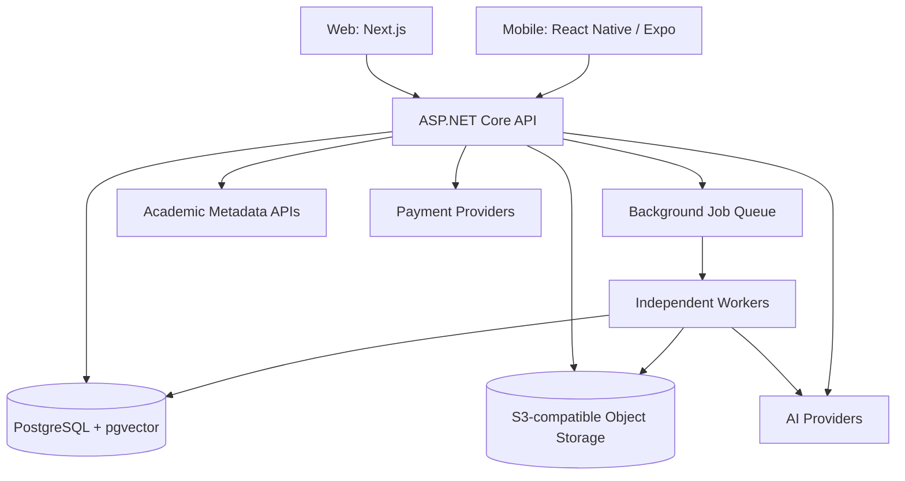

# StudyAI Campus — Product & Technical Decision Record

> **Versi:** 1.0  
> **Tanggal dokumentasi:** 12 Oktober 2026  
> **Status:** Baseline keputusan hasil diskusi; bukan spesifikasi implementasi final  
> **Tahap proyek:** Perencanaan sebelum detail database schema dan implementasi  
> **Dokumen rujukan:** `StudyAI_Master_Feature_List(1).md` (Master Feature List & Product Roadmap v1.0, 11 Oktober 2026)

## 0. Cara membaca dokumen ini

Dokumen ini mencatat **apa yang sudah kita sepakati**, **apa yang baru berupa rekomendasi**, dan **apa yang belum diputuskan**. Tujuannya agar diskusi berikutnya tidak mengulang keputusan lama atau menganggap usulan awal sudah final.

- **DIPUTUSKAN** — arah produk/teknis yang diterima selama diskusi dan dijadikan baseline.
- **DIREKOMENDASIKAN** — kandidat yang diajukan, tetapi belum melalui pemilihan atau evaluasi final.
- **TERBUKA** — masih harus diputuskan, diuji, atau dirinci.
- **BERSYARAT** — membutuhkan kontrak, izin, kepatuhan, atau dependensi eksternal.

**Aturan prioritas dokumen:** Jika daftar prioritas/fase pada master roadmap berbeda dengan keputusan dalam diskusi ini, gunakan **keputusan scope MVP terbaru** pada dokumen ini sebagai baseline perencanaan. Master roadmap tetap merupakan referensi untuk detail fitur dan visi jangka panjang, bukan bukti fitur sudah diimplementasikan.

---

## 1. Ringkasan eksekutif

**StudyAI** diarahkan menjadi *Personal Academic Operating System*: satu platform terintegrasi untuk aktivitas akademik mahasiswa, berpusat pada personal workspace dan knowledge management, dengan AI yang membantu belajar, riset, penulisan, presentasi, dan pengelolaan tugas.

**Keputusan produk terpenting:** MVP yang dimaksud **bukan MVP konvensional berisi beberapa fitur minimum**, melainkan **StudyAI Campus B2C V1 yang kaya fitur**. Semua tujuan B2C Campus dalam modul yang dipertahankan tetap menjadi target, dengan pengecualian eksplisit pada bagian scope. Pengerjaan tetap bisa dibagi ke fase internal; pembagian fase **tidak berarti menghapus fitur target**.

**Keputusan arsitektur terpenting:** Gunakan **C# / ASP.NET Core** sebagai backend utama; **API-first modular monolith** dengan background workers terpisah, PostgreSQL sebagai database utama, penyimpanan file melalui antarmuka S3-compatible, dan deployment berbasis container. Rancang sejak awal agar Web dan aplikasi Android/iOS masa depan menggunakan layanan serta data yang sama.

**Target infrastruktur:** Aplikasi dan data dapat dimigrasikan dari **laptop/server pribadi → VPS → layanan cloud** melalui prosedur deployment, backup, restore, dan migrasi yang teruji, tanpa mengganti keseluruhan fondasi aplikasi.

---

## 2. Keputusan produk dan ruang lingkup

### 2.1 Target pengguna dan positioning — DIPUTUSKAN

- **Nama lini MVP:** StudyAI Campus (B2C).
- **Target awal:** Mahasiswa. Pengalaman khusus siswa SD/SMP/SMA **bukan** bagian MVP.
- **Positioning:** Personal Academic Workspace / AI Education Operating System untuk mahasiswa.
- **Prinsip pengalaman:** Workspace menjadi pusat aktivitas; fitur AI terintegrasi ke konteks akademik pengguna, bukan sekadar kumpulan tools/chatbot terpisah.
- **Arah produk:** Satu akun + personal knowledge base + learning profile + berbagai AI workflows.

### 2.2 Tujuan utama MVP — DIPUTUSKAN

1. Menjadi **workspace personal** dan **knowledge management system** mahasiswa.
2. Mengelola materi perkuliahan berdasarkan mata kuliah, semester, serta proyek.
3. Membantu memahami pelajaran melalui AI tutor, ringkasan, latihan, dan evaluasi.
4. Membantu menyelesaikan **tugas akademik** melalui penulisan dan presentasi.
5. Mendukung kegiatan **riset dan skripsi**: pencarian jurnal, pengelolaan referensi, sitasi, penulisan berbasis sumber, dan pemeriksaan akademik.
6. Menyediakan planner untuk kegiatan, target belajar, dan deadline akademik.

### 2.3 Modul yang tetap masuk target MVP — DIPUTUSKAN

| No. | Modul | Cakupan fungsional yang dibahas |
|---|---|---|
| 1 | **Academic Workspace & Knowledge Management** | Personal workspace, course/semester/project, folder dan nested notes/pages, editor catatan, file library, pencarian pengetahuan, hubungan lintas materi |
| 2 | **Document Intelligence** | Upload/baca PDF, DOCX, PPTX, ekstraksi teks, ringkasan, konsep penting, chat dengan dokumen, rujukan dokumen/halaman |
| 3 | **AI Tutor & Personalized Learning** | Penjelasan materi, tanya jawab berbasis sumber, pembelajaran bertahap, rekomendasi pembelajaran, progress |
| 4 | **Quiz & Exam Preparation** | Generate soal, pengaturan latihan, timer, pembahasan, riwayat, flashcards, review kesalahan, pemahaman topik |
| 5 | **Academic Research** | Pencarian paper/jurnal/buku, DOI/metadata, research library, paper analysis/comparison, literature matrix |
| 6 | **Academic Writing** | Outline, drafting/revision assistance, literature review, sitasi, bibliografi, atribusi, export dokumen |
| 7 | **Presentation AI** | Dari topik/materi/draft ke slide, template, preview/edit, export PPTX editable dan PDF |
| 8 | **Academic Integrity** | Citation audit, verifikasi atribusi/referensi, dan similarity check bila tersedia penyedia berlisensi |
| 9 | **Academic Planner** | Jadwal akademik, tugas, deadline, pengingat, study plan, progress kegiatan |

**Interpretasi kelengkapan:** Targetnya adalah pengalaman B2C Campus yang lengkap sesuai master roadmap untuk modul-modul di atas, bukan hanya fitur-fitur P0. Rincian kemampuan lanjutan (misalnya voice, OCR/multimodal, advanced editor, dan fitur P3 tertentu) masih perlu dipetakan ke *acceptance criteria*, biaya, dan dependensi; jangan menganggap setiap item sudah diberi spesifikasi teknis final.

**Ketergantungan khusus:** Similarity/Turnitin tidak boleh diklaim tersedia, diberi merek Turnitin, atau dijual sebagai integrasi resmi tanpa izin/lisensi/hak distribusi yang sesuai. Integrasi yang belum tersedia menjadi **BERSYARAT**, bukan kemampuan yang dianggap sudah siap.

### 2.4 Modul yang secara eksplisit dikeluarkan dari MVP — DIPUTUSKAN

- **Collaboration:** berbagi materi, workspace kelompok, proyek kolaboratif, real-time multi-user editing.
- **Career & Opportunities:** beasiswa, CV, internship, skill development, career planning.
- **School Experience:** aplikasi khusus SD/SMP/SMA, adaptasi jenjang sekolah, tryout dan gamifikasi sekolah.
- **Parent Experience:** parent portal, laporan wali, kontrol dan persetujuan akun anak.
- **B2B:** StudyAI Teacher/Academy/Institution/Connect/Enterprise tidak menjadi produk rilis awal.

Fitur tersebut **ditunda, bukan dihapus dari visi jangka panjang**. Akses berbagi dan kolaborasi yang dikeluarkan tidak menghalangi penyimpanan referensi silang di dalam akun pribadi.

### 2.5 Monetisasi — HIPOTESIS, BELUM FINAL

- Prinsip awal: **Free + paid subscription** dengan kuota AI dan pemantauan biaya per fitur.
- **Rp69.000/bulan** pernah disebut dalam master roadmap sebagai hipotesis Study Plus; **belum tervalidasi sebagai harga final**.
- Bisa ada add-on untuk pekerjaan mahal atau similarity check berlisensi.
- Hindari janji AI tanpa batas sebelum biaya AI, penyalahgunaan, dan margin terukur.
- Skema paket, kuota aktual, dan strategi harga **TERBUKA**.

---

## 3. Struktur produk dan pengalaman pengguna

### 3.1 Navigasi tingkat atas — DIREKOMENDASIKAN

Enam menu utama agar sembilan modul tidak terlihat sebagai sembilan aplikasi terpisah:

1. **Dashboard** — aktivitas terbaru, deadline, ringkasan belajar.
2. **Workspace** — mata kuliah, proyek, notes, dokumen, knowledge library.
3. **Study & Learn** — AI tutor, quiz, flashcards, progres.
4. **Research** — journal finder, referensi, analisis paper.
5. **Create Studio** — writing, citation/integrity, presentation.
6. **Planner** — tugas, kalender, pengingat, study plan.

**Document Intelligence** diperlakukan sebagai kemampuan lintas aplikasi yang muncul saat membuka/mengolah dokumen, bukan harus menjadi menu utama mandiri.

### 3.2 Tiga ruang kerja utama — DIREKOMENDASIKAN

- **Course Workspace:** per mata kuliah; materi, catatan, AI Tutor, latihan, tugas, progress.
- **Project Workspace:** untuk tugas/proyek/skripsi; sumber, notes, riset, writing, slides, tasks.
- **Personal Knowledge Library:** koleksi lintas course dan project; dokumen, notes, jurnal, referensi.

**Aturan penting:** Satu file atau jurnal dapat dipakai pada beberapa course/project **tanpa duplikasi file fisik**. Hubungan file ke ruang kerja dipisahkan dari identitas dan lokasi penyimpanannya.

### 3.3 Workflow produk yang perlu bekerja end-to-end — DIPUTUSKAN SECARA KONSEPTUAL

- **Daily Learning:** Course → materi → ringkasan/AI Tutor → quiz/flashcards → review → progress.
- **Research & Skripsi:** Cari jurnal → verifikasi metadata → simpan referensi → analisis → draft/literature review → sitasi/bibliografi.
- **Assignment to Presentation:** Project → outline/draft → revisi → slides → export PPTX editable.
- **Knowledge Reuse:** File/jurnal/note disimpan sekali → dipilih sebagai sumber pada berbagai fitur AI.

### 3.4 Contextual AI — DIREKOMENDASIKAN

- AI mengetahui konteks *course*, *project*, atau dokumen yang sedang dibuka berdasarkan sumber yang dipilih/diizinkan.
- Jawaban mengarah kembali ke dokumen dan halaman/slide ketika data sumber tersedia.
- Pengguna dapat menyimpan output AI sebagai note atau artefak workspace.
- Sumber asli, metadata bibliografi, dan teks hasil generasi AI harus dibedakan dengan jelas.

---

## 4. Keputusan arsitektur utama

### 4.1 Gaya arsitektur — DIPUTUSKAN

**API-first Modular Monolith + Independent Background Workers.**

- **API-first:** Web dan Mobile mengakses backend yang sama; logika bisnis tidak dikunci di Next.js Server Actions.
- **Modular monolith:** Backend satu aplikasi utama, tetapi domain seperti Workspace, Research, Learning, Billing dipisahkan secara logis.
- **Independent workers:** Ekstraksi dokumen, embeddings, analisis panjang, PPTX, dan proses asynchronous lainnya dijalankan terpisah dari HTTP API.
- **Tidak langsung microservices:** Pemisahan menjadi service baru dilakukan jika ada bukti bottleneck operasional/organisasi.
- **Tidak langsung Kubernetes:** Pilih deployment container yang sederhana dulu; peningkatan kompleksitas berdasarkan kebutuhan nyata.



Diagram di atas adalah **gambaran logis**, bukan jumlah server atau kewajiban semua komponen dipisah menjadi container sejak hari pertama.

### 4.2 Tech stack dan tingkat kepastian

| Layer | Pilihan | Status | Catatan |
|---|---|---|---|
| Web | **Next.js + TypeScript** | DIPUTUSKAN sebagai baseline | Frontend responsif dan bisa self-host |
| Mobile | **React Native + Expo + TypeScript** | DIRENCANAKAN / baseline | Android & iOS; jadwal rilis belum diputuskan |
| Backend API | **C# + ASP.NET Core** | **DIPUTUSKAN** | Menggantikan proposal NestJS awal |
| Architecture | **Modular Monolith + Workers** | DIPUTUSKAN | Batas modul perlu didefinisikan |
| Database | **PostgreSQL** | DIPUTUSKAN | Sumber data utama |
| ORM & DB migrations | **Entity Framework Core** | DIREKOMENDASIKAN | SQL migration/versioning; detail belum final |
| Vector retrieval | **pgvector** | DIREKOMENDASIKAN | Tetap dalam PostgreSQL selama memadai |
| Text search | **PostgreSQL Full-Text + trigram** | DIREKOMENDASIKAN | Hybrid keyword + semantic search |
| Notes editor Web | **Tiptap** | DIREKOMENDASIKAN | Format konten harus kompatibel dengan mobile |
| UI | **Tailwind CSS + shadcn/ui** | DIREKOMENDASIKAN | Untuk aplikasi Web |
| Document/AI workers | **Python untuk kebutuhan tertentu** | DIREKOMENDASIKAN | Tidak harus semua AI logic memakai Python |
| Storage | **S3-compatible abstraction** | DIPUTUSKAN sebagai pendekatan | Provider konkret belum dipilih |
| Queue/Job system | **Belum dipilih** | TERBUKA | Evaluasi opsi yang matang untuk .NET |
| Authentication | **Belum dipilih** | TERBUKA | Kandidat: ASP.NET Core Identity / solusi OIDC; jangan otomatis memakai Better Auth dari proposal NestJS sebelumnya |
| AI Integration | **Provider-agnostic AI gateway** | DIPUTUSKAN secara arsitektural | Model/penyedia dapat diganti tanpa mengubah fitur |
| REST/OpenAPI, streaming | REST + OpenAPI; SSE untuk stream teks | DIREKOMENDASIKAN | Detail API belum dikunci |
| Deployment | **Docker + Docker Compose** | DIPUTUSKAN sebagai baseline | Dapat dipindah antar-host |
| CI/CD | **GitHub Actions atau alternatif** | DIREKOMENDASIKAN | Platform final belum diputuskan |
| Reverse proxy | **Caddy / Nginx** | TERBUKA | Pilih berdasarkan lingkungan |

**Alasan ASP.NET Core:** Cocok untuk domain bisnis yang banyak dan saling terkait; ekosistem kuat untuk modularitas, akses database, validasi, security, testing, dan maintenance. **Bukan** keputusan bahwa .NET selalu lebih cepat dari Go/NestJS pada setiap jenis beban.

**Alternatif yang pernah dievaluasi:** Go (kandidat serius untuk efisiensi resource), NestJS (produktif karena TypeScript), Java/Spring (enterprise), Rust (resource/performance tinggi namun kompleksitas lebih besar). Go tetap alternatif, tetapi backend **yang dipilih saat ini ASP.NET Core**.

### 4.3 Modul backend logis — DIREKOMENDASIKAN

- Identity & Profile
- Workspace & Knowledge
- Notes & Document Management
- Search & Retrieval
- Learning / Quiz / Progress
- Research & References
- Writing & Citations
- Presentation
- Planner
- Billing & Entitlements
- AI Orchestration & Usage Metering
- Administration, Audit & Observability

Domain yang sama tidak boleh menyebarkan aturan inti/permission secara acak ke modul lain; komunikasi antarmodul perlu kontrak yang terdefinisi.

---

## 5. Database & Knowledge Architecture — BARU LEVEL KONSEPTUAL

> **Penting:** Pada titik dokumentasi ini, kita **belum merancang atau mengesahkan ERD dan SQL schema final**. Nama tabel berikut adalah **contoh entitas untuk diskusi**, bukan keputusan implementasi.

### 5.1 Prinsip data yang disepakati

1. **PostgreSQL sebagai system of record** untuk data aplikasi.
2. **Object storage** menyimpan file asli/hasil export, bukan disimpan sebagai blob besar di tabel utama.
3. Identitas dokumen dan hubungan ke beberapa workspace **dipisah**, sehingga tidak perlu upload berkali-kali.
4. Metadata jurnal/reference dapat eksis **tanpa full-text PDF**; satu referensi dapat dihubungkan ke file yang tersedia secara sah.
5. Catatan, materi, hasil AI, dan data belajar berada di bawah kepemilikan/permission pengguna.
6. Jawaban AI dan kutipan harus memiliki provenance (asal sumber dan versi) bila tersedia.
7. Data perlu mendukung **mobile sync, versioning**, dan nanti perluasan ke organisasi tanpa membuka akses personal secara otomatis.

### 5.2 Kelompok entitas kandidat

| Area | Entitas konseptual (contoh) |
|---|---|
| Identity | User, Account, Session, UserProfile |
| Workspace | Space, Course, Project, Folder, SpaceItem |
| Knowledge | KnowledgeItem, KnowledgeLink, Note, NoteVersion |
| Documents | Document, DocumentVersion, ExtractionJob, DocumentChunk |
| Retrieval | EmbeddingRecord, SearchIndexMetadata, SourceLocation |
| Research | Reference, Author, ReferenceDocument, Citation |
| AI | Conversation, Message, AIJob, AIOutput, UsageRecord |
| Learning | Quiz, Question, Attempt, Answer, Flashcard, Progress |
| Writing/Slides | WritingProject, DraftVersion, Presentation, Slide, Export |
| Planner | Task, Event, Reminder |
| Platform | Plan, Subscription, Entitlement, Payment, UsageLedger, AuditEvent |

**Perhatian desain:** `Space`, `Folder`, `Course`, dan `Project` belum diputuskan apakah semuanya turunan dari model node yang sama atau memakai tabel terpisah. Ini harus ditentukan pada sesi desain database.

### 5.3 Contoh alur jurnal lintas workspace

1. Mahasiswa menyimpan metadata jurnal ke Research Library.
2. Jika PDF tersedia secara legal atau di-upload pengguna, file terhubung ke referensi.
3. Jurnal yang sama dihubungkan ke Course A dan Project Skripsi tanpa duplikasi binary.
4. Extraction/embedding dilakukan dengan versi dan status yang jelas.
5. Writing Assistant meminta pengguna memilih sumber yang boleh dipakai.
6. Output literature review menyimpan rujukan ke sumber beserta lokasi/provenance jika tersedia; klaim tanpa bukti ditandai.

### 5.4 Retrieval / RAG — DIREKOMENDASIKAN

- Proses: upload → validasi → ekstraksi → penyimpanan teks/halaman → chunking → embeddings/index → siap dicari.
- **Hybrid Search:** gabungan keyword/full-text dan pencarian berbasis makna (vector).
- Setiap chunk dikaitkan dengan **dokumen, versi, dan lokasi sumber**.
- Filter permission harus terjadi **sebelum informasi diberikan ke AI**.
- Embedding dibuat **versioned** agar pergantian model dan re-indexing bisa dilakukan aman.
- Job gagal harus bisa diproses ulang tanpa membuat data ganda atau tagihan ganda.
- Jangan mengarang DOI, nomor halaman, kutipan langsung, atau full-text yang tidak tersedia.

### 5.5 External academic data — DIREKOMENDASIKAN

- Kandidat sumber metadata: **OpenAlex, Crossref**, dan sumber lain yang memenuhi kebijakan API.
- Pisahkan **metadata bibliografi** dari **full-text content** serta hak akses pengguna.
- Gunakan metadata terverifikasi dan formatting engine untuk sitasi, bukan menebak referensi menggunakan LLM.

---

## 6. Multi-platform: Web, Android, iOS

### 6.1 Prinsip utama — DIPUTUSKAN

- StudyAI disiapkan **mobile-ready sejak desain awal**.
- Android/iOS **direncanakan**, tetapi belum diputuskan harus launching bersamaan dengan Web.
- **Satu akun, shared backend, shared database, shared knowledge** di semua platform.
- Business rules dan otorisasi utama berada di backend, bukan hanya di klien Web.
- Web dan mobile berbagi API contracts, tipe data/validasi yang sesuai, dan logika lintas-platform; **tidak diasumsikan berbagi semua komponen UI**.

### 6.2 Kebutuhan arsitektur mobile — DIREKOMENDASIKAN

- **Auth multi-device:** pengelolaan sesi dan token per perangkat; penyimpanan credential mobile aman.
- **Sync-aware data model:** `updated_at`/versioning, konflik perubahan, mekanisme delta sync bila dibutuhkan.
- **Online-first, offline-capable:** server sebagai sumber data utama; caching, offline notes, dan sync disiapkan bertahap.
- **Editor portability:** simpan konten sebagai struktur netral/terdokumentasi; jangan bergantung pada HTML spesifik editor Web.
- **File handling:** signed URL/upload flow yang kompatibel dengan browser dan native file picker.
- **AI conversations:** riwayat terpusat dan dapat dilanjutkan antarperangkat.
- **Notifications:** desain event yang kelak bisa mengirim Web maupun mobile push.
- **Subscription entitlements:** status akses premium tersentralisasi pada backend.

### 6.3 Pembayaran lintas platform — BERSYARAT

- **Web:** kandidat Midtrans/Xendit (belum final).
- **Mobile iOS/Android:** ketentuan App Store dan Google Play terkait digital goods/subscription harus dipatuhi; kemungkinan memerlukan IAP/Play Billing.
- Backend harus memvalidasi transaksi dan menyatukan hak akses/langganan per pengguna dengan mencegah double credit/double charge.
- Desain checkout dan penggunaan pembayaran eksternal pada mobile **belum diputuskan**.

---

## 7. Portability, deployment, dan skalabilitas

### 7.1 Target migrasi hosting — DIPUTUSKAN

| Tahap | Lingkungan | Peran |
|---|---|---|
| 1 | Laptop/server pribadi | Development, internal testing, demo, beta terbatas |
| 2 | VPS | Early production dan pengguna berbayar, sesuai hasil load test |
| 3 | Cloud/managed services | Scaling, reliability, dan workload yang lebih besar |

**Prinsip:** mempertahankan codebase, kontrak API, skema data, dan antarmuka penyimpanan sebanyak mungkin saat pindah infrastruktur. Portabilitas **tidak** berarti zero-downtime atau one-click migration secara otomatis.

### 7.2 Aturan portabilitas — DIREKOMENDASIKAN

- Package Web/API/Workers sebagai **Docker images**; gunakan Docker Compose untuk lingkungan awal.
- Simpan konfigurasi di environment/secret manager, bukan hardcode.
- Gunakan **PostgreSQL standar dan migrasi berversi**; pertahankan kompatibilitas extension termasuk pgvector.
- Simpan object storage key yang stabil, **bukan URL provider permanen** pada data bisnis.
- Abstraksikan storage provider; uji perbedaan implementasi protokol S3.
- Sediakan **backup terpisah dari host**, checksum/validasi, dan rutin lakukan restore test.
- Proses perpindahan: staging → backup/replication → verifikasi file → freeze/sync writes jika perlu → cutover → smoke tests → rollback plan.
- Kendalikan migrasi antrean job agar tidak memproses ulang atau kehilangan pekerjaan tanpa sengaja.

### 7.3 Scalability — DIPUTUSKAN SECARA PRINSIP

- Web/API dan workers dapat ditambah kapasitas **secara terpisah**.
- Skalakan berdasarkan **beban nyata** (concurrency, ukuran dokumen, latensi, DB bottleneck, biaya AI), bukan angka pengguna yang ditebak.
- Optimalkan query dan index, lalu capacity planning database sebelum memecah layanan.
- Queue, caching, vector database tersendiri, maupun microservices bisa dievaluasi belakangan bila ada kebutuhan terukur.
- **Tidak ada angka kapasitas pengguna atau spesifikasi VPS final** yang telah diputuskan.

### 7.4 Security dan reliability baseline — DIPUTUSKAN SEBAGAI KEBUTUHAN

- Private-by-default untuk data akademik dan sumber AI.
- Ownership check & authorization di backend untuk setiap resource.
- TLS, rahasia aplikasi aman, validasi/limit upload, malware scanning yang sesuai.
- Pengamanan terhadap prompt injection dari dokumen atau response integrasi.
- Log, metrics, tracing/error reporting, job status, AI cost metering.
- Backup/restore yang diuji, penghapusan data dan turunannya sesuai kebijakan.
- Job idempotency untuk menghindari hasil, potongan kuota, atau pembayaran ganda saat retry.
- Pengujian kualitas terhadap PDF, PPTX, DOCX, rumus, tabel, scan, jurnal, quiz, serta layout output.
- Tinjau kewajiban PSE, UU PDP, hak cipta, privacy policy, terms, dan kontrak layanan sebelum komersialisasi.

---

## 8. Codebase & maintainability

**Monorepo** direkomendasikan agar komponen bersama dan dokumen arsitektur tidak tersebar. Contoh struktur **belum final**:

```text
studyai/
├── apps/
│   ├── web/                     # Next.js
│   ├── mobile/                  # React Native + Expo
│   └── api/                     # ASP.NET Core
├── workers/
│   ├── background/              # .NET workers (bila perlu)
│   └── document-processor/      # Python workers (bila perlu)
├── packages/
│   ├── api-contracts/           # OpenAPI/generated clients/types
│   ├── design-tokens/           # Shared design language
│   └── shared-schemas/          # Bila benar-benar lintas platform
├── infra/
│   ├── docker/
│   └── deployment/
├── tests/
└── docs/
    ├── architecture/
    └── decisions/
```

Dengan backend .NET, tidak semua proyek harus berada di dalam `packages` JavaScript. Susunan sebenarnya perlu mempertimbangkan **.NET solution/projects**, migrations, package management, contracts, dan build pipeline setiap bahasa.

**Prinsip pengelolaan:**

- Batas domain/modul dan dependency rules yang jelas.
- API contracts berversi; perubahan yang memengaruhi Web/Mobile memiliki strategi kompatibilitas.
- Database migration berversi, rollback/forward fix yang teruji.
- Automated test: unit, integration, authorization, billing, dan critical workflows.
- CI/CD dan deployment yang dapat direproduksi.
- Arsitektur direkam melalui ADR (*Architecture Decision Records*) untuk perubahan besar.
- Evaluasi kualitas AI menggunakan kumpulan test case dan sumber nyata.

---

## 9. Rekap keputusan (decision register)

| ID | Keputusan | Status |
|---|---|---|
| D-001 | Produk awal adalah **StudyAI Campus untuk mahasiswa** | DIPUTUSKAN |
| D-002 | MVP = **B2C Campus kaya fitur**, bukan workflow minimum sempit | DIPUTUSKAN |
| D-003 | Exclude **Collaboration, Career, School, Parent, B2B** dari MVP | DIPUTUSKAN |
| D-004 | Workspace + personal knowledge base menjadi pusat platform | DIPUTUSKAN |
| D-005 | Course, Project, dan Library saling terhubung | DIPUTUSKAN sebagai prinsip |
| D-006 | Multi-platform-ready (Web + calon Android/iOS) | DIPUTUSKAN |
| D-007 | Backend utama **C# / ASP.NET Core** | **DIPUTUSKAN** |
| D-008 | **API-first Modular Monolith + Independent Workers** | DIPUTUSKAN |
| D-009 | PostgreSQL sebagai primary database | DIPUTUSKAN |
| D-010 | File storage menggunakan S3-compatible abstraction | DIPUTUSKAN |
| D-011 | Deployment portable dengan Docker; local → VPS → cloud | DIPUTUSKAN |
| D-012 | Provider-agnostic AI integration & source-grounded outputs | DIPUTUSKAN secara prinsip |
| D-013 | Next.js sebagai Web; React Native + Expo untuk calon Mobile | BASELINE |
| D-014 | EF Core, pgvector, Tiptap, hybrid search, Python workers | DIREKOMENDASIKAN |
| D-015 | Auth, job queue, payment gateway konkret, CI/CD, observability stack | TERBUKA |
| D-016 | Similarity check/Turnitin resmi menunggu kerja sama dan hak penggunaan | BERSYARAT |
| D-017 | DB ERD dan SQL schema detail belum dirancang | TERBUKA |

---

## 10. Keputusan yang masih terbuka (jangan dianggap final)

1. **ERD / physical DB schema:** identitas knowledge item, hierarki spaces/folders, relasi course/project, versioning, ownership, indeks dan constraints.
2. **Database patterns .NET:** detail penggunaan EF Core, raw SQL untuk pgvector/full-text, migration strategy.
3. **Authentication/authorization:** ASP.NET Core Identity vs OIDC solution; sesi mobile; akun Google/Apple; RBAC/resource policies.
4. **Background jobs:** queue .NET, job scheduler, retry/dead letter, concurrency, idempotency, scheduling.
5. **Editor & sync:** format notes (mis. JSON schema), versi, konflik edit web/mobile, cakupan offline.
6. **AI architecture:** penyedia/model LLM, model routing, RAG retrieval/reranking, orchestration, evaluation, token limits.
7. **Research sources:** prioritas API, batas rate, metadata verification, full-text access rights, citation formatting engine.
8. **Document pipeline:** tool ekstraksi PDF/DOCX/PPTX, OCR, pengelolaan halaman/slide, quality gates.
9. **Presentation generation:** representation konten slide, editable export, validasi render/layout.
10. **Billing & payment:** provider, harga, kuota, in-app purchase, payment verification, usage ledger.
11. **Hosting concretely:** spesifikasi server, object storage vendor, monitoring, backups, scaling trigger, load benchmarks.
12. **Feature-level acceptance criteria:** termasuk item advanced/P3 pada modul MVP dan dependensi eksternal.

---

## 11. Urutan pembahasan/desain berikutnya

1. **Database & Knowledge Domain Design** — ERD konseptual → relasi & ownership → physical PostgreSQL schema → indeks/migrations.
2. **AI & Document Architecture** — file ingestion, extraction, indexing, hybrid retrieval, AI jobs, research/citation workflow.
3. **Backend Module & API Contracts** — struktur project .NET, endpoint, authorization, OpenAPI, streaming, mobile compatibility.
4. **Infrastructure Blueprint** — Docker images, services layout, backup, monitoring, secrets, CI/CD, migrasi laptop/VPS/cloud.
5. **Quality & Commercial Readiness** — acceptance criteria fitur, load tests, AI eval, cost estimation, payment flows, privacy/security checklist.

**Tahap terdekat yang disepakati untuk diskusi selanjutnya:** merancang **Database Schema & Entity Relationships**, dengan asumsi **ASP.NET Core + PostgreSQL**, dukungan **Web/Android/iOS**, dan prinsip **portable/scalable/maintainable**.

---

## 12. Catatan perubahan terhadap master roadmap awal

| Area | Master roadmap awal | Keputusan terbaru |
|---|---|---|
| Scope awal | F1 berfokus satu paid workflow sempit | MVP ditargetkan **Campus B2C kaya fitur** |
| Target pengguna | Campus, School, Teacher, B2B tercakup dalam visi | Rilis awal **mahasiswa/Campus saja** |
| Collaboration | Fitur pengembangan Campus | **Keluar dari MVP** |
| Career & Opportunities | Ekstensi B2C | **Keluar dari MVP** |
| School & Parent | Tahapan ekspansi B2C/B2B2C | **Keluar dari MVP** |
| B2B | Tahapan Teacher/Academy/Institution | **Keluar dari MVP** |
| Backend | Belum ditetapkan di master roadmap | **C# / ASP.NET Core dipilih** |
| Mobile | Native mobile tidak termasuk F1 | **Arsitektur harus mobile-ready**, rilis mobile tidak harus bersamaan |
| Infrastruktur | Fondasi umum dan portabilitas | **Docker, PostgreSQL, S3 abstraction**, jalur local → VPS → cloud |

**Status keseluruhan:** Dokumen keputusan untuk memandu perancangan berikutnya. Tidak menyatakan bahwa fitur telah dibuat, benchmark selesai, ataupun vendor pihak ketiga telah dikontrak.
